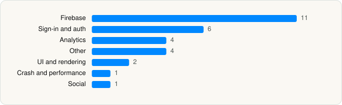

<picture><source media="(prefers-color-scheme: dark)" srcset="../../../../assets/logo/logo-dark.svg"></picture> [Tech Stack](../../../../README.md) / [BUBILET BILET BASIM VE DAGITIM ANONIM SIRKETI](../../../../companies/bubilet-bilet-basim-ve-dagitim-anonim-sirketi.md) / Bubilet

# Bubilet: Konser & Tiyatro

<picture><source media="(prefers-color-scheme: dark)" srcset="../../../../assets/badges/ios-dark.svg"></picture> <picture><source media="(prefers-color-scheme: dark)" srcset="../../../../assets/badges/inactive-dark.svg"></picture> <picture><source media="(prefers-color-scheme: dark)" srcset="../../../../assets/badges/floor-dark.svg"></picture> <picture><source media="(prefers-color-scheme: dark)" srcset="../../../../assets/badges/encrypted-dark.svg"></picture>

[App Store](https://apps.apple.com/app/id1463201795) · [latest.json](latest.json)

| | |
|---|---|
| Company | [BUBILET BILET BASIM VE DAGITIM ANONIM SIRKETI](../../../../companies/bubilet-bilet-basim-ve-dagitim-anonim-sirketi.md) |
| Store id | `1463201795` |
| Bundle / package id | `com.bukupon.app` |
| Latest version | 13.6.5 (analysed 2026-11-23) |
| Versions tracked | 1 |
| SDKs in latest version | 29 |
| Languages | C/C++, Objective-C, React Native / JavaScript, Swift |
| UI | SwiftUI, UIKit |
| Build | Swift Package Manager (SwiftPM) |
| Minimum OS | iOS 15.1 (built with Xcode 27.1, SDK iphoneos27.1) |
| Devices / ABIs | iPhone, iPad |
| Localisations | 0 |
| Capabilities | 6 |
| Declares tracking | Yes |
| Tracked | No. Kept for history. |

## SDKs by category

<picture><source media="(prefers-color-scheme: dark)" srcset="../../../../assets/charts/apps/ios/bubilet-bilet-basim-ve-dagitim-anonim-sirketi/bubilet-dark.svg"></picture>

- **Firebase** (11): FBLPromises 2.4.0, Firebase 12.4.0, FirebaseAuth 12.4.0, FirebaseCore 12.4.0, FirebaseCoreInternal 12.4.0, FirebaseInstallations 12.4.0, FirebaseRemoteConfig 12.4.0, GoogleDataTransport 10.1.0, GoogleUtilities 8.1.0, nanopb 3.30910.0, Promises 2.4.0
- **Sign-in and auth** (6): AppAuth 2.0.0, Facebook Login, FBSDKLoginKit 1.0, GoogleSignIn 9.0.0, GTMAppAuth 5.0.0, GTMSessionFetcher 3.5.0
- **Analytics** (4): AppsFlyerLib 6.18.0, Facebook SDK, FBAEMKit 1.0, FBSDKCoreKit 1.0
- **Other** (4): EXConstants 18.0.10, FBSDKGamingServicesKit 1.0, RNDeviceInfoPrivacyInfo 14.1.1, RNPermissionsPrivacyInfo 5.4.4
- **UI and rendering** (2): hermes 0.12.0, React Native
- **Crash and performance** (1): FirebaseCrashlytics 12.4.0
- **Social** (1): FBSDKShareKit 1.0

Frameworks (19)

ActivityKit (Live Activities), AdSupport (IDFA), App Tracking Transparency (ATT), Authentication Services (Sign in with Apple / passkeys), AVFoundation (audio/video), Combine (reactive), Core Location, CryptoKit, DeviceCheck / App Attest, Local Authentication (Face ID / Touch ID), MetricKit (diagnostics), Network.framework, PassKit (Wallet / Apple Pay), Photos, SafariServices, StoreKit (in-app purchase), SwiftUI, UIKit, User Notifications

Capabilities (6)

App Groups, Associated Domains (Universal Links), Background Push, Push Notifications (APNs), Sign in with Apple, Wallet passes

## Version history

| Version | Analysed | Store update | SDKs | Change | SDK list is a floor | Binary encrypted | File |
|---|---|---|---|---|---|---|---|
| 13.6.5 | 2026-11-23 |  | 29 |  | Yes | Yes | [13.6.5.json](13.6.5.json) |

---

Generated by `scripts/build_readme.py` from the JSON files. Do not edit by hand.
