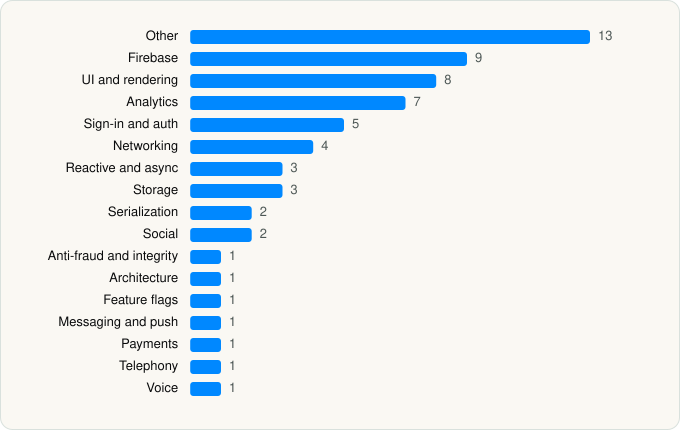

<picture><source media="(prefers-color-scheme: dark)" srcset="../../../../assets/logo/logo-dark.svg"></picture> [Tech Stack](../../../../README.md) / [BUTTERFLY EFFECT PTE. LTD.](../../../../companies/butterfly-effect-pte-ltd.md) / Manus

# Manus - AI Agent & Automation

<picture><source media="(prefers-color-scheme: dark)" srcset="../../../../assets/badges/ios-dark.svg"></picture> <picture><source media="(prefers-color-scheme: dark)" srcset="../../../../assets/badges/active-dark.svg"></picture> <picture><source media="(prefers-color-scheme: dark)" srcset="../../../../assets/badges/floor-dark.svg"></picture> <picture><source media="(prefers-color-scheme: dark)" srcset="../../../../assets/badges/encrypted-dark.svg"></picture>

[App Store](https://apps.apple.com/app/id6740909540) · [latest.json](latest.json)

| | |
|---|---|
| Company | [BUTTERFLY EFFECT PTE. LTD.](../../../../companies/butterfly-effect-pte-ltd.md) |
| Store id | `6740909540` |
| Bundle / package id | `tech.butterfly.app` |
| Latest version | 26.19.2 (analysed 2026-10-24) |
| Versions tracked | 1 |
| SDKs in latest version | 63 |
| Languages | C/C++, Objective-C, Swift |
| UI | Lottie (animations), SwiftUI, UIKit |
| Build | Swift Package Manager (SwiftPM) |
| Minimum OS | iOS 17.0 (built with Xcode 27.1, SDK iphoneos27.1) |
| Devices / ABIs | iPhone, iPad |
| Localisations | 25 |
| Capabilities | 9 |
| Declares tracking | Yes |
| Tracked | Yes |

## SDKs by category

<picture><source media="(prefers-color-scheme: dark)" srcset="../../../../assets/charts/apps/ios/butterfly-effect-pte-ltd/manus-dark.svg"></picture>

- **Other** (13): DeviceKit, FacebookBasics, GhosttyTerminal, IQKeyboardCore, IQKeyboardManagerSwift, IQKeyboardNotification, IQKeyboardReturnManager, IQKeyboardToolbar, IQKeyboardToolbarManager, IQTextInputViewNotification, IQTextView, RustLiveKitUniFFI 1.0, SwifterSwift
- **Firebase** (9): FBLPromises, Firebase, FirebaseCore, FirebaseCoreInternal, FirebaseInstallations, FirebaseRemoteConfig, GoogleDataTransport, GoogleUtilities 1.0, nanopb
- **UI and rendering** (8): Highlight.js 11.11.1, Highlightr, Lottie, SDWebImage, SDWebImageSwiftUI, SnapKit, SwiftMath, SwiftMessages
- **Analytics** (7): Adjust 1.0, AdjustSdk, Amplitude 1.0, FacebookAEM, FacebookCore, FBAEMKit 1.0, FBSDKCoreKit 1.0
- **Sign-in and auth** (5): AppAuth, GoogleSignIn, GTMAppAuth, GTMSessionFetcher, MSAL 2.12.1
- **Networking** (4): Alamofire, NIOPosix 1.0, NIOSSL 1.0, Starscream
- **Reactive and async** (3): RxCocoa, RxRelay, RxSwift 1.0
- **Storage** (3): MMKV 1.0, Realm, RealmSwift 1.0
- **Serialization** (2): SwiftProtobuf, SwiftyJSON
- **Social** (2): FacebookShare, FBSDKShareKit 1.0
- **Anti-fraud and integrity** (1): Fingerprint 2.17.0
- **Architecture** (1): ComposableArchitecture 1.0
- **Feature flags** (1): Experiment 1.0
- **Messaging and push** (1): FirebaseMessaging
- **Payments** (1): RevenueCat
- **Telephony** (1): PhoneNumberKit
- **Voice** (1): LiveKit

Frameworks (37)

ActivityKit (Live Activities), AdServices (Apple Search Ads attribution), AdSupport (IDFA), App Intents, App Tracking Transparency (ATT), Authentication Services (Sign in with Apple / passkeys), AVFoundation (audio/video), AVKit, Background Tasks, CallKit (VoIP), Combine (reactive), Contacts, Core Data, Core Image, Core Location, CryptoKit, DeviceCheck / App Attest, EventKit (Calendar / Reminders), Local Authentication (Face ID / Touch ID), MapKit, MetalKit, MetricKit (diagnostics), Network.framework, PDFKit, Photos, PhotosUI, SafariServices, SceneKit, SiriKit (Intents), SpriteKit, StoreKit (in-app purchase), Swift Charts, SwiftUI, UIKit, User Notifications, Vision, WidgetKit (widgets)

Capabilities (9)

App Groups, Associated Domains (Universal Links), Background App Refresh, Background Audio, Background Processing, Background Push, Keychain Sharing, Push Notifications (APNs), Sign in with Apple

## Version history

| Version | Analysed | Store update | SDKs | Change | SDK list is a floor | Binary encrypted | File |
|---|---|---|---|---|---|---|---|
| 26.19.2 | 2026-10-24 | 2026-10-23 | 63 |  | Yes | Yes | [26.19.2.json](26.19.2.json) |

---

Generated by `scripts/build_readme.py` from the JSON files. Do not edit by hand.
