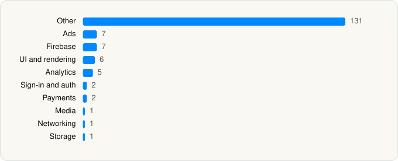

<picture><source media="(prefers-color-scheme: dark)" srcset="../../../../assets/logo/logo-dark.svg"></picture> [Tech Stack](../../../../README.md) / [Bytedance Pte. Ltd](../../../../companies/bytedance-pte-ltd.md) / CapCut

# CapCut: Photo & Video Editor

<picture><source media="(prefers-color-scheme: dark)" srcset="../../../../assets/badges/ios-dark.svg"></picture> <picture><source media="(prefers-color-scheme: dark)" srcset="../../../../assets/badges/active-dark.svg"></picture> <picture><source media="(prefers-color-scheme: dark)" srcset="../../../../assets/badges/floor-dark.svg"></picture> <picture><source media="(prefers-color-scheme: dark)" srcset="../../../../assets/badges/encrypted-dark.svg"></picture>

[App Store](https://apps.apple.com/app/id1500855883) · [latest.json](latest.json)

| | |
|---|---|
| Company | [Bytedance Pte. Ltd](../../../../companies/bytedance-pte-ltd.md) |
| Store id | `1500855883` |
| Bundle / package id | `com.lemon.lvoverseas` |
| Latest version | 19.8.1 (analysed 2026-10-24) |
| Versions tracked | 1 |
| SDKs in latest version | 163 |
| Languages | C/C++, Kotlin Multiplatform, Metal (shaders), Objective-C, Swift |
| UI | Lottie (animations), SwiftUI, UIKit |
| Build | Swift Package Manager (SwiftPM) |
| Minimum OS | iOS 15.0 (built with Xcode 26.0, SDK iphoneos26.0) |
| Devices / ABIs | iPhone, iPad |
| Localisations | 22 |
| Capabilities | 11 |
| Declares tracking | Yes |
| Tracked | Yes |

## SDKs by category

<picture><source media="(prefers-color-scheme: dark)" srcset="../../../../assets/charts/apps/ios/bytedance-pte-ltd/capcut-dark.svg"></picture>

- **Other** (131): AdsGlobalSDK 7.8.5, agent, AIGCWatermarkI18N, animate, BDALog 0.9.6, BDAlogProtocol 1.3.3, BDFishhookPrivacyInfo 0.3.0, BDInstallPopup 0.4.3, BDLRepairer 19.8.1, BDMemoryMatrix 0.0.26, BDTuringLocalized-en 2.3.10, BDWebKit 1.4.40, BDXServiceCenter 3.0.5, boringssl 1.0, Bytedance1 1.4.13, bytevc1enc 1.9.7, CCUX 0.1.0, crypto 1.0, deflicker, Emoji, enhance, FrameRecoverPrivacyInfo 1.37.2, GMTIAB 0.3.0, GMTSKOverlayImpl 0.0.1, guide, HandwriteBrush, HeimdallrPrivacyInfo 0.8.103, Hermas 2.1.3, HMDGWPAsanPrivacyInfo 0.3.0, iBaseKit 0.1.0, IESPhoto, IESWebViewMonitor 1.7.5, ImageEffect, languages, Lemon8OpenSDK 0.1.1, libvcn 4.0.2, loading, Lodash, LVAdCapCut 0.1.0, LVAdCommon 0.1.0, LVAIDigitalPortrait 1.0.0, LVAIDubbingScene 1.0.0, LVAILab 1.0.0, LVAILabAgent 1.0.0, LVAILabAgentFoundationLegacy 1.0.0, LVAILabAgentLegacy 1.0.0, LVAISound 1.0.0, LVAlbum 1.0.0, LVAppSettings 0.0.1, LVCamera 0.0.0, LVCloudSpace 0.1.0, LVCompliance 0.0.1, LVCreatorAssistant 1.0.0, LVDigitalHuman 0.1.0, LVDoraemon 1.0.0, LVDraftBox 0.1.0, LVEditor 1.0.0, LVEditorAIClipper 1.0.0, LVEditorAIGC 1.0.0, LVEditorAIMusic 12.1.0, LVEditorAudio 1.0.0, LVEditorBizUI 9.9.0, LVEditorCommon 12.1.0, LVEditorEffect 1.0.0, LVEditorSearch 1.0.0, LVEditorSearchAPI 1.0.0, LVEditorText 1.0.0, LVExport 1.0.0, LVExtension 0.1.0, LVFeed 1.0.0, LVFeedCommon 1.0.0, LVFigureEditor 0.1.0, LVFileShare 0.0.1, LVGenAI 1.0.0, LVGenAIBizUI 1.0.0, LVHomepage 0.1.0, LVI18N 0.1.0, LVInbox 0.0.1, LVInspiration 0.1.0, LVLynxKit 0.1.0, LVMain 1.0.0, LVMaskEditor 1.0.0, LVMaterialGenerate 0.1.0, LVNextEditorUI 0.1.0, LVNextFeed 1.0.0, LVPersonalizedMaterial 0.1.0, LVPhotoEditor 1.0.0, LVProfile 0.0.1, LVPublish 0.0.1, LVShare 0.1.0, LVSmartScriptTemplate 0.1.0, LVTemplateAssembler 0.1.0, LVTemplateFoundation 0.1.0, LVTemplateUI 1.0.0, LVUGKit 0.1.0, LVUIKit 9.9.0, LVUserGuidance 0.1.0, LVVideoAgent 1.0.0, LVWebView 0.1.0, MemoryGraphCapture 1.4.9, MJRefresh, MTGSDK 8.0.8, OrbuculumCore, PAGAdSDK 7.8.5, patch.ofx, Retouch 18.1.0, RetouchCompile, RetouchFilter, RetouchLocalAdjust, RetouchMiddleware-Config 16.0.0, RetouchShapeMask, RetouchSticker, ShareExtension, SmartCropResourceNew, splashResourceCore 2.2.5, Sticker, StingerPrivacyInfo 1.0.22, TailLeader, TikTokBusinessSDK 7.8.5, TikTokOpenAuthSDKPrivacyInfo 2.5.3, ToolBox, TTAppStoreStarManager 1.2.5, TTFFmpeg 1.0, TTPOrbuService 1.0, umvfi, vhdr, vmb, VoiceClone, vsf, Watermark, XConsole 1.0.0
- **Ads** (7): AppLovin 13.6.1, FBAudienceNetwork 6.21.0, GABMediation, Google Mobile Ads (AdMob), GoogleMobileAds 13.11.0, MolocoSDK 4.11.0, VungleAds 7.7.1
- **Firebase** (7): FBLPromises 2.4.0, FirebaseCore 11.14.0, FirebaseCoreInternal 11.14.0, FirebaseInstallations 11.14.0, GoogleDataTransport 10.0.0, GoogleUtilities 8.1.0, nanopb 3.30910.0
- **UI and rendering** (6): Highlight.js 9.13.1, Lottie, React Native, RetouchAnimation, SVG, XLPagerTabStrip 9.0.0
- **Analytics** (5): Adjust, AppsFlyerLib 6.17.7, Facebook SDK, TikTokOpenSDK 2.5.3, TikTokOpenShareSDK 2.5.3
- **Sign-in and auth** (2): GoogleSignIn 7.1.0, LVLogin 0.0.1
- **Payments** (2): LVSubscription 0.1.0, LVSubscriptionBase 0.1.0
- **Media** (1): dashdec 1.0
- **Networking** (1): Axios
- **Storage** (1): normal

Frameworks (33)

ActivityKit (Live Activities), AdSupport (IDFA), App Tracking Transparency (ATT), Authentication Services (Sign in with Apple / passkeys), AVFoundation (audio/video), AVKit, Background Tasks, CloudKit, Combine (reactive), Core Image, Core Location, Core ML, Core Motion, CryptoKit, DeviceCheck / App Attest, EventKit (Calendar / Reminders), Local Authentication (Face ID / Touch ID), Media Player, MessageUI (mail / SMS compose), MetalKit, MetricKit (diagnostics), Natural Language, Network.framework, Photos, PhotosUI, SafariServices, SiriKit (Intents), StoreKit (in-app purchase), SwiftUI, UIKit, User Notifications, Vision, WidgetKit (widgets)

Capabilities (11)

App Attest, App Groups, Associated Domains (Universal Links), Background App Refresh, Background Audio, Background Processing, Background Push, Communication Notifications, Push Notifications (APNs), Sign in with Apple, Time-Sensitive Notifications

## Version history

| Version | Analysed | Store update | SDKs | Change | SDK list is a floor | Binary encrypted | File |
|---|---|---|---|---|---|---|---|
| 19.8.1 | 2026-10-24 | 2026-10-22 | 163 |  | Yes | Yes | [19.8.1.json](19.8.1.json) |

---

Generated by `scripts/build_readme.py` from the JSON files. Do not edit by hand.
