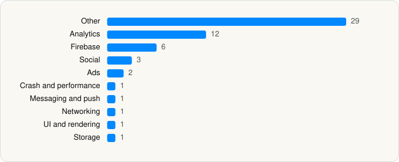

<picture><source media="(prefers-color-scheme: dark)" srcset="../../../../assets/logo/logo-dark.svg"></picture> [Tech Stack](../../../../README.md) / [Canva](../../../../companies/canva.md) / Canva AI Photo & Video Editor

# Canva AI Photo & Video Editor

<picture><source media="(prefers-color-scheme: dark)" srcset="../../../../assets/badges/ios-dark.svg"></picture> <picture><source media="(prefers-color-scheme: dark)" srcset="../../../../assets/badges/active-dark.svg"></picture> <picture><source media="(prefers-color-scheme: dark)" srcset="../../../../assets/badges/floor-dark.svg"></picture> <picture><source media="(prefers-color-scheme: dark)" srcset="../../../../assets/badges/encrypted-dark.svg"></picture>

[App Store](https://apps.apple.com/app/id897446215) · [latest.json](latest.json)

| | |
|---|---|
| Company | [Canva](../../../../companies/canva.md) |
| Store id | `897446215` |
| Bundle / package id | `com.canva.canvaeditor` |
| Latest version | 4.232.1 (analysed 2026-10-24) |
| Versions tracked | 1 |
| SDKs in latest version | 57 |
| Languages | C/C++, Metal (shaders), Objective-C, Swift |
| UI | SwiftUI, UIKit |
| Build | Swift Package Manager (SwiftPM) |
| Minimum OS | iOS 15.4 (built with Xcode 27.1, SDK iphoneos27.1) |
| Devices / ABIs | iPhone, iPad |
| Localisations | 105 |
| Capabilities | 7 |
| Declares tracking | Yes |
| Tracked | Yes |

## SDKs by category

<picture><source media="(prefers-color-scheme: dark)" srcset="../../../../assets/charts/apps/ios/canva/canva-ai-photo-video-editor-dark.svg"></picture>

- **Other** (29): ATAuthSDK 2.13.5, CastleSDK 4.1.2, DouyinOpenSDK 4.0.2, DYOpenCore, FactoryKit, GTCommonSDK 3.1.2, GTCountSDK 2.0.4, GTExtensionSDK 3.0.3, GTSDK 3.0.5, Internationalization, KakaoSDKCertCore 2.27.2, KakaoSDKCommon, KakaoSDKFriendCore 2.27.2, KakaoSDKUser, libEGL 1.0, libGLESv2 1.0, Publish, RemoteConfig, SensorsFocus 0.1.8, SharedUtilities, Styling, SurfaceKit, SurfaceKitShaders, ThorVGSwift, VideoArchX, WeiboSDK, XiaoHongShuOpenSDK 1.2.18, YTXMonitor 2.3.5, YTXOperators 1.3.5
- **Analytics** (12): AppsFlyerLib 1.0, BrazeKit 14.1.0, FacebookAEM, FacebookCore, FBAEMKit 1.0, FBSDKCoreKit 1.0, FirebaseAnalytics 12.17.0, GoogleAppMeasurement 12.17.0, GoogleAppMeasurementIdentitySupport 12.17.0, Segment, SensorsAnalyticsSDK 1.0.0, TikTokOpenSDK 5.0.0
- **Firebase** (6): FBLPromises, FirebaseCore, FirebaseCoreInternal, FirebaseInstallations, GoogleUtilities, nanopb
- **Social** (3): FacebookShare, FBSDKShareKit 1.0, LineSDK
- **Ads** (2): GoogleAdsOnDeviceConversion 3.6.0, SensorsAdvertising 0.1.3
- **Crash and performance** (1): Sentry 8.57.3
- **Messaging and push** (1): BrazeUI
- **Networking** (1): Alamofire
- **UI and rendering** (1): SDWebImage
- **Storage** (1): ZIPFoundation

Frameworks (32)

ActivityKit (Live Activities), AdServices (Apple Search Ads attribution), AdSupport (IDFA), App Tracking Transparency (ATT), ARKit, Authentication Services (Sign in with Apple / passkeys), AVFoundation (audio/video), Background Tasks, CallKit (VoIP), Combine (reactive), Core Bluetooth, Core Data, Core Image, Core Location, Core ML, Core Motion, CryptoKit, Local Authentication (Face ID / Touch ID), MessageUI (mail / SMS compose), MetricKit (diagnostics), Network.framework, PDFKit, Photos, PhotosUI, PushKit (VoIP push), SafariServices, SceneKit, StoreKit (in-app purchase), SwiftUI, UIKit, User Notifications, Vision

Capabilities (7)

App Groups, Associated Domains (Universal Links), Background App Refresh, Background Push, Keychain Sharing, Push Notifications (APNs), Sign in with Apple

## Version history

| Version | Analysed | Store update | SDKs | Change | SDK list is a floor | Binary encrypted | File |
|---|---|---|---|---|---|---|---|
| 4.232.1 | 2026-10-24 | 2026-10-21 | 57 |  | Yes | Yes | [4.232.1.json](4.232.1.json) |

---

Generated by `scripts/build_readme.py` from the JSON files. Do not edit by hand.
