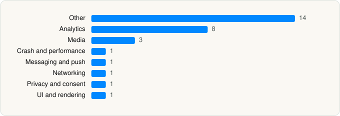

<picture><source media="(prefers-color-scheme: dark)" srcset="../../../../assets/logo/logo-dark.svg"></picture> [Tech Stack](../../../../README.md) / [CBS Interactive](../../../../companies/cbs-interactive.md) / Paramount+

# Paramount+

<picture><source media="(prefers-color-scheme: dark)" srcset="../../../../assets/badges/ios-dark.svg"></picture> <picture><source media="(prefers-color-scheme: dark)" srcset="../../../../assets/badges/inactive-dark.svg"></picture> <picture><source media="(prefers-color-scheme: dark)" srcset="../../../../assets/badges/floor-dark.svg"></picture> <picture><source media="(prefers-color-scheme: dark)" srcset="../../../../assets/badges/encrypted-dark.svg"></picture>

[App Store](https://apps.apple.com/app/id530168168) · [latest.json](latest.json)

| | |
|---|---|
| Company | [CBS Interactive](../../../../companies/cbs-interactive.md) |
| Store id | `530168168` |
| Bundle / package id | `com.cbsvideo.app` |
| Latest version | 15.18.2 (analysed 2026-06-23) |
| Versions tracked | 1 |
| SDKs in latest version | 30 |
| Languages | C/C++, Objective-C, Swift |
| UI | SwiftUI, UIKit |
| Build | Swift Package Manager (SwiftPM) |
| Minimum OS | iOS 18.0 (built with Xcode 26.3, SDK iphoneos26.2) |
| Devices / ABIs | iPhone, iPad |
| Localisations | 1 |
| Capabilities | 10 |
| Declares tracking | Yes |
| Tracked | No. Kept for history. |

## SDKs by category

<picture><source media="(prefers-color-scheme: dark)" srcset="../../../../assets/charts/apps/ios/cbs-interactive/paramount-dark.svg"></picture>

- **Other** (14): AccessEnabler 3.8.0, Avia 16.5.8, AviaTrackingCore 4.7.9, AviaTrackingKantarBarb 4.1.2, AviaTrackingMUXIMA 4.2.0, CBSiBFFE, CBSiLocalization, CBSiProfiles-iOS, ConvivaAVFoundation 4.0.51, MaestroCore 1.0, MaestroKitParamount 1.0, SAMDPDownloadEngine, VDS, Voyager
- **Analytics** (8): AEPCore, AEPServices, BrazeKit 11.2.0, ComScore 1.0, ConvivaSDK 4.0.47, Kochava 9.1.0, MUXSDKStats 4.4.0, NielsenAppApi 9.3.0
- **Media** (3): GoogleCast 4.8.1, GoogleInteractiveMediaAds 3.28.10, MuxCore 5.3.1
- **Crash and performance** (1): NewRelic 7.7.1
- **Messaging and push** (1): BrazeUI
- **Networking** (1): Alamofire
- **Privacy and consent** (1): OTPublishersHeadlessSDK 202407.2.0
- **UI and rendering** (1): RiveRuntime 6.18.1

Frameworks (32)

ActivityKit (Live Activities), AdServices (Apple Search Ads attribution), AdSupport (IDFA), App Tracking Transparency (ATT), Authentication Services (Sign in with Apple / passkeys), AVFoundation (audio/video), AVKit, Background Tasks, CloudKit, Combine (reactive), Core Bluetooth, Core Data, Core Image, Core Location, Core Motion, CryptoKit, DeviceCheck / App Attest, Group Activities (SharePlay), Local Authentication (Face ID / Touch ID), Media Player, MessageUI (mail / SMS compose), MetalKit, MetricKit (diagnostics), Network.framework, SafariServices, SceneKit, SpriteKit, StoreKit (in-app purchase), SwiftUI, UIKit, User Notifications, WidgetKit (widgets)

Capabilities (10)

App Groups, Associated Domains (Universal Links), Background App Refresh, Background Audio, Background Push, CloudKit, iCloud, iCloud Key-Value Storage, Keychain Sharing, Push Notifications (APNs)

## Version history

| Version | Analysed | Store update | SDKs | Change | SDK list is a floor | Binary encrypted | File |
|---|---|---|---|---|---|---|---|
| 15.18.2 | 2026-06-23 |  | 30 |  | Yes | Yes | [15.18.2.json](15.18.2.json) |

## Model-written summary

> Native iOS 18+ Paramount+ app with SwiftUI, AVFoundation, Adobe AEPCore, Conviva analytics, GoogleCast, and RiveRuntime

Written by a language model from the detected signals (`inferred[]`). It is commentary, not measurement.

---

Generated by `scripts/build_readme.py` from the JSON files. Do not edit by hand.
