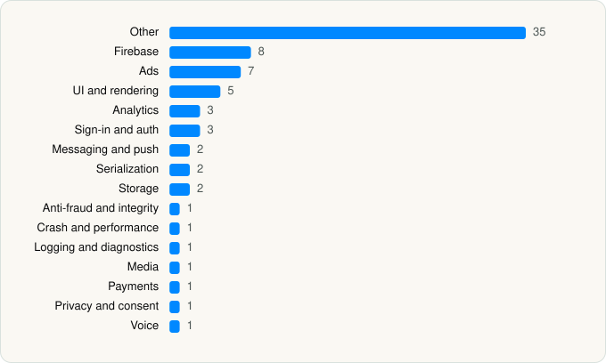

<picture><source media="(prefers-color-scheme: dark)" srcset="../../../../assets/logo/logo-dark.svg"></picture> [Tech Stack](../../../../README.md) / [Character.AI](../../../../companies/character-ai.md) / Character AI

# Character AI: Chat, Talk, Text

<picture><source media="(prefers-color-scheme: dark)" srcset="../../../../assets/badges/ios-dark.svg"></picture> <picture><source media="(prefers-color-scheme: dark)" srcset="../../../../assets/badges/active-dark.svg"></picture> <picture><source media="(prefers-color-scheme: dark)" srcset="../../../../assets/badges/floor-dark.svg"></picture> <picture><source media="(prefers-color-scheme: dark)" srcset="../../../../assets/badges/encrypted-dark.svg"></picture>

[App Store](https://apps.apple.com/app/id1671705818) · [latest.json](latest.json)

| | |
|---|---|
| Company | [Character.AI](../../../../companies/character-ai.md) |
| Store id | `1671705818` |
| Bundle / package id | `ai.character.app` |
| Latest version | 1.17.4 (analysed 2026-10-24) |
| Versions tracked | 1 |
| SDKs in latest version | 74 |
| Languages | C/C++, Metal (shaders), Objective-C, React Native / JavaScript, Swift |
| UI | Lottie (animations), SwiftUI, UIKit |
| Build | Swift Package Manager (SwiftPM) |
| Minimum OS | iOS 15.1 (built with Xcode 26.6, SDK iphoneos26.5) |
| Devices / ABIs | iPhone |
| Localisations | 29 |
| Capabilities | 6 |
| Declares tracking | Yes |
| Tracked | Yes |

## SDKs by category

<picture><source media="(prefers-color-scheme: dark)" srcset="../../../../assets/charts/apps/ios/character-ai/character-ai-dark.svg"></picture>

- **Other** (35): AdsGlobalSDK 8.1.1, AppMetricaAdSupport 5.14.0, AppMetricaCore 5.14.0, AppMetricaCoreExtension 5.14.0, AppMetricaCoreUtils 5.14.0, AppMetricaEncodingUtils 5.14.0, AppMetricaFMDB 5.14.0, AppMetricaHostState 5.14.0, AppMetricaIdentifiers 5.14.0, AppMetricaIDSync 5.14.0, AppMetricaKeychain 5.14.0, AppMetricaLibraryAdapter 5.14.0, AppMetricaLog 5.14.0, AppMetricaLogSwift 5.14.0, AppMetricaNetwork 5.14.0, AppMetricaStorageUtils 5.14.0, AppMetricaSynchronization 5.14.0, boost, BrazeLocation 13.0.0, CloudXCore 1.0, folly, hermesvm 1.0.0, IronSourceAdQualityPrivacyInfo 9.9.0, Lodash, PAGAdSDK 8.1.1, PrivacyInfo, PurchasesHybridCommon 17.33.0, ReactNativeBlobUtilPrivacyInfo 0.24.7, ReactNativeDependencies 1.0, RNCameraRollPrivacyInfo 7.10.0, RNImagePickerPrivacyInfo 7.2.3, RNPermissionsPrivacyInfo 5.4.2, SimulaAdSDK, TikTokBusinessSDK 8.1.1, VGSLFundamentalsPrivacyInfo 7.25.1
- **Firebase** (8): FBLPromises 2.4.0, FirebaseAuth 12.2.0, FirebaseCore 12.2.0, FirebaseCoreInternal 12.2.0, FirebaseInstallations 12.2.0, GoogleDataTransport 10.1.0, GoogleUtilities 8.1.0, nanopb 3.30910.0
- **Ads** (7): AppLovin 13.6.3, FBAudienceNetwork 1.0, Google Mobile Ads (AdMob), GoogleMobileAds 13.5.0, InMobiSDK 11.4.1, MolocoSDK 4.10.0, VungleAds 7.7.4
- **UI and rendering** (5): Lottie 4.6.0, MaterialDialogs, React Native, RNSVGFilters 15.15.5, SDWebImage 5.21.7
- **Analytics** (3): Amplitude 1.0, AppsFlyerLib 6.17.9, BrazeKit 13.0.0
- **Sign-in and auth** (3): AppAuth 1.7.6, GoogleSignIn 7.0.0, GTMSessionFetcher 3.5.0
- **Messaging and push** (2): BrazeUI 13.0.0, FirebaseMessaging 12.2.0
- **Serialization** (2): AppMetricaProtobuf 5.14.0, AppMetricaProtobufUtils 5.14.0
- **Storage** (2): AppMetricaPlatform 5.14.0, MMKV
- **Anti-fraud and integrity** (1): RecaptchaEnterprise 18.7.0
- **Crash and performance** (1): Sentry 9.7.0
- **Logging and diagnostics** (1): glog
- **Media** (1): GoogleCast 4.8.4
- **Payments** (1): RevenueCat
- **Privacy and consent** (1): UserMessagingPlatform 3.1.0
- **Voice** (1): WebRTC 1.0

Frameworks (32)

ActivityKit (Live Activities), AdServices (Apple Search Ads attribution), AdSupport (IDFA), App Tracking Transparency (ATT), Authentication Services (Sign in with Apple / passkeys), AVFoundation (audio/video), AVKit, Combine (reactive), Core Data, Core Image, Core Location, Core ML, Core Motion, CryptoKit, DeviceCheck / App Attest, Local Authentication (Face ID / Touch ID), MapKit, Media Player, MessageUI (mail / SMS compose), MetalKit, MetricKit (diagnostics), Network.framework, PassKit (Wallet / Apple Pay), PDFKit, Photos, PhotosUI, SafariServices, SiriKit (Intents), StoreKit (in-app purchase), SwiftUI, UIKit, User Notifications

Capabilities (6)

Associated Domains (Universal Links), Background App Refresh, Background Audio, Background Push, Push Notifications (APNs), Sign in with Apple

## Version history

| Version | Analysed | Store update | SDKs | Change | SDK list is a floor | Binary encrypted | File |
|---|---|---|---|---|---|---|---|
| 1.17.4 | 2026-10-24 | 2026-10-02 | 74 |  | Yes | Yes | [1.17.4.json](1.17.4.json) |

---

Generated by `scripts/build_readme.py` from the JSON files. Do not edit by hand.
