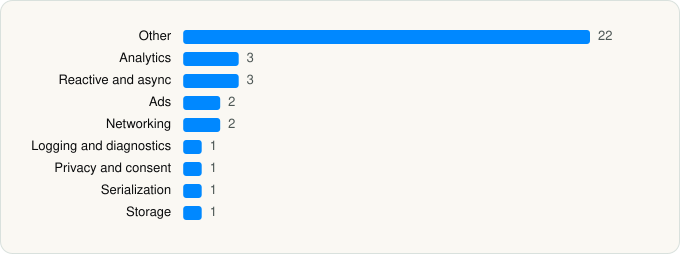

<picture><source media="(prefers-color-scheme: dark)" srcset="../../../../assets/logo/logo-dark.svg"></picture> [Tech Stack](../../../../README.md) / [Chengdu Dance Elephant Technology Co., LTD.](../../../../companies/chengdu-dance-elephant-technology-co-ltd.md) / FaceAlly

# FaceAlly: AI Baby & Age Editor

<picture><source media="(prefers-color-scheme: dark)" srcset="../../../../assets/badges/ios-dark.svg"></picture> <picture><source media="(prefers-color-scheme: dark)" srcset="../../../../assets/badges/inactive-dark.svg"></picture> <picture><source media="(prefers-color-scheme: dark)" srcset="../../../../assets/badges/floor-dark.svg"></picture> <picture><source media="(prefers-color-scheme: dark)" srcset="../../../../assets/badges/encrypted-dark.svg"></picture>

[App Store](https://apps.apple.com/app/id6618119931) · [latest.json](latest.json)

| | |
|---|---|
| Company | [Chengdu Dance Elephant Technology Co., LTD.](../../../../companies/chengdu-dance-elephant-technology-co-ltd.md) |
| Store id | `6618119931` |
| Bundle / package id | `com.dance.elephant.AICamera` |
| Latest version | 2.0.1 (analysed 2026-11-11) |
| Versions tracked | 1 |
| SDKs in latest version | 36 |
| Languages | C/C++, Metal (shaders), Objective-C, Swift |
| UI | UIKit |
| Build | Swift Package Manager (SwiftPM) |
| Minimum OS | iOS 15.0 (built with Xcode 26.3, SDK iphoneos26.2) |
| Devices / ABIs | iPhone |
| Localisations | 0 |
| Capabilities | 0 |
| Declares tracking | Yes |
| Tracked | No. Kept for history. |

## SDKs by category

<picture><source media="(prefers-color-scheme: dark)" srcset="../../../../assets/charts/apps/ios/chengdu-dance-elephant-technology-co-ltd/faceally-dark.svg"></picture>

- **Other** (22): HXPhotoPicker 4.2.5, IQKeyboardCore 1.0.9, IQKeyboardManagerSwift 8.0.3, IQKeyboardNotification 1.0.7, IQKeyboardReturnManager 1.0.6, IQKeyboardToolbar 1.1.5, IQKeyboardToolbarManager 1.1.6, IQTextInputViewNotification 1.0.9, IQTextView 1.0.5, JXPagingView 2.1.3, JXSegmentedView 1.4.1, MBProgressHUD 1.2.0, NVActivityIndicatorView 5.2.0, ObjectMapper 4.4.2, PinLayout 1.10.6, Rx 5.2.2, RxGesture 4.0.4, SwifterSwift 8.0.0, SwiftyUserDefaults 5.3.0, Then 3.0.0, YYImage 1.0.4, ZLPhotoBrowser 4.7.4
- **Analytics** (3): Facebook SDK, FBAEMKit 1.0, FBSDKCoreKit 1.0
- **Reactive and async** (3): RxCocoa 6.9.0, RxRelay 6.9.0, RxSwift 6.9.0
- **Ads** (2): Google Mobile Ads (AdMob), GoogleMobileAds 13.9.0
- **Networking** (2): Alamofire 5.12.0, Moya 15.0.0
- **Logging and diagnostics** (1): SwiftyBeaver 2.1.1
- **Privacy and consent** (1): UserMessagingPlatform 3.1.0
- **Serialization** (1): SwiftyJSON 5.0.2
- **Storage** (1): KeychainAccess 4.2.2

Frameworks (23)

AdSupport (IDFA), App Tracking Transparency (ATT), Authentication Services (Sign in with Apple / passkeys), AVFoundation (audio/video), Combine (reactive), Core Image, Core Location, Core Motion, CryptoKit, Local Authentication (Face ID / Touch ID), MapKit, Media Player, MessageUI (mail / SMS compose), Network.framework, PencilKit, Photos, PhotosUI, SafariServices, SceneKit, SpriteKit, StoreKit (in-app purchase), UIKit, User Notifications

## Version history

| Version | Analysed | Store update | SDKs | Change | SDK list is a floor | Binary encrypted | File |
|---|---|---|---|---|---|---|---|
| 2.0.1 | 2026-11-11 |  | 36 |  | Yes | Yes | [2.0.1.json](2.0.1.json) |

---

Generated by `scripts/build_readme.py` from the JSON files. Do not edit by hand.
