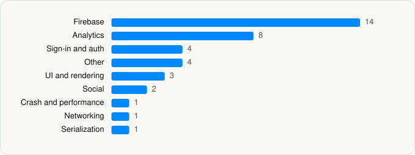

<picture><source media="(prefers-color-scheme: dark)" srcset="../../../../assets/logo/logo-dark.svg"></picture> [Tech Stack](../../../../README.md) / [CouponBirds Inc](../../../../companies/couponbirds-inc.md) / CouponBirds

# CouponBirds: Deals & Vouchers

<picture><source media="(prefers-color-scheme: dark)" srcset="../../../../assets/badges/ios-dark.svg"></picture> <picture><source media="(prefers-color-scheme: dark)" srcset="../../../../assets/badges/inactive-dark.svg"></picture> <picture><source media="(prefers-color-scheme: dark)" srcset="../../../../assets/badges/floor-dark.svg"></picture> <picture><source media="(prefers-color-scheme: dark)" srcset="../../../../assets/badges/encrypted-dark.svg"></picture>

[App Store](https://apps.apple.com/app/id1625279562) · [latest.json](latest.json)

| | |
|---|---|
| Company | [CouponBirds Inc](../../../../companies/couponbirds-inc.md) |
| Store id | `1625279562` |
| Bundle / package id | `com.couponbirds.smartcoupon` |
| Latest version | 1.11.14 (analysed 2026-11-09) |
| Versions tracked | 1 |
| SDKs in latest version | 38 |
| Languages | C/C++, Objective-C, Swift |
| UI | SwiftUI, UIKit |
| Build | Swift Package Manager (SwiftPM) |
| Minimum OS | iOS 16.0 (built with Xcode 27.2, SDK iphoneos27.2) |
| Devices / ABIs | iPhone, iPad |
| Localisations | 3 |
| Capabilities | 7 |
| Declares tracking | Yes |
| Tracked | No. Kept for history. |

## SDKs by category

<picture><source media="(prefers-color-scheme: dark)" srcset="../../../../assets/charts/apps/ios/couponbirds-inc/couponbirds-dark.svg"></picture>

- **Firebase** (14): abseil, FBLPromises, Firebase, FirebaseAuth, FirebaseCore, FirebaseCoreInternal, FirebaseFirestore, FirebaseInstallations, GoogleDataTransport, GoogleUtilities, gRPC, leveldb, nanopb, Promises
- **Analytics** (8): FacebookAEM, FacebookCore, FBAEMKit 1.0, FBSDKCoreKit 1.0, FirebaseAnalytics 10.28.0, GoogleAppMeasurement 10.28.0, GoogleAppMeasurementIdentitySupport 10.28.0, Mixpanel
- **Sign-in and auth** (4): AppAuth, GoogleSignIn, GTMAppAuth, GTMSessionFetcher
- **Other** (4): absl 1.20240116.2, abslWrapper, CryptoSwift, opensslWrapper
- **UI and rendering** (3): React Native, SDWebImage, SDWebImageSwiftUI
- **Social** (2): FacebookShare, FBSDKShareKit 1.0
- **Crash and performance** (1): FirebaseCrashlytics
- **Networking** (1): Axios
- **Serialization** (1): SwiftyJSON

Frameworks (18)

AdSupport (IDFA), App Tracking Transparency (ATT), Authentication Services (Sign in with Apple / passkeys), AVFoundation (audio/video), Combine (reactive), Core Image, CryptoKit, Local Authentication (Face ID / Touch ID), MessageUI (mail / SMS compose), MetricKit (diagnostics), Network.framework, Photos, SafariServices, SiriKit (Intents), StoreKit (in-app purchase), SwiftUI, UIKit, User Notifications

Capabilities (7)

App Groups, Associated Domains (Universal Links), Background Push, Communication Notifications, Push Notifications (APNs), Sign in with Apple, Time-Sensitive Notifications

## Version history

| Version | Analysed | Store update | SDKs | Change | SDK list is a floor | Binary encrypted | File |
|---|---|---|---|---|---|---|---|
| 1.11.14 | 2026-11-09 |  | 38 |  | Yes | Yes | [1.11.14.json](1.11.14.json) |

---

Generated by `scripts/build_readme.py` from the JSON files. Do not edit by hand.
