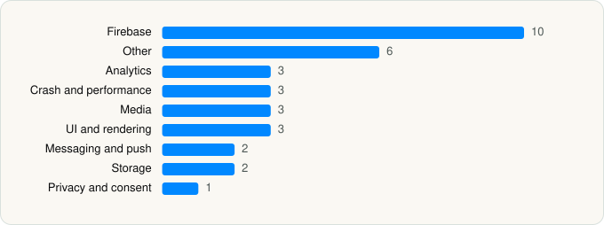

<picture><source media="(prefers-color-scheme: dark)" srcset="../../../../assets/logo/logo-dark.svg"></picture> [Tech Stack](../../../../README.md) / [Crunchyroll, LLC](../../../../companies/crunchyroll-llc.md) / Crunchyroll

# Crunchyroll

<picture><source media="(prefers-color-scheme: dark)" srcset="../../../../assets/badges/ios-dark.svg"></picture> <picture><source media="(prefers-color-scheme: dark)" srcset="../../../../assets/badges/active-dark.svg"></picture> <picture><source media="(prefers-color-scheme: dark)" srcset="../../../../assets/badges/floor-dark.svg"></picture> <picture><source media="(prefers-color-scheme: dark)" srcset="../../../../assets/badges/encrypted-dark.svg"></picture>

[App Store](https://apps.apple.com/app/id329913454) · [latest.json](latest.json)

| | |
|---|---|
| Company | [Crunchyroll, LLC](../../../../companies/crunchyroll-llc.md) |
| Store id | `329913454` |
| Bundle / package id | `com.crunchyroll.iphone` |
| Latest version | 4.109.3 (analysed 2026-06-23) |
| Versions tracked | 1 |
| SDKs in latest version | 33 |
| Languages | C/C++, Objective-C, Swift |
| UI | Lottie (animations), SwiftUI, UIKit |
| Build | Swift Package Manager (SwiftPM) |
| Minimum OS | iOS 17.0 (built with Xcode 26.4.1, SDK iphoneos26.4) |
| Devices / ABIs | iPhone, iPad |
| Localisations | 18 |
| Capabilities | 9 |
| Declares tracking | No |
| Tracked | Yes |

## SDKs by category

<picture><source media="(prefers-color-scheme: dark)" srcset="../../../../assets/charts/apps/ios/crunchyroll-llc/crunchyroll-dark.svg"></picture>

- **Firebase** (10): FBLPromises, Firebase, FirebaseCore, FirebaseCoreInternal, FirebaseInstallations, FirebaseRemoteConfig, GoogleDataTransport, GoogleUtilities 1.0, nanopb, Promises
- **Other** (6): Babylon, DeviceKit, MBProgressHUD, SwiftAssRenderer 1.0, SwiftLibass 1.0, TruexAdRenderer 3.4.0
- **Analytics** (3): BrazeKit 1.0, MUXSDKStats, Segment
- **Crash and performance** (3): DatadogCore, DatadogRUM, FirebaseCrashlytics
- **Media** (3): GoogleCast 4.8.0, GoogleInteractiveMediaAds 3.23.0, MuxCore 5.4.0
- **UI and rendering** (3): Kingfisher, Lottie, SnapKit
- **Messaging and push** (2): BrazePushStory 1.0, BrazeUI 1.0
- **Storage** (2): Realm, RealmSwift 1.0
- **Privacy and consent** (1): OTPublishersHeadlessSDK 202507.1.1

Frameworks (25)

ActivityKit (Live Activities), AdServices (Apple Search Ads attribution), AdSupport (IDFA), App Intents, App Tracking Transparency (ATT), AVFoundation (audio/video), AVKit, Combine (reactive), Core Data, Core Image, CryptoKit, Group Activities (SharePlay), Local Authentication (Face ID / Touch ID), Media Player, MetricKit (diagnostics), Network.framework, Photos, PhotosUI, SafariServices, SiriKit (Intents), StoreKit (in-app purchase), SwiftUI, UIKit, User Notifications, WidgetKit (widgets)

Capabilities (9)

App Groups, Associated Domains (Universal Links), Background App Refresh, Background Audio, Background Push, CloudKit, iCloud, Keychain Sharing, Push Notifications (APNs)

## Version history

| Version | Analysed | Store update | SDKs | Change | SDK list is a floor | Binary encrypted | File |
|---|---|---|---|---|---|---|---|
| 4.109.3 | 2026-06-23 |  | 33 |  | Yes | Yes | [4.109.3.json](4.109.3.json) |

## Model-written summary

> SwiftUI/UIKit iOS app with App Intents, widgets, modular first-party DRM video player, Braze analytics, Datadog monitoring and Realm storage

Written by a language model from the detected signals (`inferred[]`). It is commentary, not measurement.

---

Generated by `scripts/build_readme.py` from the JSON files. Do not edit by hand.
