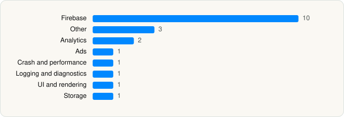

<picture><source media="(prefers-color-scheme: dark)" srcset="../../../../assets/logo/logo-dark.svg"></picture> [Tech Stack](../../../../README.md) / [DAZZ PTE. LTD.](../../../../companies/dazz-pte-ltd.md) / Dazz Cam

# Dazz Cam - Vintage Camera

<picture><source media="(prefers-color-scheme: dark)" srcset="../../../../assets/badges/ios-dark.svg"></picture> <picture><source media="(prefers-color-scheme: dark)" srcset="../../../../assets/badges/inactive-dark.svg"></picture> <picture><source media="(prefers-color-scheme: dark)" srcset="../../../../assets/badges/floor-dark.svg"></picture> <picture><source media="(prefers-color-scheme: dark)" srcset="../../../../assets/badges/encrypted-dark.svg"></picture>

[App Store](https://apps.apple.com/app/id1422471180) · [latest.json](latest.json)

| | |
|---|---|
| Company | [DAZZ PTE. LTD.](../../../../companies/dazz-pte-ltd.md) |
| Store id | `1422471180` |
| Bundle / package id | `dazz.camera.vintagecamera` |
| Latest version | 2.17.7 (analysed 2026-11-08) |
| Versions tracked | 1 |
| SDKs in latest version | 20 |
| Languages | C/C++, Metal (shaders), Objective-C, Swift |
| UI | SwiftUI, UIKit |
| Build | Swift Package Manager (SwiftPM) |
| Minimum OS | iOS 16.0 (built with Xcode 27.0, SDK iphoneos27.0) |
| Devices / ABIs | iPhone, iPad |
| Localisations | 16 |
| Capabilities | 1 |
| Declares tracking | Yes |
| Tracked | No. Kept for history. |

## SDKs by category

<picture><source media="(prefers-color-scheme: dark)" srcset="../../../../assets/charts/apps/ios/dazz-pte-ltd/dazz-cam-dark.svg"></picture>

- **Firebase** (10): FBLPromises, Firebase, FirebaseCore, FirebaseCoreInternal, FirebaseInstallations, FirebaseRemoteConfig, GoogleDataTransport, GoogleUtilities, nanopb, Promises
- **Other** (3): DeviceGuru, DZImageFilter 1.9.6, ZZCircleProgress
- **Analytics** (2): FirebaseAnalytics 12.19.0, GoogleAppMeasurement 12.19.0
- **Ads** (1): Google Mobile Ads (AdMob)
- **Crash and performance** (1): FirebaseCrashlytics
- **Logging and diagnostics** (1): CocoaLumberjack
- **UI and rendering** (1): SnapKit
- **Storage** (1): ZIPFoundation

Frameworks (23)

AdSupport (IDFA), App Intents, AVFoundation (audio/video), AVKit, Combine (reactive), Core Image, Core Location, Core Motion, MapKit, Media Player, MessageUI (mail / SMS compose), MetalKit, Network.framework, Photos, PhotosUI, SafariServices, SceneKit, SiriKit (Intents), StoreKit (in-app purchase), SwiftUI, UIKit, Vision, WidgetKit (widgets)

Capabilities (1)

App Groups

## Version history

| Version | Analysed | Store update | SDKs | Change | SDK list is a floor | Binary encrypted | File |
|---|---|---|---|---|---|---|---|
| 2.17.7 | 2026-11-08 |  | 20 |  | Yes | Yes | [2.17.7.json](2.17.7.json) |

---

Generated by `scripts/build_readme.py` from the JSON files. Do not edit by hand.
