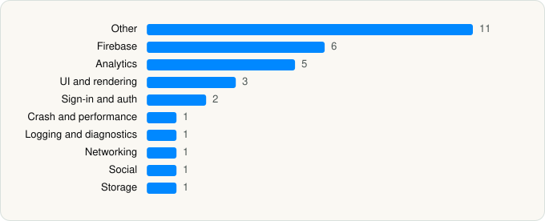

<picture><source media="(prefers-color-scheme: dark)" srcset="../../../../assets/logo/logo-dark.svg"></picture> [Tech Stack](../../../../README.md) / [DealSeek LLC](../../../../companies/dealseek-llc.md) / DealSeek

# DealSeek: Coupons & Discounts

<picture><source media="(prefers-color-scheme: dark)" srcset="../../../../assets/badges/ios-dark.svg"></picture> <picture><source media="(prefers-color-scheme: dark)" srcset="../../../../assets/badges/active-dark.svg"></picture> <picture><source media="(prefers-color-scheme: dark)" srcset="../../../../assets/badges/floor-dark.svg"></picture> <picture><source media="(prefers-color-scheme: dark)" srcset="../../../../assets/badges/encrypted-dark.svg"></picture>

[App Store](https://apps.apple.com/app/id6745274862) · [latest.json](latest.json)

| | |
|---|---|
| Company | [DealSeek LLC](../../../../companies/dealseek-llc.md) |
| Store id | `6745274862` |
| Bundle / package id | `com.dealseekorg.dealseek` |
| Latest version | 1.64.0 (analysed 2026-11-02) |
| Versions tracked | 1 |
| SDKs in latest version | 32 |
| Languages | C/C++, Metal (shaders), Objective-C, React Native / JavaScript, Swift |
| UI | SwiftUI, UIKit |
| Build | Swift Package Manager (SwiftPM) |
| Minimum OS | iOS 16.4 (built with Xcode 26.6, SDK iphoneos26.5) |
| Devices / ABIs | iPhone, iPad |
| Localisations | 0 |
| Capabilities | 7 |
| Declares tracking | Yes |
| Tracked | Yes |

## SDKs by category

<picture><source media="(prefers-color-scheme: dark)" srcset="../../../../assets/charts/apps/ios/dealseek-llc/dealseek-dark.svg"></picture>

- **Other** (11): boost, Crisp 1.0, EXConstants 57.0.19, ExpoModulesJSI 1.0, EXUpdates 57.0.23, FBSDKGamingServicesKit 1.0, folly, hermesvm 1.0.0, React 1.0, ReactNativeDependencies 1.0, RNDeviceInfoPrivacyInfo 14.1.1
- **Firebase** (6): FBLPromises 2.4.1, FirebaseCore 12.10.0, FirebaseCoreInternal 12.10.0, FirebaseInstallations 12.10.0, GoogleUtilities 8.1.5, nanopb 3.30910.0
- **Analytics** (5): AppsFlyerLib 6.18.0, Facebook SDK, FBAEMKit 1.0, FBSDKCoreKit 1.0, PostHog 3.42.1
- **UI and rendering** (3): React Native Reanimated, RNSVGFilters 15.15.4, SDWebImage 5.21.7
- **Sign-in and auth** (2): Facebook Login, FBSDKLoginKit 1.0
- **Crash and performance** (1): Sentry 8.58.0
- **Logging and diagnostics** (1): glog
- **Networking** (1): ReachabilitySwift 5.2.4
- **Social** (1): FBSDKShareKit 1.0
- **Storage** (1): MMKV

Frameworks (33)

ActivityKit (Live Activities), AdSupport (IDFA), App Intents, App Tracking Transparency (ATT), Authentication Services (Sign in with Apple / passkeys), AVFoundation (audio/video), AVKit, Background Tasks, Combine (reactive), Contacts, Core Data, Core Image, Core Location, Core Motion, CryptoKit, DeviceCheck / App Attest, Local Authentication (Face ID / Touch ID), Media Player, MessageUI (mail / SMS compose), MetricKit (diagnostics), Network.framework, PDFKit, Photos, PhotosUI, SafariServices, SiriKit (Intents), StoreKit (in-app purchase), Swift Charts, SwiftUI, UIKit, User Notifications, VisionKit (document/data scanning), WidgetKit (widgets)

Capabilities (7)

App Groups, Associated Domains (Universal Links), Background App Refresh, Background Push, iCloud, Push Notifications (APNs), Sign in with Apple

## Version history

| Version | Analysed | Store update | SDKs | Change | SDK list is a floor | Binary encrypted | File |
|---|---|---|---|---|---|---|---|
| 1.64.0 | 2026-11-02 | 2026-10-29 | 32 |  | Yes | Yes | [1.64.0.json](1.64.0.json) |

---

Generated by `scripts/build_readme.py` from the JSON files. Do not edit by hand.
