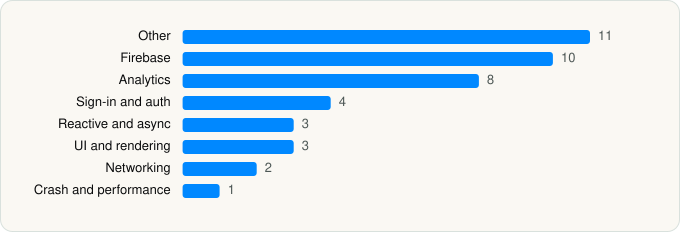

<picture><source media="(prefers-color-scheme: dark)" srcset="../../../../assets/logo/logo-dark.svg"></picture> [Tech Stack](../../../../README.md) / [DEEP FLOW SOFTWARE SERVICES](../../../../companies/deep-flow-software-services.md) / Cleanup

# Cleanup: Phone Storage Cleaner

<picture><source media="(prefers-color-scheme: dark)" srcset="../../../../assets/badges/ios-dark.svg"></picture> <picture><source media="(prefers-color-scheme: dark)" srcset="../../../../assets/badges/active-dark.svg"></picture> <picture><source media="(prefers-color-scheme: dark)" srcset="../../../../assets/badges/floor-dark.svg"></picture> <picture><source media="(prefers-color-scheme: dark)" srcset="../../../../assets/badges/encrypted-dark.svg"></picture>

[App Store](https://apps.apple.com/app/id1510944943) · [latest.json](latest.json)

| | |
|---|---|
| Company | [DEEP FLOW SOFTWARE SERVICES](../../../../companies/deep-flow-software-services.md) |
| Store id | `1510944943` |
| Bundle / package id | `com.codeway.cleanerplus` |
| Latest version | 6.25.1 (analysed 2026-11-02) |
| Versions tracked | 1 |
| SDKs in latest version | 42 |
| Languages | C/C++, Objective-C, Swift |
| UI | Lottie (animations), SwiftUI, UIKit |
| Build | Swift Package Manager (SwiftPM) |
| Minimum OS | iOS 15.0 (built with Xcode 26.0, SDK iphoneos26.0) |
| Devices / ABIs | iPhone |
| Localisations | 18 |
| Capabilities | 7 |
| Declares tracking | Yes |
| Tracked | Yes |

## SDKs by category

<picture><source media="(prefers-color-scheme: dark)" srcset="../../../../assets/charts/apps/ios/deep-flow-software-services/cleanup-dark.svg"></picture>

- **Other** (11): ADMozaicCollectionViewLayout 4.1.0, Differentiator 1.0, FacebookBasics, InfiniteScroll 1.3.0, Mute, NSObject 1.0, PromiseKit 1.0, RxDataSources 1.0, SwiftUIIntrospect 1.0, SwiftyRSA 1.0, VHGradientView 1.0.1
- **Firebase** (10): FBLPromises, Firebase, FirebaseAuth, FirebaseCore, FirebaseCoreInternal, FirebaseInstallations, GoogleDataTransport, GoogleUtilities, nanopb, Promises
- **Analytics** (8): Adjust 1.0, AdjustSdk, FacebookAEM, FacebookCore, FBAEMKit 1.0, FBSDKCoreKit 1.0, FirebaseAnalytics, Kronos
- **Sign-in and auth** (4): AppAuth, GoogleSignIn, GTMAppAuth, GTMSessionFetcher
- **Reactive and async** (3): RxCocoa 1.0, RxRelay 1.0, RxSwift 1.0
- **UI and rendering** (3): Kingfisher, Lottie 4.5.2, RiveRuntime 6.21.0
- **Networking** (2): Alamofire, Moya 1.0
- **Crash and performance** (1): FirebaseCrashlytics

Frameworks (27)

AdServices (Apple Search Ads attribution), AdSupport (IDFA), App Tracking Transparency (ATT), Authentication Services (Sign in with Apple / passkeys), AVFoundation (audio/video), AVKit, Combine (reactive), Contacts, Core Data, Core Image, Core ML, CryptoKit, DeviceCheck / App Attest, Local Authentication (Face ID / Touch ID), MessageUI (mail / SMS compose), MetalKit, MetricKit (diagnostics), Network.framework, Photos, PhotosUI, SafariServices, SiriKit (Intents), StoreKit (in-app purchase), SwiftUI, UIKit, User Notifications, WidgetKit (widgets)

Capabilities (7)

App Groups, Associated Domains (Universal Links), Background App Refresh, Background Push, Keychain Sharing, Push Notifications (APNs), SiriKit

## Version history

| Version | Analysed | Store update | SDKs | Change | SDK list is a floor | Binary encrypted | File |
|---|---|---|---|---|---|---|---|
| 6.25.1 | 2026-11-02 | 2026-10-27 | 42 |  | Yes | Yes | [6.25.1.json](6.25.1.json) |

---

Generated by `scripts/build_readme.py` from the JSON files. Do not edit by hand.
