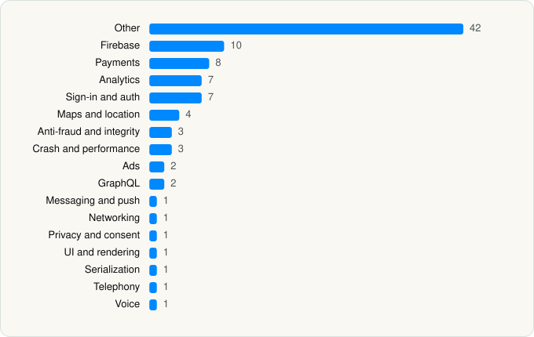

<picture><source media="(prefers-color-scheme: dark)" srcset="../../../../assets/logo/logo-dark.svg"></picture> [Tech Stack](../../../../README.md) / [Deliveroo](../../../../companies/deliveroo.md) / Deliveroo

# Deliveroo: Food & Shopping

<picture><source media="(prefers-color-scheme: dark)" srcset="../../../../assets/badges/ios-dark.svg"></picture> <picture><source media="(prefers-color-scheme: dark)" srcset="../../../../assets/badges/inactive-dark.svg"></picture> <picture><source media="(prefers-color-scheme: dark)" srcset="../../../../assets/badges/floor-dark.svg"></picture> <picture><source media="(prefers-color-scheme: dark)" srcset="../../../../assets/badges/encrypted-dark.svg"></picture>

[App Store](https://apps.apple.com/app/id1001501844) · [latest.json](latest.json)

| | |
|---|---|
| Company | [Deliveroo](../../../../companies/deliveroo.md) |
| Store id | `1001501844` |
| Bundle / package id | `com.deliveroo.orderapp` |
| Latest version | 3.349.0 (analysed 2026-11-25) |
| Versions tracked | 3 |
| SDKs in latest version | 95 |
| Languages | C/C++, Metal (shaders), Objective-C, Swift |
| UI | Lottie (animations), SwiftUI, UIKit |
| Build | Swift Package Manager (SwiftPM) |
| Minimum OS | iOS 17.0 (built with Xcode 27.0, SDK iphoneos27.0) |
| Devices / ABIs | iPhone, iPad |
| Localisations | 7 |
| Capabilities | 9 |
| Declares tracking | Yes |
| Tracked | No. Kept for history. |

## SDKs by category

<picture><source media="(prefers-color-scheme: dark)" srcset="../../../../assets/charts/apps/ios/deliveroo/deliveroo-dark.svg"></picture>

- **Other** (42): AppFeedback, AppIntegrationRooConsumer, CommonModelsService, DebugTools, Frames, GooglePlaces 10.0.0, GooglePlacesSwift 10.0.0, GooglePlacesSwiftTarget, GooglePlacesTarget, Home, IconSet 1.0, IllustrationBadges 1.0, LiveActivity, Localisations, MagicCamera, MapsCore, Mosaic, MosaicPedregalStoreWebServicePrivate, MosaicSandbox, OrderTrackingContentServicePrivate, PedregalFeedWebServicePrivate, PedregalSearchWebServicePrivate, Prism, PrismIcons, PrismTokens, PrismTokensConsumer, PrismTokensDeliveroo, PrismTokensDeliverooPlus, ProductComponents 1.0, RooBlocksConsumer, SelfHelp, Stories, UnifiedADPPrivate, UnifiedConsumerBrandedAssetsRoo, UnifiedConsumerLocalizations, UnifiedLiveActivityViews, UnifiedOrderTrackingPrivate, UnifiedReturnsReceiptCapture, UnifiedStoreCardLocalization, UnifiedStorePrivate, UnifiedUGCSubmissionPrivate, VoiceClient 1.0
- **Firebase** (10): FBLPromises, Firebase, FirebaseCore, FirebaseCoreInternal, FirebaseInstallations, FirebaseRemoteConfig, GoogleDataTransport, GoogleUtilities 1.0, nanopb, Promises
- **Payments** (8): Adyen, Braintree, CheckoutConsumer, CheckoutEventLoggerKit 1.0, PaymentComponent 1.0, Payments, Stripe, UnifiedPostCheckoutAdsPrivate
- **Analytics** (7): AppsFlyerLib, Branch, BrazeKit 14.0.1, FacebookAEM, FacebookCore, FBAEMKit 1.0, FBSDKCoreKit 1.0
- **Sign-in and auth** (7): AppAuth, FacebookLogin, FBSDKLoginKit 1.0, GoogleSignIn, GTMAppAuth, GTMSessionFetcher, LoginSignup
- **Maps and location** (4): GMSCore 25.23.0, GoogleMaps, Mapbox 23.13.1, MapboxMaps
- **Anti-fraud and integrity** (3): Fingerprint 2.16.0, RecaptchaEnterprise, ShieldFraud 1.0
- **Crash and performance** (3): DatadogCore, FirebaseCrashlytics, Sentry
- **Ads** (2): Google Mobile Ads (AdMob), GoogleMobileAds
- **GraphQL** (2): Apollo, ApolloAPI
- **Messaging and push** (1): BrazeUI 1.0
- **Networking** (1): Reachability
- **Privacy and consent** (1): OTPublishersHeadlessSDK 202604.1.0
- **UI and rendering** (1): Lottie 4.5.2
- **Serialization** (1): SwiftProtobuf
- **Telephony** (1): PhoneNumberKit
- **Voice** (1): TwilioVoice 6.10.0

Frameworks (42)

ActivityKit (Live Activities), AdServices (Apple Search Ads attribution), AdSupport (IDFA), App Intents, App Tracking Transparency (ATT), Authentication Services (Sign in with Apple / passkeys), AVFoundation (audio/video), AVKit, Background Tasks, CallKit (VoIP), Combine (reactive), Contacts, Core Data, Core Image, Core Location, Core Motion, CryptoKit, DeviceCheck / App Attest, EventKit (Calendar / Reminders), Local Authentication (Face ID / Touch ID), MapKit, MessageUI (mail / SMS compose), MetalKit, MetricKit (diagnostics), Network.framework, PassKit (Wallet / Apple Pay), PDFKit, PencilKit, Photos, PhotosUI, PushKit (VoIP push), SafariServices, SceneKit, SiriKit (Intents), StoreKit (in-app purchase), Swift Charts, SwiftUI, UIKit, User Notifications, Vision, VisionKit (document/data scanning), WidgetKit (widgets)

Capabilities (9)

App Groups, Apple Pay, Associated Domains (Universal Links), Background Push, Keychain Sharing, Push Notifications (APNs), Sign in with Apple, Time-Sensitive Notifications, VoIP

## Version history

| Version | Analysed | Store update | SDKs | Change | SDK list is a floor | Binary encrypted | File |
|---|---|---|---|---|---|---|---|
| 3.349.0 | 2026-11-25 |  | 95 | +5 / −8 | Yes | Yes | [3.349.0.json](3.349.0.json) |
| 3.346.0 | 2026-11-01 | 2026-10-29 | 98 | +0 / −0 | Yes | Yes | [3.346.0.json](3.346.0.json) |
| 3.345.0 | 2026-10-24 | 2026-10-20 | 98 |  | Yes | Yes | [3.345.0.json](3.345.0.json) |

### SDK changes between versions

- 3.346.0 → 3.349.0: added AppFeedback, CheckoutConsumer, MagicCamera, Sentry, UnifiedUGCSubmissionPrivate; removed FirebaseAnalytics, FirebasePerformance, GoogleAdsOnDeviceConversion, GoogleAppMeasurement, GoogleAppMeasurementIdentitySupport, KMPItemPage, PPRiskMagnes, UserMessagingPlatform

---

Generated by `scripts/build_readme.py` from the JSON files. Do not edit by hand.
