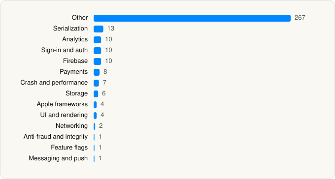

<picture><source media="(prefers-color-scheme: dark)" srcset="../../../../assets/logo/logo-dark.svg"></picture> [Tech Stack](../../../../README.md) / [Depop Ltd](../../../../companies/depop-ltd.md) / Depop

# Depop - Buy & Sell Clothes

<picture><source media="(prefers-color-scheme: dark)" srcset="../../../../assets/badges/ios-dark.svg"></picture> <picture><source media="(prefers-color-scheme: dark)" srcset="../../../../assets/badges/active-dark.svg"></picture> <picture><source media="(prefers-color-scheme: dark)" srcset="../../../../assets/badges/floor-dark.svg"></picture> <picture><source media="(prefers-color-scheme: dark)" srcset="../../../../assets/badges/encrypted-dark.svg"></picture>

[App Store](https://apps.apple.com/app/id518684914) · [latest.json](latest.json)

| | |
|---|---|
| Company | [Depop Ltd](../../../../companies/depop-ltd.md) |
| Store id | `518684914` |
| Bundle / package id | `com.garageitaly.garage` |
| Latest version | 2.418 (analysed 2026-11-02) |
| Versions tracked | 1 |
| SDKs in latest version | 344 |
| Languages | C/C++, Metal (shaders), Objective-C, Swift |
| UI | Lottie (animations), SwiftUI, UIKit |
| Build | Swift Package Manager (SwiftPM) |
| Minimum OS | iOS 18.0 (built with Xcode 27.1, SDK iphoneos27.1) |
| Devices / ABIs | iPhone |
| Localisations | 2 |
| Capabilities | 6 |
| Declares tracking | Yes |
| Tracked | Yes |

## SDKs by category

<picture><source media="(prefers-color-scheme: dark)" srcset="../../../../assets/charts/apps/ios/depop-ltd/depop-dark.svg"></picture>

- **Other** (267): Algorithms 1.0, Announcements 1.0, AnnouncementsInterface 1.0, AppConfigInterface 1.0, AppInterface 1.0, Approov 3.5.3, ApproovIntegration 1.0, ApproovIntegrationInterface 1.0, AppUI 1.0, AsyncAlgorithms 1.0, AsyncUtils 1.0, ATEvents 1.0, ATEventsInterface 1.0, AutoRespondToOffers 1.0, AutoRespondToOffersCatalogUI 1.0, AutoRespondToOffersInterface 1.0, AVEditing 1.0, AVEditingInterface 1.0, AVMedia 1.0, AVMediaCatalogUI 1.0, AVMediaInterface 1.0, AVMediaMocks 1.0, AVMediaModels 1.0, BackendComposedModules 1.0, BackendComposedModulesInterface 1.0, Bag 1.0, BagCatalogUI 1.0, BagInterface 1.0, BagService 1.0, BagServiceInterface 1.0, BanubaLicenseServicingSDK 1.43.0, BanubaSdkSimple 1.43.0, BanubaUtilities 1.43.0, BanubaVideoEditorCore 1.43.0, BanubaVideoEditorSDK 1.43.0, BitCollections 1.0, BNBLicenseUtils 1.6.0, Brands 1.0, BrandsInterface 1.0, BrazeIntegration 1.0, BrazeIntegrationInterface 1.0, BulkEnableAutoRespondOffer 1.0, BulkEnableAutoRespondOfferCatalogUI 1.0, BulkEnableAutoRespondOfferInterface 1.0, BundleDiscounts 1.0, BundleDiscountsCatalogUI 1.0, BundleDiscountsInterface 1.0, BuyerAds 1.0, BuyerAdsInterface 1.0, CampaignBanners 1.0, CampaignBannersInterface 1.0, CampaignLandingPage 1.0, CampaignLandingPageInterface 1.0, Campaigns 1.0, CampaignsInterface 1.0, CasePaths 1.0, CasePathsCore 1.0, CatalogUI 1.0, CatchUp 1.0, CatchUpCatalogUI 1.0, CatchUpInterface 1.0, ChatCatalogUI 1.0, ChatInterface 1.0, Clocks 1.0, CollectionHelpers 1.0, CombineSchedulers 1.0, CommonStyles 1.0, ComparisonHelpers 1.0, ConcurrencyExtras 1.0, ContainersPreview 1.0, CookieBannerIntegration 1.0, CookieBannerIntegrationInterface 1.0, CoreStyles 1.0, CustomDump 1.0, DateTime 1.0, DateTimeInterface 1.0, DebugSettings 1.0, DebugSettingsInterface 1.0, DecodingHelpers 1.0, Deeplinks 1.0, DeeplinksInterface 1.0, DictionaryHelpers 1.0, Discounts 1.0, DiscountsCatalogUI 1.0, DiscountsInterface 1.0, Discover 1.0, DiscoverInterface 1.0, DisputeModels 1.0, DisputeModule 1.0, DisputeModuleCatalogUI 1.0, DisputeModuleInterface 1.0, Drafts 1.0, DraftsInterface 1.0, Events 1.0, FacebookIntegration 1.0, FacebookIntegrationInterface 1.0, Feature 1.0, Filters 1.0, FiltersInterface 1.0, FiltersModels 1.0, FreeTrial 1.0, FreeTrialCatalogUI 1.0, FreeTrialInterface 1.0, HashTreeCollections 1.0, HelpCenter 1.0, HelpCenterInterface 1.0, Home 1.0, HomeInterface 1.0, HTTPClient 1.0, HybridHome 1.0, HybridHomeInterface 1.0, IdentifiedCollections 1.0, ImageCacheService 1.0, ImageCacheServiceInterface 1.0, Impression 1.0, ImpressionInterface 1.0, IssueReporting 1.0, JSONSchema 1.0, JustInTimeBucketing 1.0, JustInTimeBucketingInterface 1.0, KlarnaCore 2.7.3, KlarnaIntegration 1.0, KlarnaIntegrationInterface 1.0, KlarnaMobileSDK 2.7.3, Listing 1.0, ListingCatalogUI 1.0, ListingDesignRefresh 1.0, ListingInterface 1.0, ListingModels 1.0, ListingPrediction 1.0, ListingPredictionInterface 1.0, Locking 1.0, ManageListings 1.0, ManageListingsCatalogUI 1.0, ManageListingsInterface 1.0, Mepop 1.0, MepopCatalogUI 1.0, MepopInterface 1.0, MessageKit, MFA 1.0, MFACatalogUI 1.0, MFAInterface 1.0, MockURLProtocol 1.0, ModularScreen 1.0, ModularScreenInterface 1.0, MyAccount 1.0, MyAccountCatalogUI 1.0, MyAccountInterface 1.0, NaturalLanguageWordDetector 1.0, NaturalLanguageWordDetectorInterface 1.0, Navigator 1.0, NotificationFeed 1.0, NotificationFeedCatalogUI 1.0, NotificationFeedInterface 1.0, NumberHelpers 1.0, Offers 1.0, OffersCatalogUI 1.0, OffersInterface 1.0, OnboardingCatalogUI 1.0, OnboardingInterface 1.0, OpenEmailApp 1.0, Order 1.0, OrderCatalogUI 1.0, OrderInterface 1.0, Outfits 1.0, OutfitsCatalogUI 1.0, OutfitsInterface 1.0, PhotoEditing 1.0, PhotoEditingCatalogUI 1.0, PhotoEditingInterface 1.0, PhotoroomIntegration 1.0, PhotoroomIntegrationInterface 1.0, PresentationDefaultSnowdonApi 1.0, PriceInspiration 1.0, PriceInspirationCatalogUI 1.0, PriceInspirationInterface 1.0, PrivacyInterface 1.0, Product 1.0, ProductAttributes 1.0, ProductAttributesInterface 1.0, ProductCatalogUI 1.0, ProductCategories 1.0, ProductCategoriesInterface 1.0, ProductInterface 1.0, ProductService 1.0, ProductServiceInterface 1.0, PromiseThen 1.0, PushOptIn 1.0, PushOptInCatalogUI 1.0, PushOptInInterface 1.0, Receipts 1.0, ReceiptsCatalogUI 1.0, ReceiptsInterface 1.0, Refunds 1.0, RefundsCatalogUI 1.0, RefundsInterface 1.0, ReportingFlows 1.0, ReportingFlowsInterface 1.0, Reprice 1.0, RepriceCatalogUI 1.0, RepriceInterface 1.0, Reviews 1.0, ReviewsCatalogUI 1.0, ReviewsInterface 1.0, ROKTIntegration 1.0, ROKTIntegrationInterface 1.0, RopeModule 1.0, Search 1.0, SearchHistory 1.0, SearchInterface 1.0, SearchModels 1.0, SellerAds 1.0, SellerAdsCatalogUI 1.0, SellerAdsInterface 1.0, SellerProductDetails 1.0, SellerProductDetailsCatalogUI 1.0, SellerProductDetailsInterface 1.0, SellerService 1.0, SellerServiceInterface 1.0, Service 1.0, ServiceInterface 1.0, ServiceMocks 1.0, Shipping 1.0, ShippingCatalogUI 1.0, ShippingInterface 1.0, ShopDrop 1.0, ShopDropInterface 1.0, Signup 1.0, SignupInterface 1.0, SizePicker 1.0, SizePickerInterface 1.0, SoldItemSearch 1.0, SoldItemSearchCatalogUI 1.0, SoldItemSearchInterface 1.0, Stories 1.0, StoriesCore 1.0, StoriesCoreInterface 1.0, StoriesInterface 1.0, StringHelpers 1.0, SwiftRichString 1.0, SwiftUIHelpers 1.0, SwiftUIIntrospect 1.0, TaxCompliance 1.0, TaxComplianceCatalogUI 1.0, TaxComplianceInterface 1.0, ThreadingHelpers 1.0, TopSellerTracker 1.0, TopSellerTrackerCatalogUI 1.0, TopSellerTrackerInterface 1.0, Transcend 1.0, Transition 1.0, UIKitHelpers 1.0, UIKitObservation 1.0, UnidirectionalFlow 1.0, UnimplementedProtocolCore 1.0, UserEducationService 1.0, UserEducationServiceInterface 1.0, UserList 1.0, UserListInterface 1.0, UserPreferences 1.0, UserPreferencesCatalogUI 1.0, UserPreferencesInterface 1.0, UserProfile 1.0, UserProfileCatalogUI 1.0, UserProfileInterface 1.0, WebView 1.0, XCTestDynamicOverlay 1.0
- **Serialization** (13): Thrift 1.0, ThriftBricks 1.0, ThriftComponents 1.0, ThriftEnvironment 1.0, ThriftExtensions 1.0, ThriftFormatters 1.0, ThriftFoundation 1.0, ThriftInternalStyles 1.0, ThriftLabs 1.0, ThriftLego 1.0, ThriftModifiers 1.0, ThriftTokens 1.0, ThriftUI 1.0
- **Analytics** (10): Analytics 1.0, AnalyticsInterface 1.0, Branch, FacebookAEM, FacebookCore, FBAEMKit 1.0, FBSDKCoreKit 1.0, Heap 1.0, OmniAnalytics 1.0, OmniAnalyticsInterface 1.0
- **Sign-in and auth** (10): AppAuth, Authentication 1.0, AuthenticationFlow 1.0, AuthenticationInterface 1.0, GoogleSignIn, GTMAppAuth, GTMSessionFetcher, InputBarAccessoryView 1.0, Login 1.0, LoginInterface 1.0
- **Firebase** (10): FBLPromises 1.0, Firebase, FirebaseCore, FirebaseCoreInternal, FirebaseInstallations, FirebaseRemoteConfig, GoogleDataTransport, GoogleUtilities 1.0, nanopb, Promises 1.0
- **Payments** (8): Braintree, Checkout 1.0, CheckoutCatalogUI 1.0, CheckoutInterface 1.0, Payments 1.0, PaymentsCatalogUI 1.0, PaymentsInterface 1.0, Stripe
- **Crash and performance** (7): Embrace 1.0, EmbraceCore, FirebaseCrashlytics, KSCrash, Observability 1.0, ObservabilityInterface 1.0, ObservabilityMocks 1.0
- **Storage** (6): DatabaseRepository 1.0, DataStore 1.0, GRDB, NavigatorMocks 1.0, PerformanceMonitoring 1.0, PerformanceMonitoringInterface 1.0
- **Apple frameworks** (4): Collections 1.0, DequeModule 1.0, InternalCollectionsUtilities 1.0, OrderedCollections 1.0
- **UI and rendering** (4): Animations 1.0, AnimationsInterface 1.0, Lottie 4.6.0, SDWebImage 1.0
- **Networking** (2): Reachability 1.0, ReachabilityInterface 1.0
- **Anti-fraud and integrity** (1): Sift 1.0
- **Feature flags** (1): Experiment 1.0
- **Messaging and push** (1): BrazeUI 1.0

Frameworks (35)

ActivityKit (Live Activities), AdServices (Apple Search Ads attribution), AdSupport (IDFA), App Intents, App Tracking Transparency (ATT), Authentication Services (Sign in with Apple / passkeys), AVFoundation (audio/video), AVKit, Combine (reactive), Contacts, Core Data, Core Image, Core Location, Core Motion, CryptoKit, DeviceCheck / App Attest, Local Authentication (Face ID / Touch ID), MapKit, Media Player, MessageUI (mail / SMS compose), MetricKit (diagnostics), Natural Language, Network.framework, PassKit (Wallet / Apple Pay), PDFKit, Photos, PhotosUI, SafariServices, SiriKit (Intents), StoreKit (in-app purchase), Swift Charts, SwiftUI, UIKit, User Notifications, Vision

Capabilities (6)

Apple Pay, Associated Domains (Universal Links), Background Push, Keychain Sharing, Push Notifications (APNs), Sign in with Apple

## Version history

| Version | Analysed | Store update | SDKs | Change | SDK list is a floor | Binary encrypted | File |
|---|---|---|---|---|---|---|---|
| 2.418 | 2026-11-02 |  | 344 |  | Yes | Yes | [2.418.json](2.418.json) |

---

Generated by `scripts/build_readme.py` from the JSON files. Do not edit by hand.
