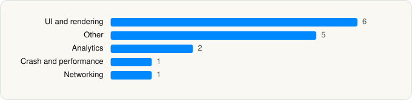

<picture><source media="(prefers-color-scheme: dark)" srcset="../../../../assets/logo/logo-dark.svg"></picture> [Tech Stack](../../../../README.md) / [Discord Inc.](../../../../companies/discord-inc.md) / Discord

# Discord - Talk, Play, Hang Out

<picture><source media="(prefers-color-scheme: dark)" srcset="../../../../assets/badges/ios-dark.svg"></picture> <picture><source media="(prefers-color-scheme: dark)" srcset="../../../../assets/badges/inactive-dark.svg"></picture> <picture><source media="(prefers-color-scheme: dark)" srcset="../../../../assets/badges/floor-dark.svg"></picture> <picture><source media="(prefers-color-scheme: dark)" srcset="../../../../assets/badges/encrypted-dark.svg"></picture>

[App Store](https://apps.apple.com/app/id985746746) · [latest.json](latest.json)

| | |
|---|---|
| Company | [Discord Inc.](../../../../companies/discord-inc.md) |
| Store id | `985746746` |
| Bundle / package id | `com.hammerandchisel.discord` |
| Latest version | 350.0 (analysed 2026-10-23) |
| Versions tracked | 2 |
| SDKs in latest version | 15 |
| Languages | C/C++, Metal (shaders), Objective-C, React Native / JavaScript, Swift |
| UI | Lottie (animations), SwiftUI, UIKit |
| Build | Swift Package Manager (SwiftPM) |
| Minimum OS | iOS 16.0 (built with Xcode 26.5, SDK iphoneos26.5) |
| Devices / ABIs | iPhone, iPad |
| Localisations | 0 |
| Capabilities | 8 |
| Declares tracking | Yes |
| Tracked | No. Kept for history. |

## SDKs by category

<picture><source media="(prefers-color-scheme: dark)" srcset="../../../../assets/charts/apps/ios/discord-inc/discord-dark.svg"></picture>

- **UI and rendering** (6): Lottie 1.0.0, React Native, React Native Reanimated, RiveRuntime 6.28.0, RNSVGFilters 1.0.0, SDWebImage 1.0.0
- **Other** (5): hermesvm 1.0.0, QBImagePicker 1.0.0, RNImageCropPickerPrivacyInfo 1.0.0, YbridOgg 0.8.1, YbridOpus 0.8.1
- **Analytics** (2): Amplitude, AppsFlyerLib 1.0.0
- **Crash and performance** (1): Sentry 1.0.0
- **Networking** (1): Alamofire 1.0.0

Frameworks (34)

ActivityKit (Live Activities), AdServices (Apple Search Ads attribution), AdSupport (IDFA), App Intents, App Tracking Transparency (ATT), Authentication Services (Sign in with Apple / passkeys), AVFoundation (audio/video), AVKit, CallKit (VoIP), Combine (reactive), Contacts, Core Data, Core Image, Core Motion, CryptoKit, DeviceCheck / App Attest, Media Player, MessageUI (mail / SMS compose), MetalKit, MetricKit (diagnostics), Natural Language, Network.framework, PDFKit, Photos, PhotosUI, PushKit (VoIP push), SafariServices, SiriKit (Intents), StoreKit (in-app purchase), SwiftUI, UIKit, User Notifications, Vision, WidgetKit (widgets)

Capabilities (8)

App Attest, App Groups, Associated Domains (Universal Links), Background Audio, Background Push, Communication Notifications, Push Notifications (APNs), VoIP

## Version history

| Version | Analysed | Store update | SDKs | Change | SDK list is a floor | Binary encrypted | File |
|---|---|---|---|---|---|---|---|
| 350.0 | 2026-10-23 | 2026-10-19 | 15 | +1 / −6 | Yes | Yes | [350.0.json](350.0.json) |
| 331.0 | 2026-06-19 |  | 20 |  | Yes | Yes | [331.0.json](331.0.json) |

### SDK changes between versions

- 331.0 → 350.0: added hermesvm; removed FlashList, hermes, Lodash, Moment.js, React Navigation, react-native-svg

---

Generated by `scripts/build_readme.py` from the JSON files. Do not edit by hand.
