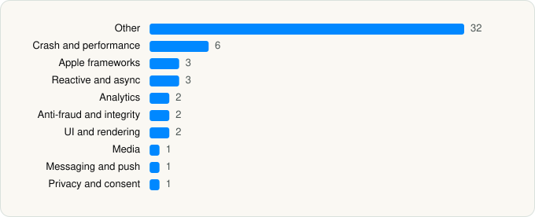

<picture><source media="(prefers-color-scheme: dark)" srcset="../../../../assets/logo/logo-dark.svg"></picture> [Tech Stack](../../../../README.md) / [Disney](../../../../companies/disney.md) / Disney+

# Disney+

<picture><source media="(prefers-color-scheme: dark)" srcset="../../../../assets/badges/ios-dark.svg"></picture> <picture><source media="(prefers-color-scheme: dark)" srcset="../../../../assets/badges/active-dark.svg"></picture> <picture><source media="(prefers-color-scheme: dark)" srcset="../../../../assets/badges/floor-dark.svg"></picture> <picture><source media="(prefers-color-scheme: dark)" srcset="../../../../assets/badges/encrypted-dark.svg"></picture>

[App Store](https://apps.apple.com/app/id1446075923) · [latest.json](latest.json)

| | |
|---|---|
| Company | [Disney](../../../../companies/disney.md) |
| Store id | `1446075923` |
| Bundle / package id | `com.disney.disneyplus` |
| Latest version | 5.20.5 (analysed 2026-11-02) |
| Versions tracked | 2 |
| SDKs in latest version | 53 |
| Languages | C/C++, Objective-C, Swift |
| UI | Lottie (animations), SwiftUI, UIKit |
| Build | Swift Package Manager (SwiftPM) |
| Minimum OS | iOS 16.5 (built with Xcode 27.0, SDK iphoneos27.0) |
| Devices / ABIs | iPhone, iPad |
| Localisations | 41 |
| Capabilities | 7 |
| Declares tracking | Yes |
| Tracked | Yes |

## SDKs by category

<picture><source media="(prefers-color-scheme: dark)" srcset="../../../../assets/charts/apps/ios/disney/disney-dark.svg"></picture>

- **Other** (32): AsyncPublisher 1.0, Cast 1.0, ClientSDK, ContentCollectionsFeature 1.0, ContentDetailsFeature 1.0, CoreGraph 1.0, CrashReporter, DMX, DominguezCore 1.0, DominguezCoreExtensionSafe 1.0, DominguezFoundation 1.0, DominguezKit 1.0, DominguezServices 1.0, DominguezUI, DominguezWidgetKit 1.0, DSSKitBase 1.0, EdgeSDK 1.0, Environment, ExploreFeature 1.0, FactoryKit, GCIX 1.0, IdentitySDK, Nest 1.0, OnboardingFeature 1.0, OrchestrationSDK 1.0, ProfileFeature 1.0, RipleyCore, RipleyUI, SettingsFeature 1.0, UMPSDK 1.0, VideoPlayerFeature 1.0, VX 1.0
- **Crash and performance** (6): Datadog 1.0, DatadogCore, DatadogCrashReporting, DatadogRUM, KSCrash, PLCrashReporter
- **Apple frameworks** (3): DequeModule 1.0, InternalCollectionsUtilities 1.0, OrderedCollections 1.0
- **Reactive and async** (3): RxCocoa 1.0, RxRelay 1.0, RxSwift 1.0
- **Analytics** (2): BrazeKit 11.4.0, NielsenAppApi 10.1.0
- **Anti-fraud and integrity** (2): RecaptchaEnterprise 1.0, RecaptchaInterop 1.0
- **UI and rendering** (2): Lottie 1.0, RiveRuntime 6.27.0
- **Media** (1): GoogleCast 4.8.3
- **Messaging and push** (1): BrazeUI 11.4.0
- **Privacy and consent** (1): OTPublishersHeadlessSDK 202601.2.5

Frameworks (27)

ActivityKit (Live Activities), AdServices (Apple Search Ads attribution), AdSupport (IDFA), App Tracking Transparency (ATT), AVFoundation (audio/video), AVKit, Combine (reactive), Core Data, Core Image, Core Location, CryptoKit, DeviceCheck / App Attest, Group Activities (SharePlay), Local Authentication (Face ID / Touch ID), Media Player, MetalKit, Network.framework, PassKit (Wallet / Apple Pay), SafariServices, SiriKit (Intents), Speech (recognition), StoreKit (in-app purchase), SwiftData (persistence), SwiftUI, UIKit, User Notifications, WidgetKit (widgets)

Capabilities (7)

App Groups, Associated Domains (Universal Links), Background App Refresh, Background Audio, Background Push, Keychain Sharing, Push Notifications (APNs)

## Version history

| Version | Analysed | Store update | SDKs | Change | SDK list is a floor | Binary encrypted | File |
|---|---|---|---|---|---|---|---|
| 5.20.5 | 2026-11-02 | 2026-11-01 | 53 | +5 / −2 | Yes | Yes | [5.20.5.json](5.20.5.json) |
| 5.10.0 | 2026-06-23 |  | 50 |  | Yes | Yes | [5.10.0.json](5.10.0.json) |

### SDK changes between versions

- 5.10.0 → 5.20.5: added AsyncPublisher, DominguezKit, DominguezWidgetKit, GCIX, OrchestrationSDK; removed Chromecast, DSSKitADK

---

Generated by `scripts/build_readme.py` from the JSON files. Do not edit by hand.
