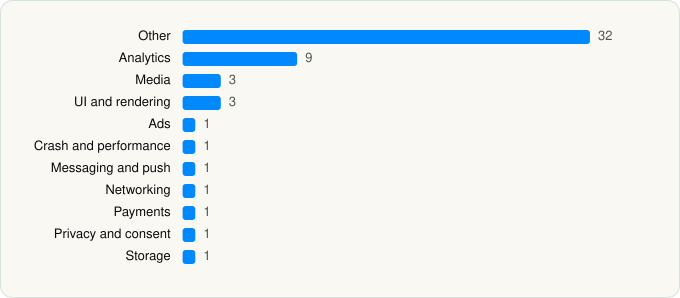

<picture><source media="(prefers-color-scheme: dark)" srcset="../../../../assets/logo/logo-dark.svg"></picture> [Tech Stack](../../../../README.md) / [Disney](../../../../companies/disney.md) / ESPN

# ESPN: Live Sports & Scores

<picture><source media="(prefers-color-scheme: dark)" srcset="../../../../assets/badges/ios-dark.svg"></picture> <picture><source media="(prefers-color-scheme: dark)" srcset="../../../../assets/badges/active-dark.svg"></picture> <picture><source media="(prefers-color-scheme: dark)" srcset="../../../../assets/badges/floor-dark.svg"></picture> <picture><source media="(prefers-color-scheme: dark)" srcset="../../../../assets/badges/encrypted-dark.svg"></picture>

[App Store](https://apps.apple.com/app/id317469184) · [latest.json](latest.json)

| | |
|---|---|
| Company | [Disney](../../../../companies/disney.md) |
| Store id | `317469184` |
| Bundle / package id | `com.espn.ScoreCenter` |
| Latest version | 8.19.0 (analysed 2026-06-23) |
| Versions tracked | 1 |
| SDKs in latest version | 54 |
| Languages | C/C++, Objective-C, Swift |
| UI | Lottie (animations), SwiftUI, UIKit |
| Build | Swift Package Manager (SwiftPM) |
| Minimum OS | iOS 17.0 (built with Xcode 26.2, SDK iphoneos26.2) |
| Devices / ABIs | iPhone, iPad |
| Localisations | 6 |
| Capabilities | 8 |
| Declares tracking | Yes |
| Tracked | Yes |

## SDKs by category

<picture><source media="(prefers-color-scheme: dark)" srcset="../../../../assets/charts/apps/ios/disney/espn-dark.svg"></picture>

- **Other** (32): AccessEnabler 3.9.2, AccessibilityIdentifiers 1.0, BaseFoundationSwift 1.0, ClientSDK, ConvivaAVFoundation 4.3.1, CryptoSwift, DebugSettings, Disney 1.4.11, DisneyMediaPlayer, DMX, DSSKitADK, DSSKitBase, DTCITVEAccessKit 1.0, FeaturesKit, InsightsKit, LifecycleKit, NetworkTrafficCapture, OneID, Paywall, PrismKitCore, RipleyCore, RipleyUI, SportscenterForYou, StateKit, StorageKit, StreamCenterMocks, StreamCenterUI, TournamentChallenge, UnifiedInterface, VisionCore, WebAppKit, WhereToWatch
- **Analytics** (9): AEPCore, AEPServices, BrazeKit 12.0.0, BrazeLocation 12.0.0, ComScore 1.0, ConvivaSDK 4.3.1, Facebook SDK, Kochava 8.4.1, NielsenAppApi 9.1.0
- **Media** (3): GoogleCast 4.8.3, GoogleInteractiveMediaAds 3.19.1, MediaPlayback
- **UI and rendering** (3): Lottie, RiveRuntime 6.7.5, SDWebImage
- **Ads** (1): ProgrammaticAccessLibrary 2.5.3
- **Crash and performance** (1): NewRelic 7.6.0
- **Messaging and push** (1): BrazeUI
- **Networking** (1): Alamofire
- **Payments** (1): SubscriptionsManagement
- **Privacy and consent** (1): OTPublishersHeadlessSDK 202601.2.5
- **Storage** (1): ZIPFoundation

Frameworks (28)

ActivityKit (Live Activities), AdServices (Apple Search Ads attribution), AdSupport (IDFA), App Tracking Transparency (ATT), AVFoundation (audio/video), AVKit, Background Tasks, Combine (reactive), Core Data, Core Image, Core Location, Core Motion, CryptoKit, DeviceCheck / App Attest, Group Activities (SharePlay), Local Authentication (Face ID / Touch ID), Media Player, MessageUI (mail / SMS compose), MetalKit, Network.framework, SafariServices, SiriKit (Intents), StoreKit (in-app purchase), SwiftUI, UIKit, User Notifications, Watch Connectivity, WidgetKit (widgets)

Capabilities (8)

App Groups, Associated Domains (Universal Links), Background App Refresh, Background Audio, Background Push, Communication Notifications, iCloud Key-Value Storage, Push Notifications (APNs)

## Version history

| Version | Analysed | Store update | SDKs | Change | SDK list is a floor | Binary encrypted | File |
|---|---|---|---|---|---|---|---|
| 8.19.0 | 2026-06-23 |  | 54 |  | Yes | Yes | [8.19.0.json](8.19.0.json) |

---

Generated by `scripts/build_readme.py` from the JSON files. Do not edit by hand.
