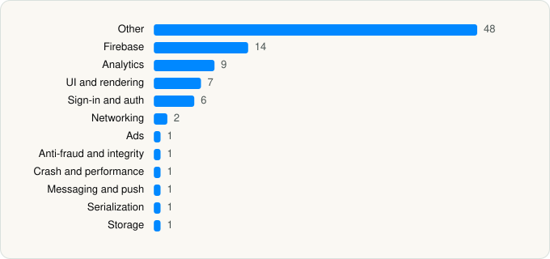

<picture><source media="(prefers-color-scheme: dark)" srcset="../../../../assets/logo/logo-dark.svg"></picture> [Tech Stack](../../../../README.md) / [Distribuidora Liverpool S.A. De C.V.](../../../../companies/distribuidora-liverpool-s-a-de-c-v.md) / Liverpool

# Liverpool: Compra en línea

<picture><source media="(prefers-color-scheme: dark)" srcset="../../../../assets/badges/ios-dark.svg"></picture> <picture><source media="(prefers-color-scheme: dark)" srcset="../../../../assets/badges/inactive-dark.svg"></picture> <picture><source media="(prefers-color-scheme: dark)" srcset="../../../../assets/badges/floor-dark.svg"></picture> <picture><source media="(prefers-color-scheme: dark)" srcset="../../../../assets/badges/encrypted-dark.svg"></picture>

[App Store](https://apps.apple.com/app/id1148204349) · [latest.json](latest.json)

| | |
|---|---|
| Company | [Distribuidora Liverpool S.A. De C.V.](../../../../companies/distribuidora-liverpool-s-a-de-c-v.md) |
| Store id | `1148204349` |
| Bundle / package id | `mx.com.liverpool.appcliente` |
| Latest version | 10.9.5 (analysed 2026-11-14) |
| Versions tracked | 1 |
| SDKs in latest version | 92 |
| Languages | C/C++, Objective-C, Swift |
| UI | Lottie (animations), SwiftUI, UIKit |
| Build | Swift Package Manager (SwiftPM) |
| Minimum OS | iOS 15.0 (built with Xcode 27.1, SDK iphoneos27.1) |
| Devices / ABIs | iPhone |
| Localisations | 2 |
| Capabilities | 12 |
| Declares tracking | Yes |
| Tracked | No. Kept for history. |

## SDKs by category

<picture><source media="(prefers-color-scheme: dark)" srcset="../../../../assets/charts/apps/ios/distribuidora-liverpool-s-a-de-c-v/liverpool-dark.svg"></picture>

- **Other** (48): absl 1.20250512.2, abslWrapper, BambuserCommerceSDK 1.0, Cdp 3.0.2, D1 4.2.1, DespegarWebKit 3.5.6, Dynatrace 8.349.1, Eureka 5.3.6, Evergage 1.5.0, EzioMobile 1.0, FlixMediaSDK 1.0, GoogleTagManager 9.2.0, helper 1.0.4, HTMLKit 4.2.0, InAppMessagingFeatureSDK 1.0.0, IncdOnboarding 5.43.0, IQKeyboardManagerSwift 6.5.6, JewelSDK, JWTDecode 3.1.0, Kanna, KVNProgress 2.3.5, lib 1.2.2, MDFInternationalization 3.0.0, MDFTextAccessibility 2.0.1, MedalliaDigitalSDK 4.10.0, NVActivityIndicatorView 5.1.1, ObjectMapper 3.5.3, opensslWrapper, PocketClientVoice, PocketDesignSystem, PocketInsurancesiOS, PocketMisComprasiOS, Popover 1.3.0, PushFeatureSDK 2.0.0, QMNative 1.202609.0, QMNativeSwiftUI 1.0, SantaLetter, SecureLogAPI 1.5.0, SFMCSDK 4.0.2, SimpleKeychain 1.1.0, SpreadsheetView 0.9.1, SwiftKeychainWrapper 4.0.1, TMXBehavioSec 1.0, TMXProfiling 1.0, TMXProfilingConnections 1.0, UPCarouselFlowLayout 1.1.2, WebWidget 0.5.2, WultraSSLPinning 1.4.0
- **Firebase** (14): abseil, FBLPromises, Firebase, FirebaseAuth, FirebaseCore, FirebaseCoreInternal, FirebaseFirestore, FirebaseInstallations, FirebaseRemoteConfig, GoogleDataTransport, GoogleUtilities, gRPC, leveldb, nanopb
- **Analytics** (9): AppsFlyerLib 1.0, FacebookAEM, FacebookCore, FBAEMKit 1.0, FBSDKCoreKit 1.0, FirebaseAnalytics 13.0.1, GoogleAppMeasurement 13.0.1, GoogleAppMeasurementIdentitySupport 13.0.1, MarketingCloudSDK 11.0.2
- **UI and rendering** (7): FloatingPanel 2.8.6, Lottie 3.3.0, MaterialComponents 124.2.0, SDWebImage, SDWebImageSwiftUI, SnapKit 5.6.0, SwiftMessages 5.0.1
- **Sign-in and auth** (6): Auth0 2.8.0, FacebookLogin, FBSDKLoginKit 1.0, GTMSessionFetcher, OAuth2 5.3.1, TMXAuthentication 1.0
- **Networking** (2): Alamofire 3.6.0, RatingsAndReviewsNetworking 1.0.0
- **Ads** (1): GoogleAdsOnDeviceConversion 3.7.0
- **Anti-fraud and integrity** (1): Persona 1.0.0
- **Crash and performance** (1): FirebaseCrashlytics
- **Messaging and push** (1): FirebaseMessaging
- **Serialization** (1): SwiftyJSON 5.0.1
- **Storage** (1): StringPatternFormatter 1.0.3

Frameworks (34)

AdSupport (IDFA), App Tracking Transparency (ATT), Authentication Services (Sign in with Apple / passkeys), AVFoundation (audio/video), AVKit, CallKit (VoIP), Combine (reactive), Contacts, Core Data, Core Image, Core Location, Core ML, Core Motion, CryptoKit, DeviceCheck / App Attest, Local Authentication (Face ID / Touch ID), MapKit, MessageUI (mail / SMS compose), MetricKit (diagnostics), Network.framework, PassKit (Wallet / Apple Pay), PDFKit, Photos, PhotosUI, SafariServices, SiriKit (Intents), StoreKit (in-app purchase), SwiftData (persistence), SwiftUI, UIKit, User Notifications, Vision, VisionKit (document/data scanning), Watch Connectivity

Capabilities (12)

App Attest, App Groups, Apple Pay, Associated Domains (Universal Links), Background App Refresh, Background Audio, Background Location, Background Push, Keychain Sharing, Push Notifications (APNs), Sign in with Apple, VoIP

## Version history

| Version | Analysed | Store update | SDKs | Change | SDK list is a floor | Binary encrypted | File |
|---|---|---|---|---|---|---|---|
| 10.9.5 | 2026-11-14 |  | 92 |  | Yes | Yes | [10.9.5.json](10.9.5.json) |

---

Generated by `scripts/build_readme.py` from the JSON files. Do not edit by hand.
