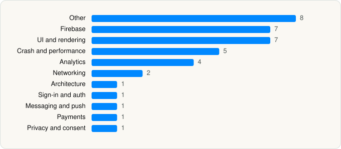

<picture><source media="(prefers-color-scheme: dark)" srcset="../../../../assets/logo/logo-dark.svg"></picture> [Tech Stack](../../../../README.md) / [Doctolib](../../../../companies/doctolib.md) / Doctolib

# Doctolib - Your health partner

<picture><source media="(prefers-color-scheme: dark)" srcset="../../../../assets/badges/ios-dark.svg"></picture> <picture><source media="(prefers-color-scheme: dark)" srcset="../../../../assets/badges/inactive-dark.svg"></picture> <picture><source media="(prefers-color-scheme: dark)" srcset="../../../../assets/badges/floor-dark.svg"></picture> <picture><source media="(prefers-color-scheme: dark)" srcset="../../../../assets/badges/encrypted-dark.svg"></picture>

[App Store](https://apps.apple.com/app/id925339063) · [latest.json](latest.json)

| | |
|---|---|
| Company | [Doctolib](../../../../companies/doctolib.md) |
| Store id | `925339063` |
| Bundle / package id | `fr.doctolib.www` |
| Latest version | 5.18.1 (analysed 2026-11-19) |
| Versions tracked | 1 |
| SDKs in latest version | 38 |
| Languages | C/C++, Metal (shaders), Objective-C, React Native / JavaScript, Swift |
| UI | Lottie (animations), SwiftUI, UIKit |
| Build | Swift Package Manager (SwiftPM) |
| Minimum OS | iOS 15.1 (built with Xcode 26.1.1, SDK iphoneos26.1) |
| Devices / ABIs | iPhone, iPad |
| Localisations | 3 |
| Capabilities | 8 |
| Declares tracking | Yes |
| Tracked | No. Kept for history. |

## SDKs by category

<picture><source media="(prefers-color-scheme: dark)" srcset="../../../../assets/charts/apps/ios/doctolib/doctolib-dark.svg"></picture>

- **Other** (8): dayjs, EXConstants 55.0.17, EXUpdates 55.0.30, hermesvm 0.12.0, Lodash, PurchasesHybridCommon 18.3.0, ReactNativeBlobUtilPrivacyInfo 0.19.11, Screeb 4.3.0
- **Firebase** (7): FBLPromises 2.4.1, FirebaseCore 12.10.0, FirebaseCoreInternal 12.10.0, FirebaseInstallations 12.10.0, GoogleDataTransport 10.1.1, GoogleUtilities 8.1.3, nanopb 3.30910.0
- **UI and rendering** (7): FlashList, Lottie 4.6.0, React Native, React Native Reanimated, react-native-svg, RNSVGFilters 15.15.3, SDWebImage 5.21.7
- **Crash and performance** (5): DatadogCore 3.16.0, DatadogCrashReporting 3.16.0, DatadogRUM 3.16.0, KSCrash 2.5.1, Sentry 9.15.0
- **Analytics** (4): Adjust 1.0, Amplitude, AppsFlyer, Mixpanel
- **Networking** (2): Axios, ReachabilitySwift 5.2.4
- **Architecture** (1): React Navigation
- **Sign-in and auth** (1): AppAuth 3.0.0
- **Messaging and push** (1): FirebaseMessaging 12.10.0
- **Payments** (1): RevenueCat
- **Privacy and consent** (1): Didomi 1.95.1

Frameworks (35)

ActivityKit (Live Activities), AdServices (Apple Search Ads attribution), AdSupport (IDFA), App Intents, Authentication Services (Sign in with Apple / passkeys), AVFoundation (audio/video), AVKit, Combine (reactive), Core Bluetooth, Core Data, Core Image, Core Location, Core Motion, CryptoKit, EventKit (Calendar / Reminders), HealthKit, Local Authentication (Face ID / Touch ID), Media Player, MessageUI (mail / SMS compose), MetalKit, MetricKit (diagnostics), Network.framework, PDFKit, Photos, PhotosUI, SafariServices, SiriKit (Intents), Speech (recognition), StoreKit (in-app purchase), Swift Charts, SwiftUI, UIKit, User Notifications, VisionKit (document/data scanning), WidgetKit (widgets)

Capabilities (8)

App Groups, Associated Domains (Universal Links), Background App Refresh, Background Audio, Background Push, HealthKit, Push Notifications (APNs), Time-Sensitive Notifications

## Version history

| Version | Analysed | Store update | SDKs | Change | SDK list is a floor | Binary encrypted | File |
|---|---|---|---|---|---|---|---|
| 5.18.1 | 2026-11-19 |  | 38 |  | Yes | Yes | [5.18.1.json](5.18.1.json) |

---

Generated by `scripts/build_readme.py` from the JSON files. Do not edit by hand.
