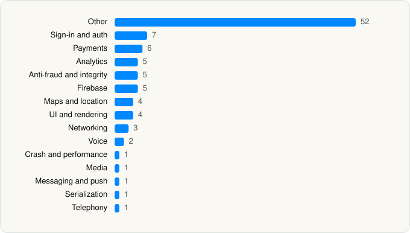

<picture><source media="(prefers-color-scheme: dark)" srcset="../../../../assets/logo/logo-dark.svg"></picture> [Tech Stack](../../../../README.md) / [DoorDash, Inc.](../../../../companies/doordash-inc.md) / DoorDash

# DoorDash: Food, Grocery, More

<picture><source media="(prefers-color-scheme: dark)" srcset="../../../../assets/badges/ios-dark.svg"></picture> <picture><source media="(prefers-color-scheme: dark)" srcset="../../../../assets/badges/active-dark.svg"></picture> <picture><source media="(prefers-color-scheme: dark)" srcset="../../../../assets/badges/floor-dark.svg"></picture> <picture><source media="(prefers-color-scheme: dark)" srcset="../../../../assets/badges/encrypted-dark.svg"></picture>

[App Store](https://apps.apple.com/app/id719972451) · [latest.json](latest.json)

| | |
|---|---|
| Company | [DoorDash, Inc.](../../../../companies/doordash-inc.md) |
| Store id | `719972451` |
| Bundle / package id | `doordash.DoorDashConsumer` |
| Latest version | 8.41.0 (analysed 2026-10-24) |
| Versions tracked | 1 |
| SDKs in latest version | 98 |
| Languages | C/C++, Metal (shaders), Objective-C, Swift |
| UI | Lottie (animations), SwiftUI, UIKit |
| Build | Swift Package Manager (SwiftPM) |
| Minimum OS | iOS 18.0 (built with Xcode 26.6, SDK iphoneos26.5) |
| Devices / ABIs | iPhone |
| Localisations | 6 |
| Capabilities | 16 |
| Declares tracking | Yes |
| Tracked | Yes |

## SDKs by category

<picture><source media="(prefers-color-scheme: dark)" srcset="../../../../assets/charts/apps/ios/doordash-inc/doordash-dark.svg"></picture>

- **Other** (52): AddressModule, AppFeedback, AppIntegrationConsumer, CommonModelsService, ConvenienceModule, DashPassModule, DDChat, DDCMSUI, DebugTools, DefaultTheme 1.0, ForageSDK, FTRAuth 1.0.2, FTRCommon 1.0.2, GiftCardModule, IdentityService, IdentityServiceCore, MagicCamera, Maps, MapsCore, Mosaic, MosaicPedregalStoreWebServicePrivate, MosaicSandbox, NomiSDUIService, NomiShopperModule, OrderTrackerServiceTestSupport, OrderTrackingContentServicePrivate, PayWithMyBank 2.3.0, PCIDframe 1.0, PedregalFeedWebServicePrivate, PedregalSearchWebServicePrivate, PickupModule, Prism, PrismIcons, PrismIconsConsumer, PrismTokens, PrismTokensConsumer, RLTMXProfiling 1.0, SelfHelp, SendBirdSDK 3.1.60, ShopAndDeliverShared, SignifydProfilingSdk 1.0, UnifiedADPPrivate, UnifiedConsumerBrandedAssetsConsumer, UnifiedConsumerLocalizations, UnifiedLiveActivityViews, UnifiedOrderTrackingPrivate, UnifiedReturnsReceiptCapture, UnifiedStoreCardLocalization, UnifiedStorePrivate, UnifiedUGCSubmissionPrivate, UserLocationSharingModule, VGSCollectSDK
- **Sign-in and auth** (7): AppAuth, FacebookLogin, FBSDKLoginKit 1.0, GoogleSignIn, GTMAppAuth, GTMSessionFetcher, MultiFactorAuthentication
- **Payments** (6): Braintree, MosaicCheckoutNetworking, Payments, PaymentSDK 1.5.4, PostCheckoutModule, Stripe
- **Analytics** (5): FacebookAEM, FacebookCore, FBAEMKit 1.0, FBSDKCoreKit 1.0, FullStory 1.65.1
- **Anti-fraud and integrity** (5): DyScanFraud 1.0, Forter 3.0.4, Fraud, Persona2, RiskifiedBeacon 1.0
- **Firebase** (5): FBLPromises, FirebaseCore, FirebaseCoreInternal, FirebaseInstallations, GoogleUtilities 1.0
- **Maps and location** (4): GMSCore 25.23.0, GoogleMaps, Mapbox 23.12.1, MapboxMaps
- **UI and rendering** (4): Highlight.js 11.9.0, HighlightSwift, iosMath, Lottie 4.5.2
- **Networking** (3): CityFulfillmentNetworkingTestSupport, ConsumerCoreNetworkingTestSupport, PedregalNetworking
- **Voice** (2): TwilioVoice 6.10.0, VoipCallingUI
- **Crash and performance** (1): Instabug 16.0.2
- **Media** (1): SwiftStreamingMarkdown
- **Messaging and push** (1): Iterable
- **Serialization** (1): SwiftProtobuf
- **Telephony** (1): PhoneNumberKit

Frameworks (45)

ActivityKit (Live Activities), AdServices (Apple Search Ads attribution), AdSupport (IDFA), App Intents, App Tracking Transparency (ATT), Authentication Services (Sign in with Apple / passkeys), AVFoundation (audio/video), AVKit, Background Tasks, CallKit (VoIP), Combine (reactive), Contacts, Core Bluetooth, Core Data, Core Image, Core Location, Core ML, Core Motion, Core NFC, CryptoKit, DeviceCheck / App Attest, Local Authentication (Face ID / Touch ID), MapKit, MessageUI (mail / SMS compose), MetalKit, MetricKit (diagnostics), Network.framework, PassKit (Wallet / Apple Pay), PDFKit, PencilKit, Photos, PhotosUI, PushKit (VoIP push), SafariServices, SceneKit, SiriKit (Intents), Speech (recognition), StoreKit (in-app purchase), Swift Charts, SwiftUI, UIKit, User Notifications, Vision, VisionKit (document/data scanning), WidgetKit (widgets)

Capabilities (16)

App Attest, App Groups, Apple Pay, Associated Domains (Universal Links), Background App Refresh, Background Audio, Background Location, Background Push, Bluetooth (central), Keychain Sharing, NFC, Push Notifications (APNs), Sign in with Apple, Time-Sensitive Notifications, VoIP, Wallet passes

## Version history

| Version | Analysed | Store update | SDKs | Change | SDK list is a floor | Binary encrypted | File |
|---|---|---|---|---|---|---|---|
| 8.41.0 | 2026-10-24 | 2026-10-19 | 98 |  | Yes | Yes | [8.41.0.json](8.41.0.json) |

---

Generated by `scripts/build_readme.py` from the JSON files. Do not edit by hand.
