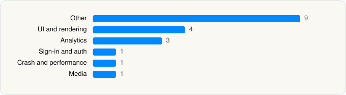

<picture><source media="(prefers-color-scheme: dark)" srcset="../../../../assets/logo/logo-dark.svg"></picture> [Tech Stack](../../../../README.md) / [Dropbox, Inc.](../../../../companies/dropbox-inc.md) / Dropbox

# Dropbox: Cloud Storage Backup

<picture><source media="(prefers-color-scheme: dark)" srcset="../../../../assets/badges/ios-dark.svg"></picture> <picture><source media="(prefers-color-scheme: dark)" srcset="../../../../assets/badges/inactive-dark.svg"></picture> <picture><source media="(prefers-color-scheme: dark)" srcset="../../../../assets/badges/floor-dark.svg"></picture> <picture><source media="(prefers-color-scheme: dark)" srcset="../../../../assets/badges/encrypted-dark.svg"></picture>

[App Store](https://apps.apple.com/app/id327630330) · [latest.json](latest.json)

| | |
|---|---|
| Company | [Dropbox, Inc.](../../../../companies/dropbox-inc.md) |
| Store id | `327630330` |
| Bundle / package id | `com.getdropbox.Dropbox` |
| Latest version | 476.2 (analysed 2026-06-23) |
| Versions tracked | 2 |
| SDKs in latest version | 19 |
| Languages | C/C++, Metal (shaders), Objective-C, Swift |
| UI | SwiftUI, UIKit |
| Build | Swift Package Manager (SwiftPM) |
| Minimum OS | iOS 16.7.10 (built with Xcode 26.5, SDK iphoneos26.5) |
| Devices / ABIs | iPhone, iPad |
| Localisations | 22 |
| Capabilities | 12 |
| Declares tracking | No |
| Tracked | No. Kept for history. |

## SDKs by category

<picture><source media="(prefers-color-scheme: dark)" srcset="../../../../assets/charts/apps/ios/dropbox-inc/dropbox-dark.svg"></picture>

- **Other** (9): TreeSitterBashQueries, TreeSitterCQueries, TreeSitterCSSQueries, TreeSitterHTMLQueries, TreeSitterJavaQueries, TreeSitterJavaScriptQueries, TreeSitterJSONQueries, TreeSitterPythonQueries, TreeSitterTOMLQueries
- **UI and rendering** (4): PSPDFKit 26.4.0, PSPDFKitUI 0, TreeSitterMarkdownInlineQueries, TreeSitterMarkdownQueries
- **Analytics** (3): Adjust 1.0, MUXSDKStats 4.8.2, UserLeapKit 4.8.5
- **Sign-in and auth** (1): GoogleSignIn 6.0.2
- **Crash and performance** (1): Sentry 9.8.0
- **Media** (1): MuxCore 5.6.0

Frameworks (38)

AdServices (Apple Search Ads attribution), AdSupport (IDFA), App Tracking Transparency (ATT), Authentication Services (Sign in with Apple / passkeys), AVFoundation (audio/video), AVKit, Background Tasks, CloudKit, Combine (reactive), Contacts, Core Data, Core Image, Core Location, Core Motion, CryptoKit, DeviceCheck / App Attest, Local Authentication (Face ID / Touch ID), MapKit, Media Player, MessageUI (mail / SMS compose), MetalKit, MetricKit (diagnostics), Natural Language, Network.framework, PDFKit, Photos, PhotosUI, SafariServices, SiriKit (Intents), Speech (recognition), StoreKit (in-app purchase), SwiftData (persistence), SwiftUI, UIKit, User Notifications, Vision, VisionKit (document/data scanning), WidgetKit (widgets)

Capabilities (12)

App Groups, Associated Domains (Universal Links), Background App Refresh, Background Audio, Background Processing, Background Push, CloudKit, iCloud, Keychain Sharing, Push Notifications (APNs), Sign in with Apple, SiriKit

## Version history

| Version | Analysed | Store update | SDKs | Change | SDK list is a floor | Binary encrypted | File |
|---|---|---|---|---|---|---|---|
| 476.2 | 2026-06-23 |  | 19 | +0 / −0 | Yes | Yes | [476.2.json](476.2.json) |
| 474.4 | 2026-06-09 |  | 19 |  | Yes | Yes | [474.4.json](474.4.json) |

## Model-written summary

> Hybrid SwiftUI/UIKit Dropbox iOS client with FileProvider/Widgets extensions, PSPDFKit, TreeSitter parsers, 2 Metal shaders, Amplitude and Firebase

Written by a language model from the detected signals (`inferred[]`). It is commentary, not measurement.

---

Generated by `scripts/build_readme.py` from the JSON files. Do not edit by hand.
