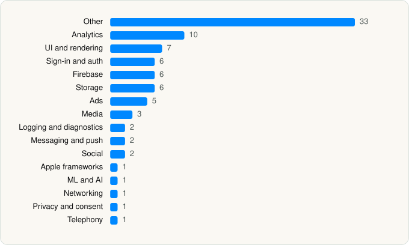

<picture><source media="(prefers-color-scheme: dark)" srcset="../../../../assets/logo/logo-dark.svg"></picture> [Tech Stack](../../../../README.md) / [Duolingo](../../../../companies/duolingo.md) / Duolingo

# Duolingo: Learn Languages

<picture><source media="(prefers-color-scheme: dark)" srcset="../../../../assets/badges/ios-dark.svg"></picture> <picture><source media="(prefers-color-scheme: dark)" srcset="../../../../assets/badges/inactive-dark.svg"></picture> <picture><source media="(prefers-color-scheme: dark)" srcset="../../../../assets/badges/floor-dark.svg"></picture> <picture><source media="(prefers-color-scheme: dark)" srcset="../../../../assets/badges/encrypted-dark.svg"></picture>

[App Store](https://apps.apple.com/app/id570060128) · [latest.json](latest.json)

| | |
|---|---|
| Company | [Duolingo](../../../../companies/duolingo.md) |
| Store id | `570060128` |
| Bundle / package id | `com.duolingo.DuolingoMobile` |
| Latest version | 7.145.1 (analysed 2026-10-24) |
| Versions tracked | 1 |
| SDKs in latest version | 87 |
| Languages | C/C++, Kotlin Multiplatform, Objective-C, React Native / JavaScript, Swift, Unity (C# / IL2CPP) |
| UI | Lottie (animations), SwiftUI, UIKit |
| Build | Swift Package Manager (SwiftPM) |
| Minimum OS | iOS 17.0 (built with Xcode 26.5, SDK iphoneos26.5) |
| Devices / ABIs | iPhone, iPad |
| Localisations | 35 |
| Capabilities | 14 |
| Declares tracking | Yes |
| Tracked | No. Kept for history. |

## SDKs by category

<picture><source media="(prefers-color-scheme: dark)" srcset="../../../../assets/charts/apps/ios/duolingo/duolingo-dark.svg"></picture>

- **Other** (33): AdsGlobalPackage, BUAdSDK 7.2.1, Clocks 1.0, ConfiantSDK 6.1.4, ContextSDK 5.16.0, ContextSDKExtension 5.16.0, CSJAdSDK 7.2.1, Dependencies 1.0, Excess 1.0, IronSource 9.4.1, IronSourceAdapter 9.4.0, IronSourceAdQualitySDK 7.24.1, IssueReporting 1.0, LiftoffMonetizeAdapter 7.7.0, MetaAdapter 6.21.1, MolocoAdapter 1.0, Mutex 1.0, Newtonsoft.Json, ogg 1.0, OpenSSL 3.1.5007, opus 1.0, PAGAdSDK 7.6.6, PangleAdapter 7.8.5, Prebidorg 1.5.5, SnapshotPreferences 1.0, Tagged 1.0, UID2, UID2GMAPlugin, UnityAdapter 4.16.6, UnityAds 1.0, VungleAdsSDK 1.0, XCTestDynamicOverlay 1.0, XiaoHongShuOpenSDK 1.2.4
- **Analytics** (10): Adjust 1.0, AdjustSdk, FacebookAEM, FacebookCore, FBAEMKit 1.0, FBSDKCoreKit 1.0, FirebaseAnalytics 12.19.2, FullStory 1.64.2, GoogleAppMeasurement 12.19.2, GoogleAppMeasurementIdentitySupport 12.19.2
- **UI and rendering** (7): DGCharts, Lottie 1.0, RiveRuntime 6.27.0, SnapKit, SwiftMath, Unity TextMeshPro, Unity Universal Render Pipeline
- **Sign-in and auth** (6): AppAuth, FacebookLogin, FBSDKLoginKit 1.0, GoogleSignIn, GTMAppAuth, GTMSessionFetcher
- **Firebase** (6): FBLPromises, FirebaseCore, FirebaseCoreInternal, FirebaseInstallations, GoogleUtilities, nanopb
- **Storage** (6): GRDB, GZIP 1.0, Realm 1.0, Unity Addressables, Unity ResourceManager, ZIPFoundation
- **Ads** (5): FBAudienceNetwork 1.0, Google Mobile Ads (AdMob), GoogleAdsOnDeviceConversion 3.7.0, GoogleMobileAds 13.4.0, MolocoSDK 4.5.1
- **Media** (3): Autodesk FBX, GoogleInteractiveMediaAds 3.31.0, Unity Timeline
- **Logging and diagnostics** (2): CocoaLumberjack, Graphy (perf HUD)
- **Messaging and push** (2): SupportProvidersSDK 8.0.2, ZendeskCoreSDK 5.0.2
- **Social** (2): FacebookShare, FBSDKShareKit 1.0
- **Apple frameworks** (1): DequeModule 1.0
- **ML and AI** (1): UnityFramework 1.0
- **Networking** (1): Ably
- **Privacy and consent** (1): UserMessagingPlatform 3.1.0
- **Telephony** (1): PhoneNumberKit

Frameworks (43)

ActivityKit (Live Activities), AdServices (Apple Search Ads attribution), AdSupport (IDFA), App Intents, App Tracking Transparency (ATT), Authentication Services (Sign in with Apple / passkeys), AVFoundation (audio/video), AVKit, Background Tasks, CallKit (VoIP), Combine (reactive), Contacts, Core Data, Core Image, Core Location, Core ML, Core Motion, CryptoKit, DeviceCheck / App Attest, EventKit (Calendar / Reminders), Family Controls / Screen Time, Local Authentication (Face ID / Touch ID), Media Player, MessageUI (mail / SMS compose), MetalKit, MetricKit (diagnostics), Natural Language, Network.framework, PassKit (Wallet / Apple Pay), PDFKit, PencilKit, Photos, PhotosUI, SafariServices, SiriKit (Intents), Speech (recognition), StoreKit (in-app purchase), Swift Charts, SwiftUI, UIKit, User Notifications, Watch Connectivity, WidgetKit (widgets)

Capabilities (14)

App Attest, App Groups, Apple Pay, Associated Domains (Universal Links), Background App Refresh, Background Audio, Background Processing, Background Push, Communication Notifications, Family Controls / Screen Time, Keychain Sharing, Push Notifications (APNs), Sign in with Apple, Time-Sensitive Notifications

## Version history

| Version | Analysed | Store update | SDKs | Change | SDK list is a floor | Binary encrypted | File |
|---|---|---|---|---|---|---|---|
| 7.145.1 | 2026-10-24 | 2026-10-21 | 87 |  | Yes | Yes | [7.145.1.json](7.145.1.json) |

---

Generated by `scripts/build_readme.py` from the JSON files. Do not edit by hand.
