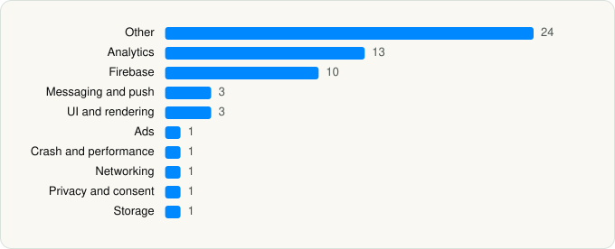

<picture><source media="(prefers-color-scheme: dark)" srcset="../../../../assets/logo/logo-dark.svg"></picture> [Tech Stack](../../../../README.md) / [El Corte Ingles S.A.](../../../../companies/el-corte-ingles-s-a.md) / El Corte Inglés

# El Corte Inglés

<picture><source media="(prefers-color-scheme: dark)" srcset="../../../../assets/badges/ios-dark.svg"></picture> <picture><source media="(prefers-color-scheme: dark)" srcset="../../../../assets/badges/inactive-dark.svg"></picture> <picture><source media="(prefers-color-scheme: dark)" srcset="../../../../assets/badges/floor-dark.svg"></picture> <picture><source media="(prefers-color-scheme: dark)" srcset="../../../../assets/badges/encrypted-dark.svg"></picture>

[App Store](https://apps.apple.com/app/id1497498548) · [latest.json](latest.json)

| | |
|---|---|
| Company | [El Corte Ingles S.A.](../../../../companies/el-corte-ingles-s-a.md) |
| Store id | `1497498548` |
| Bundle / package id | `com.elcorteingles.mobilestore` |
| Latest version | 4.40.1 (analysed 2026-11-27) |
| Versions tracked | 1 |
| SDKs in latest version | 58 |
| Languages | C/C++, Objective-C, Swift |
| UI | Lottie (animations), SwiftUI, UIKit |
| Build | Swift Package Manager (SwiftPM) |
| Minimum OS | iOS 17.0 (built with Xcode 26.5, SDK iphoneos26.5) |
| Devices / ABIs | iPhone, iPad |
| Localisations | 2 |
| Capabilities | 9 |
| Declares tracking | Yes |
| Tracked | No. Kept for history. |

## SDKs by category

<picture><source media="(prefers-color-scheme: dark)" srcset="../../../../assets/charts/apps/ios/el-corte-ingles-s-a/el-corte-ingl-s-dark.svg"></picture>

- **Other** (24): ECICess 1.1.0, ECICommon 1.3.0, ECICommonUI 1.2.0, ECICookies 1.1.0, ECICore 0.1.0, ECIDesignSystem 0.1.0, ECIDomain 0.1.0, ECIFeatures 0.1.0, ECIFeaturesLegacy 0.1.0, ECINavigation 0.1.0, ECINetworkClient 1.0.0, ECIPrimaveraDesignSystem 1.12.0, ECIResourcesLegacy 0.1.0, ECISupermarket 2.12.0, ECITelecor 1.2.1, ECIUserSession 1.4.0, SFMCSDK 2.0.1, SMIMultimediaCommon 1.12.0, TMXProfiling 1.0, TMXProfiling-companion 1.0, TMXProfilingConnections 1.0, TMXProfilingConnections-companion 1.0, TSHPaySDK 7.3.0, UsizyIosSdk
- **Analytics** (13): AEPCore, AEPServices, ECIAnalytics 2.0.0, FacebookAEM, FacebookCore, FBAEMKit 1.0, FBSDKCoreKit 1.0, FirebaseAnalytics 12.19.2, FullStory 1.73.2, GoogleAppMeasurement 12.19.2, GoogleAppMeasurementIdentitySupport 12.19.2, MarketingCloudSDK 9.0.3, Singular 1.0
- **Firebase** (10): FBLPromises, Firebase, FirebaseCore, FirebaseCoreInternal, FirebaseInstallations, FirebaseRemoteConfig, GoogleDataTransport, GoogleUtilities, nanopb, Promises
- **Messaging and push** (3): FirebaseMessaging, SMIClientCore 1.12.1, SMIClientUI 1.12.1
- **UI and rendering** (3): Kingfisher 8.13.0, Lottie 4.6.1, SVGKit.PrivacyInfo 3.1.5
- **Ads** (1): GoogleAdsOnDeviceConversion 3.7.0
- **Crash and performance** (1): FirebaseCrashlytics
- **Networking** (1): Alamofire 5.12.0
- **Privacy and consent** (1): OTPublishersHeadlessSDK 202609.2.0
- **Storage** (1): SQLCipher 1.0

Frameworks (28)

AdSupport (IDFA), App Tracking Transparency (ATT), Authentication Services (Sign in with Apple / passkeys), AVFoundation (audio/video), CallKit (VoIP), Combine (reactive), Core Data, Core Image, Core Location, Core Motion, Core NFC, CryptoKit, EventKit (Calendar / Reminders), Local Authentication (Face ID / Touch ID), MapKit, MessageUI (mail / SMS compose), MetricKit (diagnostics), Network.framework, PDFKit, Photos, PhotosUI, SafariServices, StoreKit (in-app purchase), SwiftUI, UIKit, User Notifications, Vision, WidgetKit (widgets)

Capabilities (9)

App Groups, Associated Domains (Universal Links), AutoFill Credentials, Background App Refresh, Background Audio, Background Location, Background Push, Push Notifications (APNs), VoIP

## Version history

| Version | Analysed | Store update | SDKs | Change | SDK list is a floor | Binary encrypted | File |
|---|---|---|---|---|---|---|---|
| 4.40.1 | 2026-11-27 |  | 58 |  | Yes | Yes | [4.40.1.json](4.40.1.json) |

---

Generated by `scripts/build_readme.py` from the JSON files. Do not edit by hand.
