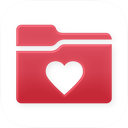

<picture><source media="(prefers-color-scheme: dark)" srcset="../../../../assets/logo/logo-dark.svg"></picture> [Tech Stack](../../../../README.md) / [Epic](../../../../companies/epic.md) / MyChart

# MyChart

<picture><source media="(prefers-color-scheme: dark)" srcset="../../../../assets/badges/ios-dark.svg"></picture> <picture><source media="(prefers-color-scheme: dark)" srcset="../../../../assets/badges/active-dark.svg"></picture> <picture><source media="(prefers-color-scheme: dark)" srcset="../../../../assets/badges/floor-dark.svg"></picture> <picture><source media="(prefers-color-scheme: dark)" srcset="../../../../assets/badges/encrypted-dark.svg"></picture>

[App Store](https://apps.apple.com/app/id382952264) · [latest.json](latest.json)

| | |
|---|---|
| Company | [Epic](../../../../companies/epic.md) |
| Store id | `382952264` |
| Bundle / package id | `com.epic.mychart` |
| Latest version | 11.9.5 (analysed 2026-11-02) |
| Versions tracked | 1 |
| SDKs in latest version | 0 |
| Languages | C/C++, Objective-C, Swift |
| UI | SwiftUI, UIKit |
| Build | Unknown / Xcode native |
| Minimum OS | iOS 18.0 (built with Xcode 26.4.1, SDK iphoneos26.4) |
| Devices / ABIs | iPhone, iPad |
| Localisations | 20 |
| Capabilities | 7 |
| Declares tracking | No |
| Tracked | Yes |

Frameworks (24)

ActivityKit (Live Activities), Authentication Services (Sign in with Apple / passkeys), AVFoundation (audio/video), AVKit, Combine (reactive), Core Bluetooth, Core Image, Core Location, Core Motion, CryptoKit, EventKit (Calendar / Reminders), HealthKit, Local Authentication (Face ID / Touch ID), Media Player, Network.framework, PassKit (Wallet / Apple Pay), SafariServices, Speech (recognition), StoreKit (in-app purchase), SwiftUI, UIKit, User Notifications, Watch Connectivity, WidgetKit (widgets)

Capabilities (7)

App Groups, Associated Domains (Universal Links), Background Audio, Background Processing, Bluetooth (central), HealthKit, Push Notifications (APNs)

## Version history

| Version | Analysed | Store update | SDKs | Change | SDK list is a floor | Binary encrypted | File |
|---|---|---|---|---|---|---|---|
| 11.9.5 | 2026-11-02 | 2026-10-26 | 0 |  | Yes | Yes | [11.9.5.json](11.9.5.json) |

---

Generated by `scripts/build_readme.py` from the JSON files. Do not edit by hand.
