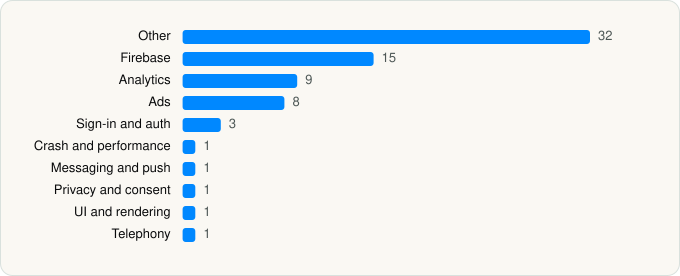

<picture><source media="(prefers-color-scheme: dark)" srcset="../../../../assets/logo/logo-dark.svg"></picture> [Tech Stack](../../../../README.md) / [Esame Marketing Limited](../../../../companies/esame-marketing-limited.md) / iAmor Family Location Tracker

# iAmor Family Location Tracker

<picture><source media="(prefers-color-scheme: dark)" srcset="../../../../assets/badges/ios-dark.svg"></picture> <picture><source media="(prefers-color-scheme: dark)" srcset="../../../../assets/badges/active-dark.svg"></picture> <picture><source media="(prefers-color-scheme: dark)" srcset="../../../../assets/badges/floor-dark.svg"></picture> <picture><source media="(prefers-color-scheme: dark)" srcset="../../../../assets/badges/encrypted-dark.svg"></picture>

[App Store](https://apps.apple.com/app/id6759792530) · [latest.json](latest.json)

| | |
|---|---|
| Company | [Esame Marketing Limited](../../../../companies/esame-marketing-limited.md) |
| Store id | `6759792530` |
| Bundle / package id | `com.amor.findphone.familylocation` |
| Latest version | 1.0.6 (analysed 2026-11-06) |
| Versions tracked | 1 |
| SDKs in latest version | 72 |
| Languages | C/C++, Objective-C, Swift |
| UI | Lottie (animations), SwiftUI, UIKit |
| Build | Swift Package Manager (SwiftPM) |
| Minimum OS | iOS 15.6 (built with Xcode 26.6, SDK iphoneos26.5) |
| Devices / ABIs | iPhone |
| Localisations | 23 |
| Capabilities | 4 |
| Declares tracking | Yes |
| Tracked | Yes |

## SDKs by category

<picture><source media="(prefers-color-scheme: dark)" srcset="../../../../assets/charts/apps/ios/esame-marketing-limited/iamor-family-location-tracker-dark.svg"></picture>

- **Other** (32): absl 1.20240722.0, abslWrapper, AdsGlobalPackage, IAAAdCore, IAAAdTradPlus, InMobiAdapter 11.3.0, IronSource 9.4.2, IronSourceAdapter 9.4.1, LiftoffMonetizeAdapter 7.7.4, MetaAdapter 6.21.1, MintegralAdapter 8.1.5, MintegralAdSDK, MTGSDK 1.0, MTGSDKBanner 1.0, MTGSDKBidding 1.0, MTGSDKNativeAdvanced 1.0, MTGSDKReward 1.0, MTGSDKSplash 1.0, opensslWrapper, PAGAdSDK 8.1.9, PangleAdapter 8.1.0, TPAdMobAdapter 15.10.0, TPAppLovinAdapter 15.10.0, TPCrossAdapter 15.10.0, TPFacebookAdapter 15.10.0, TPInMobiAdapter 15.10.0, TPIronSourceAdapter 15.10.0, TPMintegralAdapter 15.10.0, TPPangleAdapter 15.10.0, TPVungleAdapter 15.10.0, TradPlusAds 15.10.0, VungleAdsSDK 1.0
- **Firebase** (15): abseil, FBLPromises, Firebase, FirebaseAuth, FirebaseCore, FirebaseCoreInternal, FirebaseFirestore, FirebaseInstallations, FirebaseRemoteConfig, GoogleDataTransport, GoogleUtilities, gRPC, leveldb, nanopb, Promises
- **Analytics** (9): AppsFlyerLib 1.0, FacebookAEM, FacebookCore, FBAEMKit 1.0, FBSDKCoreKit 1.0, FirebaseAnalytics 12.17.0, GoogleAppMeasurement 12.17.0, GoogleAppMeasurementIdentitySupport 12.17.0, NexadAnalyticsCore
- **Ads** (8): AppLovin 13.6.3, FBAudienceNetwork 1.0, Google Mobile Ads (AdMob), GoogleAdsOnDeviceConversion 3.6.0, GoogleMobileAds 13.5.0, InMobiSDK 11.3.0, MTGSDKInterstitialVideo 1.0, MTGSDKNewInterstitial 1.0
- **Sign-in and auth** (3): FacebookLogin, FBSDKLoginKit 1.0, GTMSessionFetcher
- **Crash and performance** (1): FirebaseCrashlytics
- **Messaging and push** (1): FirebaseMessaging
- **Privacy and consent** (1): UserMessagingPlatform 3.1.0
- **UI and rendering** (1): Lottie
- **Telephony** (1): PhoneNumberKit

Frameworks (26)

AdServices (Apple Search Ads attribution), AdSupport (IDFA), App Tracking Transparency (ATT), Authentication Services (Sign in with Apple / passkeys), AVFoundation (audio/video), Combine (reactive), Contacts, Core Image, Core Location, Core ML, Core Motion, CryptoKit, DeviceCheck / App Attest, EventKit (Calendar / Reminders), MapKit, Media Player, MessageUI (mail / SMS compose), MetricKit (diagnostics), Network.framework, Photos, PhotosUI, SafariServices, StoreKit (in-app purchase), SwiftUI, UIKit, User Notifications

Capabilities (4)

Associated Domains (Universal Links), Background Location, Background Push, Push Notifications (APNs)

## Version history

| Version | Analysed | Store update | SDKs | Change | SDK list is a floor | Binary encrypted | File |
|---|---|---|---|---|---|---|---|
| 1.0.6 | 2026-11-06 |  | 72 |  | Yes | Yes | [1.0.6.json](1.0.6.json) |

---

Generated by `scripts/build_readme.py` from the JSON files. Do not edit by hand.
