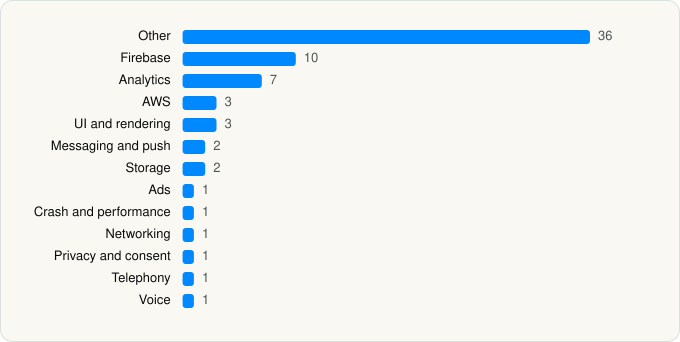

<picture><source media="(prefers-color-scheme: dark)" srcset="../../../../assets/logo/logo-dark.svg"></picture> [Tech Stack](../../../../README.md) / [FIFA](../../../../companies/fifa.md) / FIFA World Cup 2026™

# FIFA World Cup 2026™

<picture><source media="(prefers-color-scheme: dark)" srcset="../../../../assets/badges/ios-dark.svg"></picture> <picture><source media="(prefers-color-scheme: dark)" srcset="../../../../assets/badges/inactive-dark.svg"></picture> <picture><source media="(prefers-color-scheme: dark)" srcset="../../../../assets/badges/floor-dark.svg"></picture> <picture><source media="(prefers-color-scheme: dark)" srcset="../../../../assets/badges/encrypted-dark.svg"></picture>

[App Store](https://apps.apple.com/app/id6476561442) · [latest.json](latest.json)

| | |
|---|---|
| Company | [FIFA](../../../../companies/fifa.md) |
| Store id | `6476561442` |
| Bundle / package id | `com.fifa.tournament` |
| Latest version | 3.1.1 (analysed 2026-06-23) |
| Versions tracked | 1 |
| SDKs in latest version | 69 |
| Languages | C/C++, Flutter / Dart, Objective-C, Swift |
| UI | Lottie (animations), SwiftUI, UIKit |
| Build | Swift Package Manager (SwiftPM) |
| Minimum OS | iOS 17.0 (built with Xcode 26.3, SDK iphoneos26.2) |
| Devices / ABIs | iPhone |
| Localisations | 7 |
| Capabilities | 6 |
| Declares tracking | Yes |
| Tracked | No. Kept for history. |

## SDKs by category

<picture><source media="(prefers-color-scheme: dark)" srcset="../../../../assets/charts/apps/ios/fifa/fifa-world-cup-2026-dark.svg"></picture>

- **Other** (36): AMBClient 1.0.1, BDPointSDK 17.2.0, connector 0.0.1, contacts 0.0.1, CryptoSwift 1.8.4, darwin 0.0.4, decrypter 0.0.1, device 1.0.0, DTTJailbreakDetection 0.4.0, FanZone 4.1.9, Flutter 1.0, foundation 0.0.1, integration 0.0.1, libs 0.0.1, Lokalise 1.0.2, manager 0.0.1, NowChat 1.0.0, NowData 1.0.0, NowFoundation 1.0, NowLocalization 1.0, NowPush 1.0.0, NowSDK 2.20.0, NowUI 1.0, NowWeb 1.0.0, OrderedSet 6.0.3, plus 0.0.1, prevention 0.0.1, review 2.0.0, SnowChat 1, SpeakNow 0.2.15, storage 6.0.0, suppression 0.0.1, THEOplayerSDK 10.3.0, tixsiphash 0.0.1, uptime 0.0.1, wkwebview 0.0.1
- **Firebase** (10): FBLPromises, Firebase, FirebaseCore, FirebaseCoreInternal, FirebaseInstallations, FirebaseRemoteConfig, GoogleDataTransport, GoogleUtilities, nanopb, Promises
- **Analytics** (7): AEPCore, AEPServices, AppsFlyerLib 1.0, FirebaseAnalytics 12.0.0, GoogleAppMeasurement 12.0.0, GoogleAppMeasurementIdentitySupport 12.0.0, NowAnalytics 1.0
- **AWS** (3): AWSCognitoIdentityProvider 2.36.1, AWSCognitoIdentityProviderASF 2.36.1, AWSCore 2.36.1
- **UI and rendering** (3): Kingfisher, Lottie 4.5.2, PocketSVG
- **Messaging and push** (2): Airship, FirebaseMessaging
- **Storage** (2): KeychainSwift 19.0.0, ObjectBox 1.0
- **Ads** (1): GoogleAdsOnDeviceConversion 2.1.0
- **Crash and performance** (1): FirebaseCrashlytics
- **Networking** (1): NowNetworking 1.0.0
- **Privacy and consent** (1): OTPublishersHeadlessSDK 202601.1.0
- **Telephony** (1): PhoneNumberKit 3.6.6
- **Voice** (1): WebRTC 1.0

Frameworks (31)

ActivityKit (Live Activities), App Tracking Transparency (ATT), Authentication Services (Sign in with Apple / passkeys), AVFoundation (audio/video), AVKit, Combine (reactive), Contacts, Core Data, Core Image, Core Location, Core Motion, Core NFC, CryptoKit, Local Authentication (Face ID / Touch ID), MapKit, Media Player, MetalKit, MetricKit (diagnostics), Network.framework, PassKit (Wallet / Apple Pay), PDFKit, PencilKit, Photos, PhotosUI, SafariServices, Speech (recognition), StoreKit (in-app purchase), SwiftUI, UIKit, User Notifications, Vision

Capabilities (6)

Associated Domains (Universal Links), Background App Refresh, Background Location, Background Push, Push Notifications (APNs), Wallet passes

## Version history

| Version | Analysed | Store update | SDKs | Change | SDK list is a floor | Binary encrypted | File |
|---|---|---|---|---|---|---|---|
| 3.1.1 | 2026-06-23 |  | 69 |  | Yes | Yes | [3.1.1.json](3.1.1.json) |

## Model-written summary

> Hybrid Flutter-Swift iOS app for FIFA World Cup 2026 with Firebase, AppsFlyer, THEOplayer and Wallet/Bluetooth tickets

Written by a language model from the detected signals (`inferred[]`). It is commentary, not measurement.

---

Generated by `scripts/build_readme.py` from the JSON files. Do not edit by hand.
