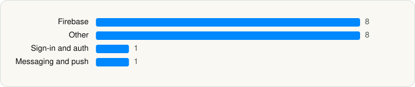

<picture><source media="(prefers-color-scheme: dark)" srcset="../../../../assets/logo/logo-dark.svg"></picture> [Tech Stack](../../../../README.md) / [Flex Applications AB](../../../../companies/flex-applications-ab.md) / Flex HRM

# Flex HRM

<picture><source media="(prefers-color-scheme: dark)" srcset="../../../../assets/badges/ios-dark.svg"></picture> <picture><source media="(prefers-color-scheme: dark)" srcset="../../../../assets/badges/inactive-dark.svg"></picture> <picture><source media="(prefers-color-scheme: dark)" srcset="../../../../assets/badges/floor-dark.svg"></picture> <picture><source media="(prefers-color-scheme: dark)" srcset="../../../../assets/badges/encrypted-dark.svg"></picture>

[App Store](https://apps.apple.com/app/id6744020056) · [latest.json](latest.json)

| | |
|---|---|
| Company | [Flex Applications AB](../../../../companies/flex-applications-ab.md) |
| Store id | `6744020056` |
| Bundle / package id | `com.flexhrm.app` |
| Latest version | 2026.4.50 (analysed 2026-11-27) |
| Versions tracked | 1 |
| SDKs in latest version | 18 |
| Languages | C/C++, Flutter / Dart, Objective-C, Swift |
| UI | SwiftUI, UIKit |
| Build | Swift Package Manager (SwiftPM) |
| Minimum OS | iOS 15.0 (built with Xcode 27.1, SDK iphoneos27.1) |
| Devices / ABIs | iPhone |
| Localisations | 5 |
| Capabilities | 2 |
| Declares tracking | No |
| Tracked | No. Kept for history. |

## SDKs by category

<picture><source media="(prefers-color-scheme: dark)" srcset="../../../../assets/charts/apps/ios/flex-applications-ab/flex-hrm-dark.svg"></picture>

- **Firebase** (8): FBLPromises, Firebase, FirebaseCore, FirebaseCoreInternal, FirebaseInstallations, GoogleDataTransport, GoogleUtilities, nanopb
- **Other** (8): apple, c 1.0, darwin, Flutter 1.0, foundation, plus, Survicate 7.3.0, x
- **Sign-in and auth** (1): AppAuth
- **Messaging and push** (1): FirebaseMessaging

Frameworks (12)

Authentication Services (Sign in with Apple / passkeys), AVFoundation (audio/video), Combine (reactive), Core Location, Network.framework, Photos, PhotosUI, SafariServices, Speech (recognition), SwiftUI, UIKit, User Notifications

Capabilities (2)

Background Push, Push Notifications (APNs)

## Version history

| Version | Analysed | Store update | SDKs | Change | SDK list is a floor | Binary encrypted | File |
|---|---|---|---|---|---|---|---|
| 2026.4.50 | 2026-11-27 |  | 18 |  | Yes | Yes | [2026.4.50.json](2026.4.50.json) |

---

Generated by `scripts/build_readme.py` from the JSON files. Do not edit by hand.
