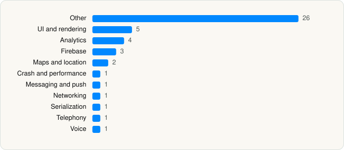

<picture><source media="(prefers-color-scheme: dark)" srcset="../../../../assets/logo/logo-dark.svg"></picture> [Tech Stack](../../../../README.md) / [Flipkart Internet Private Limited](../../../../companies/flipkart-internet-private-limited.md) / Flipkart

# Flipkart - Online Shopping App

<picture><source media="(prefers-color-scheme: dark)" srcset="../../../../assets/badges/ios-dark.svg"></picture> <picture><source media="(prefers-color-scheme: dark)" srcset="../../../../assets/badges/inactive-dark.svg"></picture> <picture><source media="(prefers-color-scheme: dark)" srcset="../../../../assets/badges/floor-dark.svg"></picture> <picture><source media="(prefers-color-scheme: dark)" srcset="../../../../assets/badges/encrypted-dark.svg"></picture>

[App Store](https://apps.apple.com/app/id742044692) · [latest.json](latest.json)

| | |
|---|---|
| Company | [Flipkart Internet Private Limited](../../../../companies/flipkart-internet-private-limited.md) |
| Store id | `742044692` |
| Bundle / package id | `com.appflipkart.flipkart` |
| Latest version | 11.36.2 (analysed 2026-11-24) |
| Versions tracked | 1 |
| SDKs in latest version | 46 |
| Languages | C/C++, Metal (shaders), Objective-C, React Native / JavaScript, Swift |
| UI | Lottie (animations), SwiftUI, UIKit |
| Build | Swift Package Manager (SwiftPM) |
| Minimum OS | iOS 15.1 (built with Xcode 26.3, SDK iphoneos26.2) |
| Devices / ABIs | iPhone, iPad |
| Localisations | 12 |
| Capabilities | 7 |
| Declares tracking | Yes |
| Tracked | No. Kept for history. |

## SDKs by category

<picture><source media="(prefers-color-scheme: dark)" srcset="../../../../assets/charts/apps/ios/flipkart-internet-private-limited/flipkart-dark.svg"></picture>

- **Other** (26): AiVoiceKit 0.1.0, BureauSMV 1.2.2, CommonLibrary 2.1, FCChatHeads 1.0.3, FkPrexo 1.1.0, FKRanger 0.1.5, FKRC 5.2.9, HyperCore 1.0, HyperSDK 2.2, iVersion, JuspaySafeBrowser 1.0, Ligero 0.8.8, MediaKit 1.0.35, NowYouSeeMe 1.0.4, NowYouSeeReact 1.1.2, NSDateTimeAgo, ObjcExceptionBridging 7.1.5, PayU3DS2CoreKit 2.3.0, PayU3DS2Kit 5.0.2, PayUCrashReporter 4.0.3, PayUliboqs 1.0, PayUTridentityMFAKit 2.2.0, PINCache 3.0.4, PINOperation 1.2.3, RustLiveKitFFI 1.0, TLPhotoPickerController
- **UI and rendering** (5): hermes 0.12.0, Lottie 4.5.2, RiveRuntime 6.21.1, RNSVGFilters 15.14.0, SDWebImage 5.21.4
- **Analytics** (4): AppsFlyerLib 6.17.0, Branch, Facebook SDK, PayUAnalyticsKit 4.1.0
- **Firebase** (3): FBLPromises 2.4.1, GoogleDataTransport 9.4.1, GoogleUtilities 7.13.3
- **Maps and location** (2): GMSCore 25.0.0, GoogleMaps 1.27.2
- **Crash and performance** (1): NewRelic 7.4.0
- **Messaging and push** (1): CleverTap 7.8.1
- **Networking** (1): PayUNetworkReachability 2.1.1
- **Serialization** (1): SwiftyJSON 5.0.8
- **Telephony** (1): libPhoneNumber 1.0.4
- **Voice** (1): LiveKit 0.13.1

Frameworks (38)

ActivityKit (Live Activities), AdSupport (IDFA), App Intents, App Tracking Transparency (ATT), ARKit, Authentication Services (Sign in with Apple / passkeys), AVFoundation (audio/video), AVKit, Background Tasks, CallKit (VoIP), Combine (reactive), Contacts, Core Bluetooth, Core Data, Core Image, Core Location, Core Motion, CryptoKit, Local Authentication (Face ID / Touch ID), MapKit, Media Player, MessageUI (mail / SMS compose), MetalKit, MetricKit (diagnostics), Network.framework, PassKit (Wallet / Apple Pay), Photos, PhotosUI, RealityKit, SafariServices, SiriKit (Intents), Speech (recognition), StoreKit (in-app purchase), SwiftUI, UIKit, User Notifications, Vision, WidgetKit (widgets)

Capabilities (7)

App Groups, Associated Domains (Universal Links), Background App Refresh, Background Audio, Background Push, Keychain Sharing, Push Notifications (APNs)

## Version history

| Version | Analysed | Store update | SDKs | Change | SDK list is a floor | Binary encrypted | File |
|---|---|---|---|---|---|---|---|
| 11.36.2 | 2026-11-24 |  | 46 |  | Yes | Yes | [11.36.2.json](11.36.2.json) |

---

Generated by `scripts/build_readme.py` from the JSON files. Do not edit by hand.
