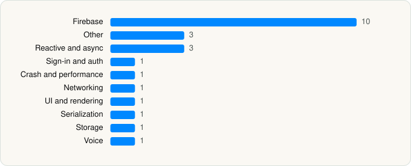

<picture><source media="(prefers-color-scheme: dark)" srcset="../../../../assets/logo/logo-dark.svg"></picture> [Tech Stack](../../../../README.md) / [GIE SESAM Vitale](../../../../companies/gie-sesam-vitale.md) / Carte Vitale

# Carte Vitale

<picture><source media="(prefers-color-scheme: dark)" srcset="../../../../assets/badges/ios-dark.svg"></picture> <picture><source media="(prefers-color-scheme: dark)" srcset="../../../../assets/badges/inactive-dark.svg"></picture> <picture><source media="(prefers-color-scheme: dark)" srcset="../../../../assets/badges/floor-dark.svg"></picture> <picture><source media="(prefers-color-scheme: dark)" srcset="../../../../assets/badges/encrypted-dark.svg"></picture>

[App Store](https://apps.apple.com/app/id1458351041) · [latest.json](latest.json)

| | |
|---|---|
| Company | [GIE SESAM Vitale](../../../../companies/gie-sesam-vitale.md) |
| Store id | `1458351041` |
| Bundle / package id | `fr.sesamvitale.cartevitale.app` |
| Latest version | 9.2.3 (analysed 2026-11-11) |
| Versions tracked | 1 |
| SDKs in latest version | 23 |
| Languages | C/C++, Objective-C, Swift |
| UI | Lottie (animations), SwiftUI, UIKit |
| Build | Swift Package Manager (SwiftPM) |
| Minimum OS | iOS 16.6 (built with Xcode 26.1.1, SDK iphoneos26.1) |
| Devices / ABIs | iPhone |
| Localisations | 0 |
| Capabilities | 2 |
| Declares tracking | No |
| Tracked | No. Kept for history. |

## SDKs by category

<picture><source media="(prefers-color-scheme: dark)" srcset="../../../../assets/charts/apps/ios/gie-sesam-vitale/carte-vitale-dark.svg"></picture>

- **Firebase** (10): FBLPromises, Firebase, FirebaseAuth, FirebaseCore, FirebaseCoreInternal, FirebaseInstallations, GoogleDataTransport, GoogleUtilities, nanopb, Promises
- **Other** (3): OpenSSL 3.6.0001, SVSDK 5.1.7, VideoIDSDK 26.10.5
- **Reactive and async** (3): RxCocoa, RxRelay, RxSwift
- **Sign-in and auth** (1): GTMSessionFetcher
- **Crash and performance** (1): FirebaseCrashlytics
- **Networking** (1): Reachability
- **UI and rendering** (1): Lottie 4.4.3
- **Serialization** (1): SwiftProtobuf
- **Storage** (1): GRDB
- **Voice** (1): WebRTC 1.0

Frameworks (19)

AVFoundation (audio/video), Combine (reactive), Core Bluetooth, Core Data, Core Image, Core NFC, CryptoKit, DeviceCheck / App Attest, Local Authentication (Face ID / Touch ID), MetalKit, MetricKit (diagnostics), Network.framework, PassKit (Wallet / Apple Pay), SafariServices, StoreKit (in-app purchase), SwiftUI, UIKit, User Notifications, Vision

Capabilities (2)

Associated Domains (Universal Links), NFC

## Version history

| Version | Analysed | Store update | SDKs | Change | SDK list is a floor | Binary encrypted | File |
|---|---|---|---|---|---|---|---|
| 9.2.3 | 2026-11-11 |  | 23 |  | Yes | Yes | [9.2.3.json](9.2.3.json) |

---

Generated by `scripts/build_readme.py` from the JSON files. Do not edit by hand.
