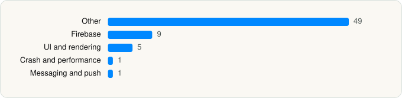

<picture><source media="(prefers-color-scheme: dark)" srcset="../../../../assets/logo/logo-dark.svg"></picture> [Tech Stack](../../../../README.md) / [GitHub](../../../../companies/github.md) / GitHub

# GitHub

<picture><source media="(prefers-color-scheme: dark)" srcset="../../../../assets/badges/ios-dark.svg"></picture> <picture><source media="(prefers-color-scheme: dark)" srcset="../../../../assets/badges/active-dark.svg"></picture> <picture><source media="(prefers-color-scheme: dark)" srcset="../../../../assets/badges/floor-dark.svg"></picture> <picture><source media="(prefers-color-scheme: dark)" srcset="../../../../assets/badges/encrypted-dark.svg"></picture>

[App Store](https://apps.apple.com/app/id1477376905) · [latest.json](latest.json)

| | |
|---|---|
| Company | [GitHub](../../../../companies/github.md) |
| Store id | `1477376905` |
| Bundle / package id | `com.github.stormbreaker.prod` |
| Latest version | 1.282.1 (analysed 2026-11-02) |
| Versions tracked | 2 |
| SDKs in latest version | 65 |
| Languages | C/C++, Metal (shaders), Objective-C, Swift |
| UI | SwiftUI, UIKit |
| Build | Swift Package Manager (SwiftPM) |
| Minimum OS | iOS 17.0 (built with Xcode 26.6, SDK iphoneos26.5) |
| Devices / ABIs | iPhone, iPad |
| Localisations | 7 |
| Capabilities | 9 |
| Declares tracking | No |
| Tracked | Yes |

## SDKs by category

<picture><source media="(prefers-color-scheme: dark)" srcset="../../../../assets/charts/apps/ios/github/github-dark.svg"></picture>

- **Other** (49): CCryptoBoringSSL, CCryptoBoringSSLShims, Crypto, CryptoBoringWrapper, CryptoExtras, GULNSData 1.0, GULUserDefaults 1.0, KeyboardToolbar, Lodash, PrimerSwiftUI 1.0, PrimerTokens, PrimerUIKit 1.0, Runestone, SwiftTerm, third-party-IsAppEncrypted 1.0, TreeSitterAstroQueries, TreeSitterBashQueries, TreeSitterCommentQueries, TreeSitterCPPQueries, TreeSitterCQueries, TreeSitterCSharpQueries, TreeSitterCSSQueries, TreeSitterElixirQueries, TreeSitterElmQueries, TreeSitterGoQueries, TreeSitterHaskellQueries, TreeSitterHTMLQueries, TreeSitterJavaQueries, TreeSitterJavaScriptQueries, TreeSitterJSDocQueries, TreeSitterJSON5Queries, TreeSitterJSONQueries, TreeSitterLaTeXQueries, TreeSitterLuaQueries, TreeSitterOCamlQueries, TreeSitterPerlQueries, TreeSitterPHPQueries, TreeSitterPythonQueries, TreeSitterRegexQueries, TreeSitterRQueries, TreeSitterRubyQueries, TreeSitterRustQueries, TreeSitterSCSSQueries, TreeSitterSvelteQueries, TreeSitterSwiftQueries, TreeSitterTOMLQueries, TreeSitterTSXQueries, TreeSitterTypeScriptQueries, TreeSitterYAMLQueries
- **Firebase** (9): FBLPromises, Firebase 1.0, FirebaseCore, FirebaseCoreInternal, FirebaseInstallations, GoogleDataTransport, GoogleUtilities 1.0, nanopb, Promises
- **UI and rendering** (5): KaTeX, MathJax, SDWebImage, SnapKit, TreeSitterMarkdownQueries
- **Crash and performance** (1): FirebaseCrashlytics
- **Messaging and push** (1): FirebaseMessaging

Frameworks (22)

ActivityKit (Live Activities), Authentication Services (Sign in with Apple / passkeys), Background Tasks, Combine (reactive), Core Image, CryptoKit, Local Authentication (Face ID / Touch ID), MessageUI (mail / SMS compose), MetalKit, MetricKit (diagnostics), Network.framework, PDFKit, PhotosUI, SafariServices, SiriKit (Intents), Speech (recognition), SpriteKit, StoreKit (in-app purchase), SwiftUI, UIKit, User Notifications, WidgetKit (widgets)

Capabilities (9)

App Groups, Associated Domains (Universal Links), Background App Refresh, Background Push, Communication Notifications, Keychain Sharing, Push Notifications (APNs), SiriKit, Time-Sensitive Notifications

## Version history

| Version | Analysed | Store update | SDKs | Change | SDK list is a floor | Binary encrypted | File |
|---|---|---|---|---|---|---|---|
| 1.282.1 | 2026-11-02 | 2026-10-27 | 65 | +0 / −0 | Yes | Yes | [1.282.1.json](1.282.1.json) |
| 1.282.0 | 2026-10-24 | 2026-10-23 | 65 |  | Yes | Yes | [1.282.0.json](1.282.0.json) |

---

Generated by `scripts/build_readme.py` from the JSON files. Do not edit by hand.
