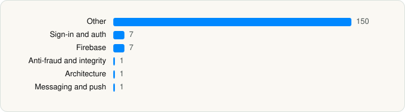

<picture><source media="(prefers-color-scheme: dark)" srcset="../../../../assets/logo/logo-dark.svg"></picture> [Tech Stack](../../../../README.md) / [デジタル庁](../../../../companies/go.md) / MynaApp (formerly Mynaportal)

# MynaApp (formerly Mynaportal)

<picture><source media="(prefers-color-scheme: dark)" srcset="../../../../assets/badges/ios-dark.svg"></picture> <picture><source media="(prefers-color-scheme: dark)" srcset="../../../../assets/badges/inactive-dark.svg"></picture> <picture><source media="(prefers-color-scheme: dark)" srcset="../../../../assets/badges/floor-dark.svg"></picture> <picture><source media="(prefers-color-scheme: dark)" srcset="../../../../assets/badges/encrypted-dark.svg"></picture>

[App Store](https://apps.apple.com/app/id1476359069) · [latest.json](latest.json)

| | |
|---|---|
| Company | [デジタル庁](../../../../companies/go.md) |
| Store id | `1476359069` |
| Bundle / package id | `jp.go.cao.mpa.iOS` |
| Latest version | 2026.10.0 (analysed 2026-11-10) |
| Versions tracked | 1 |
| SDKs in latest version | 167 |
| Languages | C/C++, Objective-C, Swift |
| UI | SwiftUI, UIKit |
| Build | Swift Package Manager (SwiftPM) |
| Minimum OS | iOS 16.4 (built with Xcode 27.1, SDK iphoneos27.1) |
| Devices / ABIs | iPhone |
| Localisations | 2 |
| Capabilities | 7 |
| Declares tracking | No |
| Tracked | No. Kept for history. |

## SDKs by category

<picture><source media="(prefers-color-scheme: dark)" srcset="../../../../assets/charts/apps/ios/go/mynaapp-formerly-mynaportal-dark.svg"></picture>

- **Other** (150): AppAgreementsFeature, AppEntryPointTokenRefreshFailedFeature, AppFeature, AppForceUpdateFeature, AppMenuFeature, AppTabFeature, AppTutorialFeature, AuthAndSignPhysicalCardReaderFeature, AuthAndSignPhysicalCardTextDataPasscodeInputFeature, AuthMethodSelectionFeature, AuthOtherMethodSelectionFeature, AuthPermissionConfirmationFeature, AuthPhysicalUserIdentityPasscodeInputFeature, BirthDateInputFeature, BuiltInErrorHandlingPhysicalMyNumberCardReader, CardDocumentReader, CCryptoBoringSSL, ChangeIPhonePasscodePasswordSelectionFeature, ChangeIPhoneSigningIdentityPasswordCompletionFeature, ChangeIPhoneSigningIdentityPasswordConfirmationInputFeature, ChangeIPhoneSigningIdentityPasswordCurrentInputFeature, ChangeIPhoneSigningIdentityPasswordFlow, ChangeIPhoneSigningIdentityPasswordNewInputFeature, ChangeIPhoneUserIdentityPasscodeCompletionFeature, ChangeIPhoneUserIdentityPasscodeConfirmationInputFeature, ChangeIPhoneUserIdentityPasscodeCurrentInputFeature, ChangeIPhoneUserIdentityPasscodeFlow, ChangeIPhoneUserIdentityPasscodeNewInputFeature, ConfirmIPhoneSigningCertificateDetailCompletionFeature, ConfirmIPhoneSigningCertificateDetailPasswordInputFeature, ConfirmIPhoneUserCertificateDetailCompletionFeature, ConfirmIPhoneUserCertificateDetailFlow, ConfirmIPhoneUserCertificateDetailPasscodeInputFeature, ConfirmOperationIPhoneSigningCertificateCompletionFeature, ConfirmOperationIPhoneSigningCertificatePasswordInputFeature, ConfirmOperationIPhoneUserCertificateCompletionFeature, ConfirmOperationIPhoneUserCertificateFlow, ConfirmOperationIPhoneUserCertificatePasscodeInputFeature, ConfirmValidityIPhoneSigningCertificateCompletionFeature, ConfirmValidityIPhoneSigningCertificatePasswordInputFeature, ConfirmValidityIPhoneUserCertificateCompletionFeature, ConfirmValidityIPhoneUserCertificateFlow, ConfirmValidityIPhoneUserCertificatePasscodeInputFeature, CrossDeviceAuthCancellationFeature, CrossDeviceAuthCompletionFeature, CrossDeviceSignCancellationFeature, CrossDeviceSignCompletionFeature, CrossDeviceSignVerificationCodeFeature, CrossDeviceVerificationCodeComponents, Crypto, CryptoBoringWrapper, CryptoExtras, DeleteIPhoneMyNumberCardCompletionFeature, DeleteIPhoneMyNumberCardFlow, DeleteIPhoneMyNumberCardIPhoneSigningIdentityPasswordInputFeature, DeleteSmartphoneMyNumberCardCompletionFeature, DeleteSmartphoneMyNumberCardFlow, DeleteSmartphoneMyNumberCardPhysicalSigningIdentityPasswordInputFeature, DeviceDetailFeature, DeviceListFeature, DigitalIdentificationServerMaintenanceFeature, ErrorComponents, ExpirationYearInputFeature, FlowComponents, HelpMenuFeature, HomeFeature, IPhoneMyNumberCardActivationStateComponents, IPhoneMyNumberCardClient, IPhoneMyNumberCardGuideComponents, IPhoneMyNumberCardMenuFeature, IPhoneMyNumberCardSigningCertificateMenuFeature, IPhoneMyNumberCardUserCertificateMenuFeature, LegacyMynaportal, LicenseFeature, MainAccountAuthIPhoneUserIdentityPasscodeInputFeature, MainAccountCrossDeviceAuthIPhoneMyNumberCardBiometricFeature, MainAccountCrossDeviceAuthVerificationCodeFeature, MainAccountDeletionFeature, MainAccountLogoutFeature, MainAccountOtherMethodSelectionFeature, MainAccountRegistrationCompletionFeature, MainAccountRegistrationDeviceAuthPermissionFeature, MainAccountRegistrationFlow, MainAccountRegistrationIPhoneUserIdentityPasscodeInputFeature, MainAccountRegistrationMethodSelectionFeature, MainAccountRegistrationPhysicalUserIdentityPasscodeInputFeature, MainAccountRegistrationPushNotificationRequestAuthorizationFeature, MainAccountSignIPhoneSigningIdentityPasswordInputFeature, OpenSSL 3.6.2000, PassportFlow, PassportMRZScanFeature, PassportNFCScanFeature, PassportNoPermissionFeature, PassportScanCrossDeviceCompletionFeature, PassportScanSameDeviceCompletionFeature, PassportUnrecoverableErrorFeature, PhysicalMyNumberCardGuideComponents, PhysicalMyNumberCardMenuFeature, PhysicalMyNumberCardReader, QRCodeScanFeature, ReferenceNumberBScanFeature, ReferenceNumberBStartFeature, ReissueIPhoneUserCertificateCompletionFeature, ReissueIPhoneUserCertificatePhysicalSigningIdentityPasswordInputFeature, ReprovisioningFlow, ReprovisioningFlowInstructionFeature, ReprovisioningOTPPhysicalCardReaderFeature, ReprovisioningSignPhysicalCardReaderFeature, ResetIPhoneSigningIdentityPasswordCompletionFeature, ResetIPhoneSigningIdentityPasswordConfirmationInputFeature, ResetIPhoneSigningIdentityPasswordFlow, ResetIPhoneSigningIdentityPasswordNewInputFeature, ResetIPhoneSigningIdentityPasswordPhysicalSigningIdentityPasswordInputFeature, ResetIPhoneSigningIdentityPasswordPreparingFeature, ResetIPhoneUserIdentityPasscodeCompletionFeature, ResetIPhoneUserIdentityPasscodeConfirmationInputFeature, ResetIPhoneUserIdentityPasscodeFlow, ResetIPhoneUserIdentityPasscodeIPhoneSigningIdentityPasswordInputFeature, ResetIPhoneUserIdentityPasscodeMethodSelectionFeature, ResetIPhoneUserIdentityPasscodeNewInputFeature, ResetIPhoneUserIdentityPasscodePhysicalSigningIdentityPasswordInputFeature, ResetIPhoneUserIdentityPasscodePreparingFeature, RPDetailFeature, RPListFeature, RPReportableUnrecoverableErrorDisplayFeature, SameDeviceAuthCancellationFeature, SameDeviceAuthCompletionFeature, SameDeviceSignCancellationFeature, SameDeviceSignCompletionFeature, SecurePasscodeInputComponents, SecurePasswordInputComponents, SecurityCodeInputFeature, SignMethodSelectionFeature, SignOtherMethodSelectionFeature, SignPermissionConfirmationFeature, SignPhysicalSigningIdentityPasswordInputFeature, SmartphoneMyNumberCardDeleteMethodSelectionFeature, SMPSPTSMMaintenanceFeature, SpecialBirthDateInputFeature, Styleguide, TemporaryAccountCrossDeviceAuthVerificationCodeFeature, TemporaryAccountCrossDeviceSignStartFeature, TemporaryAccountRegistrationAuthAgreementsFeature, TemporaryAccountRegistrationAuthStartFeature, TemporaryAccountRegistrationForSignAgreementsFeature, TemporaryAccountRegistrationForSignPhysicalUserIdentityPasscodeInputFeature, TemporaryAccountRegistrationForSignStartFeature, TemporaryAccountSameDeviceSignStartFeature, TrustedBrowserListFeature, UserStatusSuspendedFeature
- **Sign-in and auth** (7): AppEntryPointRetryDeviceAuthenticationFeature, LoginDateTimeFormat, MainAccountLoginCompletionFeature, MainAccountLoginFlow, MainAccountLoginIPhoneUserIdentityPasscodeInputFeature, MainAccountLoginMethodSelectionFeature, MainAccountLoginPhysicalUserIdentityPasscodeInputFeature
- **Firebase** (7): FBLPromises, FirebaseCore, FirebaseCoreInternal, FirebaseInstallations, GoogleDataTransport, GoogleUtilities, nanopb
- **Anti-fraud and integrity** (1): Persona
- **Architecture** (1): ComposableArchitecture
- **Messaging and push** (1): FirebaseMessaging

Frameworks (16)

ARKit, AVFoundation (audio/video), Combine (reactive), Core Image, Core Location, Core NFC, CryptoKit, Local Authentication (Face ID / Touch ID), PassKit (Wallet / Apple Pay), SafariServices, Swift Charts, SwiftUI, UIKit, User Notifications, Vision, VisionKit (document/data scanning)

Capabilities (7)

App Groups, Apple Pay, Associated Domains (Universal Links), Keychain Sharing, NFC, Push Notifications (APNs), Wallet passes

## Version history

| Version | Analysed | Store update | SDKs | Change | SDK list is a floor | Binary encrypted | File |
|---|---|---|---|---|---|---|---|
| 2026.10.0 | 2026-11-10 |  | 167 |  | Yes | Yes | [2026.10.0.json](2026.10.0.json) |

---

Generated by `scripts/build_readme.py` from the JSON files. Do not edit by hand.
