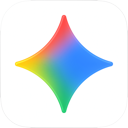
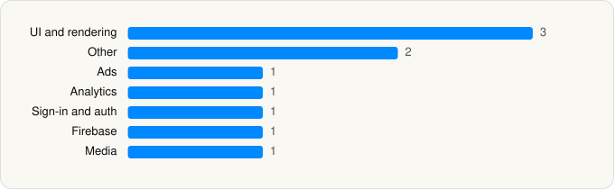

<picture><source media="(prefers-color-scheme: dark)" srcset="../../../../assets/logo/logo-dark.svg"></picture> [Tech Stack](../../../../README.md) / [Google](../../../../companies/google.md) / Google Gemini

# Google Gemini

<picture><source media="(prefers-color-scheme: dark)" srcset="../../../../assets/badges/ios-dark.svg"></picture> <picture><source media="(prefers-color-scheme: dark)" srcset="../../../../assets/badges/active-dark.svg"></picture> <picture><source media="(prefers-color-scheme: dark)" srcset="../../../../assets/badges/floor-dark.svg"></picture> <picture><source media="(prefers-color-scheme: dark)" srcset="../../../../assets/badges/encrypted-dark.svg"></picture>

[App Store](https://apps.apple.com/app/id6477489729) · [latest.json](latest.json)

| | |
|---|---|
| Company | [Google](../../../../companies/google.md) |
| Store id | `6477489729` |
| Bundle / package id | `com.google.gemini` |
| Latest version | 1.2026.4171302 (analysed 2026-10-23) |
| Versions tracked | 3 |
| SDKs in latest version | 10 |
| Languages | C/C++, Metal (shaders), Objective-C, Swift |
| UI | SwiftUI, UIKit |
| Build | Unknown / Xcode native |
| Minimum OS | iOS 18.2 (built with Xcode 27.1, SDK iphoneos27.1) |
| Devices / ABIs | iPhone, iPad |
| Localisations | 85 |
| Capabilities | 8 |
| Declares tracking | No |
| Tracked | Yes |

## SDKs by category

<picture><source media="(prefers-color-scheme: dark)" srcset="../../../../assets/charts/apps/ios/google/gemini-dark.svg"></picture>

- **UI and rendering** (3): MaterialDialogs, MaterialPullToRefresh, MaterialSearch
- **Other** (2): MaterialM3CTextField, SpotlightCardCarousel
- **Ads** (1): OneGoogle
- **Analytics** (1): GIPPseudonymousID
- **Sign-in and auth** (1): SSOAuth
- **Firebase** (1): gRPC
- **Media** (1): SpotifyiOS 5.0.1

Frameworks (34)

ActivityKit (Live Activities), AdServices (Apple Search Ads attribution), App Intents, Authentication Services (Sign in with Apple / passkeys), AVFoundation (audio/video), AVKit, Background Tasks, Combine (reactive), Contacts, Core Data, Core Image, Core Location, Core Motion, CryptoKit, DeviceCheck / App Attest, Local Authentication (Face ID / Touch ID), MapKit, Media Player, MessageUI (mail / SMS compose), MetalKit, MetricKit (diagnostics), Network.framework, PDFKit, PencilKit, Photos, PhotosUI, SafariServices, SiriKit (Intents), StoreKit (in-app purchase), Swift Charts, SwiftUI, UIKit, User Notifications, WidgetKit (widgets)

Capabilities (8)

App Groups, Associated Domains (Universal Links), Background App Refresh, Background Audio, Background Processing, Background Push, Keychain Sharing, Push Notifications (APNs)

## Version history

| Version | Analysed | Store update | SDKs | Change | SDK list is a floor | Binary encrypted | File |
|---|---|---|---|---|---|---|---|
| 1.2026.4171302 | 2026-10-23 | 2026-10-21 | 10 | +2 / −0 | Yes | Yes | [1.2026.4171302.json](1.2026.4171302.json) |
| 1.2026.2171803 | 2026-06-19 |  | 8 | +0 / −0 | Yes | Yes | [1.2026.2171803.json](1.2026.2171803.json) |
| 1.2026.2070601 | 2026-06-09 |  | 8 |  | Yes | Yes | [1.2026.2070601.json](1.2026.2070601.json) |

### SDK changes between versions

- 1.2026.2171803 → 1.2026.4171302: added MaterialM3CTextField, SpotlightCardCarousel

---

Generated by `scripts/build_readme.py` from the JSON files. Do not edit by hand.
