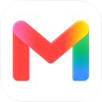
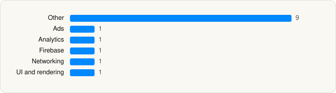

<picture><source media="(prefers-color-scheme: dark)" srcset="../../../../assets/logo/logo-dark.svg"></picture> [Tech Stack](../../../../README.md) / [Google](../../../../companies/google.md) / Gmail

# Gmail - Email by Google

<picture><source media="(prefers-color-scheme: dark)" srcset="../../../../assets/badges/ios-dark.svg"></picture> <picture><source media="(prefers-color-scheme: dark)" srcset="../../../../assets/badges/active-dark.svg"></picture> <picture><source media="(prefers-color-scheme: dark)" srcset="../../../../assets/badges/floor-dark.svg"></picture> <picture><source media="(prefers-color-scheme: dark)" srcset="../../../../assets/badges/encrypted-dark.svg"></picture>

[App Store](https://apps.apple.com/app/id422689480) · [latest.json](latest.json)

| | |
|---|---|
| Company | [Google](../../../../companies/google.md) |
| Store id | `422689480` |
| Bundle / package id | `com.google.Gmail` |
| Latest version | 6.0.260525 (analysed 2026-06-19) |
| Versions tracked | 1 |
| SDKs in latest version | 14 |
| Languages | C/C++, Metal (shaders), Objective-C, Swift |
| UI | SwiftUI, UIKit |
| Build | Unknown / Xcode native |
| Minimum OS | iOS 18.0 (built with Xcode 26.2, SDK iphoneos26.2) |
| Devices / ABIs | iPhone, iPad |
| Localisations | 63 |
| Capabilities | 12 |
| Declares tracking | No |
| Tracked | Yes |

## SDKs by category

<picture><source media="(prefers-color-scheme: dark)" srcset="../../../../assets/charts/apps/ios/google/gmail-email-by-google-dark.svg"></picture>

- **Other** (9): ABCCalloutView, AppUpdateService, ChronosIntentDetectors, ChronosSiriShortcutManager, ChronosWidgets, GoogleS3KitVoiceSearch, MapsAppClip, MediaPicker, SystemIcons 26.21
- **Ads** (1): OneGoogle
- **Analytics** (1): GIPPseudonymousID
- **Firebase** (1): gRPC
- **Networking** (1): GoogleKitWeb
- **UI and rendering** (1): MaterialSearch

Frameworks (32)

App Intents, Authentication Services (Sign in with Apple / passkeys), AVFoundation (audio/video), AVKit, Background Tasks, CallKit (VoIP), Combine (reactive), Contacts, Core Image, Core Location, Core Motion, CryptoKit, DeviceCheck / App Attest, Local Authentication (Face ID / Touch ID), Media Player, MessageUI (mail / SMS compose), MetalKit, MetricKit (diagnostics), Natural Language, Network.framework, PassKit (Wallet / Apple Pay), PDFKit, Photos, PhotosUI, PushKit (VoIP push), SafariServices, SiriKit (Intents), StoreKit (in-app purchase), SwiftUI, UIKit, User Notifications, WidgetKit (widgets)

Capabilities (12)

App Groups, Associated Domains (Universal Links), Background App Refresh, Background Audio, Background Processing, Background Push, Communication Notifications, Keychain Sharing, Push Notifications (APNs), SiriKit, Time-Sensitive Notifications, VoIP

## Version history

| Version | Analysed | Store update | SDKs | Change | SDK list is a floor | Binary encrypted | File |
|---|---|---|---|---|---|---|---|
| 6.0.260525 | 2026-06-19 |  | 14 |  | Yes | Yes | [6.0.260525.json](6.0.260525.json) |

## Model-written summary

> Gmail iOS app using SwiftUI/UIKit hybrid with Metal, iOS 18 minimum, Google/Firebase backends, App Attest, and WidgetKit/SiriKit extensions

Written by a language model from the detected signals (`inferred[]`). It is commentary, not measurement.

---

Generated by `scripts/build_readme.py` from the JSON files. Do not edit by hand.
