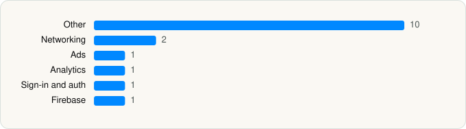

<picture><source media="(prefers-color-scheme: dark)" srcset="../../../../assets/logo/logo-dark.svg"></picture> [Tech Stack](../../../../README.md) / [Google](../../../../companies/google.md) / Google Authenticator

# Google Authenticator

<picture><source media="(prefers-color-scheme: dark)" srcset="../../../../assets/badges/ios-dark.svg"></picture> <picture><source media="(prefers-color-scheme: dark)" srcset="../../../../assets/badges/inactive-dark.svg"></picture> <picture><source media="(prefers-color-scheme: dark)" srcset="../../../../assets/badges/floor-dark.svg"></picture> <picture><source media="(prefers-color-scheme: dark)" srcset="../../../../assets/badges/encrypted-dark.svg"></picture>

[App Store](https://apps.apple.com/app/id388497605) · [latest.json](latest.json)

| | |
|---|---|
| Company | [Google](../../../../companies/google.md) |
| Store id | `388497605` |
| Bundle / package id | `com.google.Authenticator` |
| Latest version | 5.0.0 (analysed 2026-06-23) |
| Versions tracked | 1 |
| SDKs in latest version | 16 |
| Languages | C/C++, Objective-C, Swift |
| UI | SwiftUI, UIKit |
| Build | Unknown / Xcode native |
| Minimum OS | iOS 16.0 (built with Xcode 16.4, SDK iphoneos18.5) |
| Devices / ABIs | iPhone, iPad |
| Localisations | 34 |
| Capabilities | 5 |
| Declares tracking | No |
| Tracked | No. Kept for history. |

## SDKs by category

<picture><source media="(prefers-color-scheme: dark)" srcset="../../../../assets/charts/apps/ios/google/google-authenticator-dark.svg"></picture>

- **Other** (10): Chips, ChronosPrivacyScreen, GoogleKitContentViews, GoogleKitDialogsArrows, GoogleKitHeader, GoogleKitProgressBar, GoogleKitRefreshControl, GoogleMaterialOpenSearch, GoogleMaterialOpenSearchBarView, QuantumCollections
- **Networking** (2): GoogleKitCore, GoogleKitWeb
- **Ads** (1): OneGoogle
- **Analytics** (1): GIPPseudonymousID
- **Sign-in and auth** (1): SSOAuth
- **Firebase** (1): gRPC

Frameworks (18)

Authentication Services (Sign in with Apple / passkeys), AVFoundation (audio/video), Background Tasks, Combine (reactive), Core Image, Core Location, CryptoKit, DeviceCheck / App Attest, Local Authentication (Face ID / Touch ID), MetricKit (diagnostics), Network.framework, Photos, SafariServices, SiriKit (Intents), StoreKit (in-app purchase), SwiftUI, UIKit, User Notifications

Capabilities (5)

App Groups, Associated Domains (Universal Links), Background App Refresh, Keychain Sharing, Push Notifications (APNs)

## Version history

| Version | Analysed | Store update | SDKs | Change | SDK list is a floor | Binary encrypted | File |
|---|---|---|---|---|---|---|---|
| 5.0.0 | 2026-06-23 |  | 16 |  | Yes | Yes | [5.0.0.json](5.0.0.json) |

## Model-written summary

> SwiftUI and UIKit iOS Google Authenticator using GoogleKit/Material components, App Attest, CryptoKit and otpauth schemes

Written by a language model from the detected signals (`inferred[]`). It is commentary, not measurement.

---

Generated by `scripts/build_readme.py` from the JSON files. Do not edit by hand.
