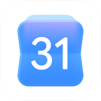
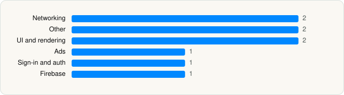

<picture><source media="(prefers-color-scheme: dark)" srcset="../../../../assets/logo/logo-dark.svg"></picture> [Tech Stack](../../../../README.md) / [Google](../../../../companies/google.md) / Google Calendar

# Google Calendar: Get Organized

<picture><source media="(prefers-color-scheme: dark)" srcset="../../../../assets/badges/ios-dark.svg"></picture> <picture><source media="(prefers-color-scheme: dark)" srcset="../../../../assets/badges/inactive-dark.svg"></picture> <picture><source media="(prefers-color-scheme: dark)" srcset="../../../../assets/badges/floor-dark.svg"></picture> <picture><source media="(prefers-color-scheme: dark)" srcset="../../../../assets/badges/encrypted-dark.svg"></picture>

[App Store](https://apps.apple.com/app/id909319292) · [latest.json](latest.json)

| | |
|---|---|
| Company | [Google](../../../../companies/google.md) |
| Store id | `909319292` |
| Bundle / package id | `com.google.calendar` |
| Latest version | 26.20.0 (analysed 2026-06-19) |
| Versions tracked | 1 |
| SDKs in latest version | 9 |
| Languages | C/C++, Objective-C, Swift |
| UI | SwiftUI, UIKit |
| Build | Unknown / Xcode native |
| Minimum OS | iOS 17.0 (built with Xcode 26.2, SDK iphoneos26.2) |
| Devices / ABIs | iPhone, iPad |
| Localisations | 49 |
| Capabilities | 8 |
| Declares tracking | No |
| Tracked | No. Kept for history. |

## SDKs by category

<picture><source media="(prefers-color-scheme: dark)" srcset="../../../../assets/charts/apps/ios/google/google-calendar-dark.svg"></picture>

- **Networking** (2): GoogleKitCore, GoogleKitWeb
- **Other** (2): ABCCalloutView, MaterialFABMenu
- **UI and rendering** (2): MaterialDialogs, MaterialSearch
- **Ads** (1): OneGoogle
- **Sign-in and auth** (1): SSOAuth
- **Firebase** (1): gRPC

Frameworks (27)

App Intents, Authentication Services (Sign in with Apple / passkeys), AVFoundation (audio/video), AVKit, Background Tasks, Combine (reactive), Contacts, Core Image, Core Location, CryptoKit, DeviceCheck / App Attest, EventKit (Calendar / Reminders), Local Authentication (Face ID / Touch ID), Media Player, MessageUI (mail / SMS compose), MetricKit (diagnostics), Network.framework, PDFKit, Photos, SafariServices, SiriKit (Intents), StoreKit (in-app purchase), SwiftUI, UIKit, User Notifications, Watch Connectivity, WidgetKit (widgets)

Capabilities (8)

App Groups, Associated Domains (Universal Links), Background App Refresh, Background Processing, Background Push, Keychain Sharing, Push Notifications (APNs), Time-Sensitive Notifications

## Version history

| Version | Analysed | Store update | SDKs | Change | SDK list is a floor | Binary encrypted | File |
|---|---|---|---|---|---|---|---|
| 26.20.0 | 2026-06-19 |  | 9 |  | Yes | Yes | [26.20.0.json](26.20.0.json) |

---

Generated by `scripts/build_readme.py` from the JSON files. Do not edit by hand.
