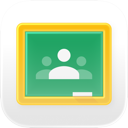
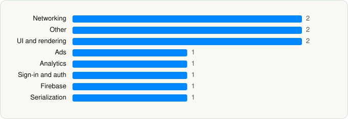

<picture><source media="(prefers-color-scheme: dark)" srcset="../../../../assets/logo/logo-dark.svg"></picture> [Tech Stack](../../../../README.md) / [Google](../../../../companies/google.md) / Google Classroom

# Google Classroom

<picture><source media="(prefers-color-scheme: dark)" srcset="../../../../assets/badges/ios-dark.svg"></picture> <picture><source media="(prefers-color-scheme: dark)" srcset="../../../../assets/badges/active-dark.svg"></picture> <picture><source media="(prefers-color-scheme: dark)" srcset="../../../../assets/badges/floor-dark.svg"></picture> <picture><source media="(prefers-color-scheme: dark)" srcset="../../../../assets/badges/encrypted-dark.svg"></picture>

[App Store](https://apps.apple.com/app/id924620788) · [latest.json](latest.json)

| | |
|---|---|
| Company | [Google](../../../../companies/google.md) |
| Store id | `924620788` |
| Bundle / package id | `com.google.Classroom` |
| Latest version | 3.59.300048840 (analysed 2026-06-23) |
| Versions tracked | 1 |
| SDKs in latest version | 11 |
| Languages | C/C++, Flutter / Dart, Objective-C, Swift |
| UI | SwiftUI, UIKit |
| Build | Unknown / Xcode native |
| Minimum OS | iOS 17.0 (built with Xcode 26.2, SDK iphoneos26.2) |
| Devices / ABIs | iPhone, iPad |
| Localisations | 78 |
| Capabilities | 7 |
| Declares tracking | No |
| Tracked | Yes |

## SDKs by category

<picture><source media="(prefers-color-scheme: dark)" srcset="../../../../assets/charts/apps/ios/google/google-classroom-dark.svg"></picture>

- **Networking** (2): GoogleKitCore, GoogleKitWeb
- **Other** (2): ABCCalloutView, Flutter 1.0
- **UI and rendering** (2): MaterialDialogs, MaterialSearch
- **Ads** (1): OneGoogle
- **Analytics** (1): GIPPseudonymousID
- **Sign-in and auth** (1): SSOAuth
- **Firebase** (1): Promises
- **Serialization** (1): SwiftProtobuf

Frameworks (25)

Authentication Services (Sign in with Apple / passkeys), AVFoundation (audio/video), AVKit, Background Tasks, Combine (reactive), Core Image, Core Location, CryptoKit, DeviceCheck / App Attest, Local Authentication (Face ID / Touch ID), Media Player, MessageUI (mail / SMS compose), MetricKit (diagnostics), Network.framework, PDFKit, Photos, PhotosUI, PushKit (VoIP push), SafariServices, SiriKit (Intents), StoreKit (in-app purchase), SwiftUI, UIKit, User Notifications, VisionKit (document/data scanning)

Capabilities (7)

App Groups, Associated Domains (Universal Links), Background App Refresh, Background Processing, Background Push, Keychain Sharing, Push Notifications (APNs)

## Version history

| Version | Analysed | Store update | SDKs | Change | SDK list is a floor | Binary encrypted | File |
|---|---|---|---|---|---|---|---|
| 3.59.300048840 | 2026-06-23 |  | 11 |  | Yes | Yes | [3.59.300048840.json](3.59.300048840.json) |

---

Generated by `scripts/build_readme.py` from the JSON files. Do not edit by hand.
