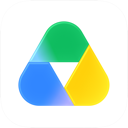
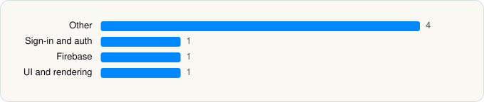

<picture><source media="(prefers-color-scheme: dark)" srcset="../../../../assets/logo/logo-dark.svg"></picture> [Tech Stack](../../../../README.md) / [Google](../../../../companies/google.md) / Google Drive

# Google Drive

<picture><source media="(prefers-color-scheme: dark)" srcset="../../../../assets/badges/ios-dark.svg"></picture> <picture><source media="(prefers-color-scheme: dark)" srcset="../../../../assets/badges/active-dark.svg"></picture> <picture><source media="(prefers-color-scheme: dark)" srcset="../../../../assets/badges/floor-dark.svg"></picture> <picture><source media="(prefers-color-scheme: dark)" srcset="../../../../assets/badges/encrypted-dark.svg"></picture>

[App Store](https://apps.apple.com/app/id507874739) · [latest.json](latest.json)

| | |
|---|---|
| Company | [Google](../../../../companies/google.md) |
| Store id | `507874739` |
| Bundle / package id | `com.google.Drive` |
| Latest version | 4.2622.41005 (analysed 2026-06-19) |
| Versions tracked | 2 |
| SDKs in latest version | 7 |
| Languages | C/C++, Objective-C, React Native / JavaScript, Swift |
| UI | SwiftUI, UIKit |
| Build | Unknown / Xcode native |
| Minimum OS | iOS 16.0 (built with Xcode 26.2, SDK iphoneos26.2) |
| Devices / ABIs | iPhone, iPad |
| Localisations | 72 |
| Capabilities | 10 |
| Declares tracking | No |
| Tracked | Yes |

## SDKs by category

<picture><source media="(prefers-color-scheme: dark)" srcset="../../../../assets/charts/apps/ios/google/google-drive-dark.svg"></picture>

- **Other** (4): ABCCalloutView, ChronosPrivacyScreen, ChronosSiriShortcutManager, ChronosWidgets
- **Sign-in and auth** (1): SSOAuth
- **Firebase** (1): gRPC
- **UI and rendering** (1): MaterialPullToRefresh

Frameworks (27)

App Intents, Authentication Services (Sign in with Apple / passkeys), AVFoundation (audio/video), AVKit, Background Tasks, Combine (reactive), Contacts, Core Image, Core Location, CryptoKit, DeviceCheck / App Attest, Local Authentication (Face ID / Touch ID), Media Player, MessageUI (mail / SMS compose), MetricKit (diagnostics), Network.framework, PDFKit, Photos, PhotosUI, SafariServices, SiriKit (Intents), StoreKit (in-app purchase), SwiftUI, UIKit, User Notifications, VisionKit (document/data scanning), WidgetKit (widgets)

Capabilities (10)

App Groups, Associated Domains (Universal Links), Background App Refresh, Background Audio, Background Processing, Background Push, CloudKit, iCloud, Keychain Sharing, Push Notifications (APNs)

## Version history

| Version | Analysed | Store update | SDKs | Change | SDK list is a floor | Binary encrypted | File |
|---|---|---|---|---|---|---|---|
| 4.2622.41005 | 2026-06-19 |  | 7 | +0 / −11 | Yes | Yes | [4.2622.41005.json](4.2622.41005.json) |
| 4.2622.41004 | 2026-06-03 |  | 18 |  | Yes | Yes | [4.2622.41004.json](4.2622.41004.json) |

### SDK changes between versions

- 4.2622.41004 → 4.2622.41005: removed AELScoperMenuStrings, AELSearchCorporaSettingsStrings, AELSidekickMenuStrings, AELSidekickStrings, AppStoreBillsStrings, AppSwitchingStrings, Cards, DeviceManagement, GoogleSansFlex, ImageBundle, ParadeStrings

---

Generated by `scripts/build_readme.py` from the JSON files. Do not edit by hand.
