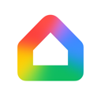
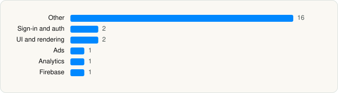

<picture><source media="(prefers-color-scheme: dark)" srcset="../../../../assets/logo/logo-dark.svg"></picture> [Tech Stack](../../../../README.md) / [Google](../../../../companies/google.md) / Google Home

# Google Home

<picture><source media="(prefers-color-scheme: dark)" srcset="../../../../assets/badges/ios-dark.svg"></picture> <picture><source media="(prefers-color-scheme: dark)" srcset="../../../../assets/badges/inactive-dark.svg"></picture> <picture><source media="(prefers-color-scheme: dark)" srcset="../../../../assets/badges/floor-dark.svg"></picture> <picture><source media="(prefers-color-scheme: dark)" srcset="../../../../assets/badges/encrypted-dark.svg"></picture>

[App Store](https://apps.apple.com/app/id680819774) · [latest.json](latest.json)

| | |
|---|---|
| Company | [Google](../../../../companies/google.md) |
| Store id | `680819774` |
| Bundle / package id | `com.google.Chromecast` |
| Latest version | 4.17.55 (analysed 2026-06-23) |
| Versions tracked | 1 |
| SDKs in latest version | 23 |
| Languages | C/C++, Metal (shaders), Objective-C, Swift |
| UI | SwiftUI, UIKit |
| Build | Swift Package Manager (SwiftPM) |
| Minimum OS | iOS 17.0 (built with Xcode 26.2, SDK iphoneos26.2) |
| Devices / ABIs | iPhone, iPad |
| Localisations | 61 |
| Capabilities | 11 |
| Declares tracking | No |
| Tracked | No. Kept for history. |

## SDKs by category

<picture><source media="(prefers-color-scheme: dark)" srcset="../../../../assets/charts/apps/ios/google/google-home-dark.svg"></picture>

- **Other** (16): demo, flow, FluxResourceManager, GWACore, GWALocalization, heatlink, identification, migration, package, picker, ring, setup, SmartSetup, translations, VirtualRemote, youtube-player
- **Sign-in and auth** (2): lock, SSOAuth
- **UI and rendering** (2): MaterialDialogs, MaterialSearch
- **Ads** (1): OneGoogle
- **Analytics** (1): GIPPseudonymousID
- **Firebase** (1): gRPC

Frameworks (33)

App Intents, Authentication Services (Sign in with Apple / passkeys), AVFoundation (audio/video), AVKit, Background Tasks, Combine (reactive), Contacts, Core Bluetooth, Core Data, Core Image, Core Location, Core Motion, CryptoKit, DeviceCheck / App Attest, EventKit (Calendar / Reminders), HomeKit, Local Authentication (Face ID / Touch ID), Media Player, MessageUI (mail / SMS compose), MetalKit, MetricKit (diagnostics), Network.framework, Photos, SafariServices, SiriKit (Intents), SpriteKit, StoreKit (in-app purchase), SwiftUI, UIKit, User Notifications, Vision, VisionKit (document/data scanning), WidgetKit (widgets)

Capabilities (11)

App Groups, Associated Domains (Universal Links), Background App Refresh, Background Audio, Background Processing, Background Push, Bluetooth (central), Bluetooth (peripheral), Keychain Sharing, Push Notifications (APNs), Time-Sensitive Notifications

## Version history

| Version | Analysed | Store update | SDKs | Change | SDK list is a floor | Binary encrypted | File |
|---|---|---|---|---|---|---|---|
| 4.17.55 | 2026-06-23 |  | 23 |  | Yes | Yes | [4.17.55.json](4.17.55.json) |

## Model-written summary

> iOS 17+ SwiftUI/UIKit app with HomeKit, 106 Metal shaders, three bundled ML models, Firebase, and widget extensions

Written by a language model from the detected signals (`inferred[]`). It is commentary, not measurement.

---

Generated by `scripts/build_readme.py` from the JSON files. Do not edit by hand.
