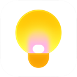
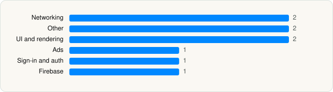

<picture><source media="(prefers-color-scheme: dark)" srcset="../../../../assets/logo/logo-dark.svg"></picture> [Tech Stack](../../../../README.md) / [Google](../../../../companies/google.md) / Google Keep

# Google Keep - Notes and lists

<picture><source media="(prefers-color-scheme: dark)" srcset="../../../../assets/badges/ios-dark.svg"></picture> <picture><source media="(prefers-color-scheme: dark)" srcset="../../../../assets/badges/inactive-dark.svg"></picture> <picture><source media="(prefers-color-scheme: dark)" srcset="../../../../assets/badges/floor-dark.svg"></picture> <picture><source media="(prefers-color-scheme: dark)" srcset="../../../../assets/badges/encrypted-dark.svg"></picture>

[App Store](https://apps.apple.com/app/id1029207872) · [latest.json](latest.json)

| | |
|---|---|
| Company | [Google](../../../../companies/google.md) |
| Store id | `1029207872` |
| Bundle / package id | `com.google.Keep` |
| Latest version | 2.2026.43101 (analysed 2026-11-01) |
| Versions tracked | 2 |
| SDKs in latest version | 9 |
| Languages | C/C++, Objective-C, Swift |
| UI | SwiftUI, UIKit |
| Build | Unknown / Xcode native |
| Minimum OS | iOS 18.0 (built with Xcode 26.4.1, SDK iphoneos26.4) |
| Devices / ABIs | iPhone, iPad |
| Localisations | 82 |
| Capabilities | 5 |
| Declares tracking | No |
| Tracked | No. Kept for history. |

## SDKs by category

<picture><source media="(prefers-color-scheme: dark)" srcset="../../../../assets/charts/apps/ios/google/google-keep-dark.svg"></picture>

- **Networking** (2): GoogleKitCore, GoogleKitWeb
- **Other** (2): FeedbackKitFeedbackPrompt, MaterialM3CTextField
- **UI and rendering** (2): MaterialDialogs, MaterialSearch
- **Ads** (1): OneGoogle
- **Sign-in and auth** (1): SSOAuth
- **Firebase** (1): gRPC

Frameworks (24)

App Intents, Authentication Services (Sign in with Apple / passkeys), AVFoundation (audio/video), Background Tasks, Combine (reactive), Core Data, Core Image, Core Location, CryptoKit, DeviceCheck / App Attest, Local Authentication (Face ID / Touch ID), Media Player, MessageUI (mail / SMS compose), MetricKit (diagnostics), Network.framework, Photos, SafariServices, SiriKit (Intents), SpriteKit, StoreKit (in-app purchase), SwiftUI, UIKit, User Notifications, WidgetKit (widgets)

Capabilities (5)

App Groups, Associated Domains (Universal Links), Background Push, Keychain Sharing, Push Notifications (APNs)

## Version history

| Version | Analysed | Store update | SDKs | Change | SDK list is a floor | Binary encrypted | File |
|---|---|---|---|---|---|---|---|
| 2.2026.43101 | 2026-11-01 |  | 9 | +1 / −0 | Yes | Yes | [2.2026.43101.json](2.2026.43101.json) |
| 2.2026.22200 | 2026-06-19 |  | 8 |  | Yes | Yes | [2.2026.22200.json](2.2026.22200.json) |

### SDK changes between versions

- 2.2026.22200 → 2.2026.43101: added MaterialM3CTextField

---

Generated by `scripts/build_readme.py` from the JSON files. Do not edit by hand.
