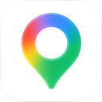
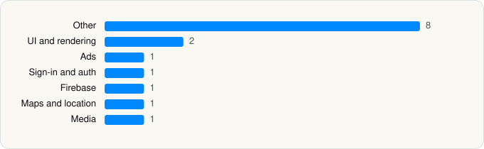

<picture><source media="(prefers-color-scheme: dark)" srcset="../../../../assets/logo/logo-dark.svg"></picture> [Tech Stack](../../../../README.md) / [Google](../../../../companies/google.md) / Google Maps

# Google Maps

<picture><source media="(prefers-color-scheme: dark)" srcset="../../../../assets/badges/ios-dark.svg"></picture> <picture><source media="(prefers-color-scheme: dark)" srcset="../../../../assets/badges/inactive-dark.svg"></picture> <picture><source media="(prefers-color-scheme: dark)" srcset="../../../../assets/badges/floor-dark.svg"></picture> <picture><source media="(prefers-color-scheme: dark)" srcset="../../../../assets/badges/encrypted-dark.svg"></picture>

[App Store](https://apps.apple.com/app/id585027354) · [latest.json](latest.json)

| | |
|---|---|
| Company | [Google](../../../../companies/google.md) |
| Store id | `585027354` |
| Bundle / package id | `com.google.Maps` |
| Latest version | 26.22.2 (analysed 2026-06-19) |
| Versions tracked | 1 |
| SDKs in latest version | 15 |
| Languages | C/C++, Metal (shaders), Objective-C, Swift |
| UI | SwiftUI, UIKit |
| Build | Unknown / Xcode native |
| Minimum OS | iOS 16.0 (built with Xcode 26.2, SDK iphoneos26.2) |
| Devices / ABIs | iPhone, iPad |
| Localisations | 49 |
| Capabilities | 11 |
| Declares tracking | No |
| Tracked | No. Kept for history. |

## SDKs by category

<picture><source media="(prefers-color-scheme: dark)" srcset="../../../../assets/charts/apps/ios/google/google-maps-dark.svg"></picture>

- **Other** (8): AR, ChronosWidgets, DesignSystemAccessibility, GMCSBusyness, GMCSOpenHours, SULLibrary, SwiftBridging 26.22.2, ULR
- **UI and rendering** (2): MaterialDialogs, MaterialSearch
- **Ads** (1): OneGoogle
- **Sign-in and auth** (1): SSOAuth
- **Firebase** (1): gRPC
- **Maps and location** (1): GoogleMaps
- **Media** (1): SpotifyiOS 3.0.0

Frameworks (19)

ActivityKit (Live Activities), App Intents, ARKit, AVFoundation (audio/video), AVKit, Background Tasks, Core Data, Core Location, Core ML, MapKit, SceneKit, SpriteKit, StoreKit (in-app purchase), SwiftUI, UIKit, User Notifications, Vision, Watch Connectivity, WidgetKit (widgets)

Capabilities (11)

App Groups, Associated Domains (Universal Links), Background App Refresh, Background Audio, Background Location, Background Push, CarPlay, Keychain Sharing, Push Notifications (APNs), SiriKit, Time-Sensitive Notifications

## Version history

| Version | Analysed | Store update | SDKs | Change | SDK list is a floor | Binary encrypted | File |
|---|---|---|---|---|---|---|---|
| 26.22.2 | 2026-06-19 |  | 15 |  | Yes | Yes | [26.22.2.json](26.22.2.json) |

## Model-written summary

> Google Maps iOS app using SwiftUI/UIKit with 12 app extensions, App Intents, 50 Metal shaders, and first-party Google modules like ARCore and GMSCore

Written by a language model from the detected signals (`inferred[]`). It is commentary, not measurement.

---

Generated by `scripts/build_readme.py` from the JSON files. Do not edit by hand.
