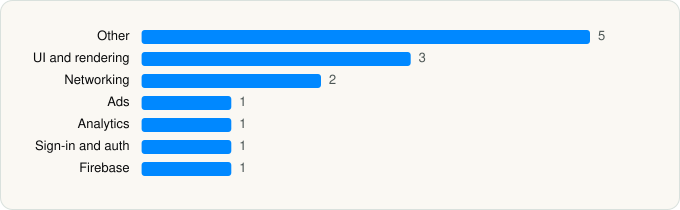

<picture><source media="(prefers-color-scheme: dark)" srcset="../../../../assets/logo/logo-dark.svg"></picture> [Tech Stack](../../../../README.md) / [Google](../../../../companies/google.md) / Google Meet

# Google Meet

<picture><source media="(prefers-color-scheme: dark)" srcset="../../../../assets/badges/ios-dark.svg"></picture> <picture><source media="(prefers-color-scheme: dark)" srcset="../../../../assets/badges/active-dark.svg"></picture> <picture><source media="(prefers-color-scheme: dark)" srcset="../../../../assets/badges/floor-dark.svg"></picture> <picture><source media="(prefers-color-scheme: dark)" srcset="../../../../assets/badges/encrypted-dark.svg"></picture>

[App Store](https://apps.apple.com/app/id1096918571) · [latest.json](latest.json)

| | |
|---|---|
| Company | [Google](../../../../companies/google.md) |
| Store id | `1096918571` |
| Bundle / package id | `com.google.Tachyon` |
| Latest version | 383.1 (analysed 2026-11-05) |
| Versions tracked | 3 |
| SDKs in latest version | 14 |
| Languages | C/C++, Metal (shaders), Objective-C, Swift |
| UI | SwiftUI, UIKit |
| Build | Unknown / Xcode native |
| Minimum OS | iOS 18.0 (built with Xcode 27.0, SDK iphoneos27.0) |
| Devices / ABIs | iPhone, iPad |
| Localisations | 60 |
| Capabilities | 12 |
| Declares tracking | No |
| Tracked | Yes |

## SDKs by category

<picture><source media="(prefers-color-scheme: dark)" srcset="../../../../assets/charts/apps/ios/google/google-meet-dark.svg"></picture>

- **Other** (5): ABCCalloutView, AppUpdateService, ChronosSiriShortcutManager, MaterialM3CTextField, SystemIcons 26.43
- **UI and rendering** (3): MaterialDialogs, MaterialPullToRefresh, MaterialSearch
- **Networking** (2): GoogleKitCore, GoogleKitWeb
- **Ads** (1): OneGoogle
- **Analytics** (1): GIPPseudonymousID
- **Sign-in and auth** (1): SSOAuth
- **Firebase** (1): gRPC

Frameworks (29)

App Intents, Authentication Services (Sign in with Apple / passkeys), AVFoundation (audio/video), AVKit, Background Tasks, CallKit (VoIP), Combine (reactive), Contacts, Core Image, Core Location, Core Motion, CryptoKit, DeviceCheck / App Attest, Local Authentication (Face ID / Touch ID), Media Player, MessageUI (mail / SMS compose), MetalKit, MetricKit (diagnostics), Network.framework, PDFKit, Photos, PushKit (VoIP push), SafariServices, SiriKit (Intents), StoreKit (in-app purchase), SwiftUI, UIKit, User Notifications, WidgetKit (widgets)

Capabilities (12)

App Groups, Associated Domains (Universal Links), Background App Refresh, Background Audio, Background Processing, Background Push, CarPlay, External Accessory, Keychain Sharing, Push Notifications (APNs), SiriKit, VoIP

## Version history

| Version | Analysed | Store update | SDKs | Change | SDK list is a floor | Binary encrypted | File |
|---|---|---|---|---|---|---|---|
| 383.1 | 2026-11-05 | 2026-11-03 | 14 | +0 / −0 | Yes | Yes | [383.1.json](383.1.json) |
| 382.1 | 2026-11-02 |  | 14 | +3 / −0 | Yes | Yes | [382.1.json](382.1.json) |
| 361.1 | 2026-06-19 |  | 11 |  | Yes | Yes | [361.1.json](361.1.json) |

### SDK changes between versions

- 361.1 → 382.1: added AppUpdateService, MaterialM3CTextField, MaterialPullToRefresh

---

Generated by `scripts/build_readme.py` from the JSON files. Do not edit by hand.
