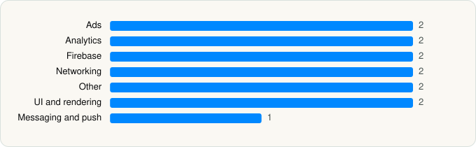

<picture><source media="(prefers-color-scheme: dark)" srcset="../../../../assets/logo/logo-dark.svg"></picture> [Tech Stack](../../../../README.md) / [Google](../../../../companies/google.md) / Google News

# Google News

<picture><source media="(prefers-color-scheme: dark)" srcset="../../../../assets/badges/ios-dark.svg"></picture> <picture><source media="(prefers-color-scheme: dark)" srcset="../../../../assets/badges/inactive-dark.svg"></picture> <picture><source media="(prefers-color-scheme: dark)" srcset="../../../../assets/badges/floor-dark.svg"></picture> <picture><source media="(prefers-color-scheme: dark)" srcset="../../../../assets/badges/encrypted-dark.svg"></picture>

[App Store](https://apps.apple.com/app/id459182288) · [latest.json](latest.json)

| | |
|---|---|
| Company | [Google](../../../../companies/google.md) |
| Store id | `459182288` |
| Bundle / package id | `com.google.GoogleDigitalEditions` |
| Latest version | 5.118 (analysed 2026-06-19) |
| Versions tracked | 1 |
| SDKs in latest version | 13 |
| Languages | C/C++, Objective-C, Swift |
| UI | SwiftUI, UIKit |
| Build | Unknown / Xcode native |
| Minimum OS | iOS 17.0 (built with Xcode 26.2, SDK iphoneos26.2) |
| Devices / ABIs | iPhone, iPad |
| Localisations | 51 |
| Capabilities | 7 |
| Declares tracking | No |
| Tracked | No. Kept for history. |

## SDKs by category

<picture><source media="(prefers-color-scheme: dark)" srcset="../../../../assets/charts/apps/ios/google/google-news-dark.svg"></picture>

- **Ads** (2): Google Mobile Ads (AdMob), OneGoogle
- **Analytics** (2): FirebaseAnalytics, GIPPseudonymousID
- **Firebase** (2): Firebase, gRPC
- **Networking** (2): GoogleKitCore, GoogleKitWeb
- **Other** (2): AmpKit, ChronosWidgets
- **UI and rendering** (2): MaterialDialogs, MaterialSearch
- **Messaging and push** (1): FirebaseMessaging

Frameworks (23)

App Intents, Authentication Services (Sign in with Apple / passkeys), AVFoundation (audio/video), Background Tasks, Combine (reactive), Core Image, Core Location, Core Motion, CryptoKit, DeviceCheck / App Attest, Local Authentication (Face ID / Touch ID), Media Player, MessageUI (mail / SMS compose), MetricKit (diagnostics), Network.framework, Photos, SafariServices, SiriKit (Intents), StoreKit (in-app purchase), SwiftUI, UIKit, User Notifications, WidgetKit (widgets)

Capabilities (7)

App Groups, Associated Domains (Universal Links), Background App Refresh, Background Audio, Background Push, Keychain Sharing, Push Notifications (APNs)

## Version history

| Version | Analysed | Store update | SDKs | Change | SDK list is a floor | Binary encrypted | File |
|---|---|---|---|---|---|---|---|
| 5.118 | 2026-06-19 |  | 13 |  | Yes | Yes | [5.118.json](5.118.json) |

## Model-written summary

> Native SwiftUI/UIKit iOS app with WidgetKit and Notification extensions, Firebase backend, Google Mobile Ads, and App Attest

Written by a language model from the detected signals (`inferred[]`). It is commentary, not measurement.

---

Generated by `scripts/build_readme.py` from the JSON files. Do not edit by hand.
