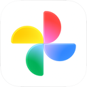
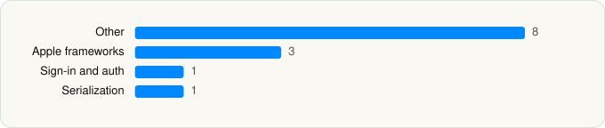

<picture><source media="(prefers-color-scheme: dark)" srcset="../../../../assets/logo/logo-dark.svg"></picture> [Tech Stack](../../../../README.md) / [Google](../../../../companies/google.md) / Google Photos

# Google Photos: Backup & Edit

<picture><source media="(prefers-color-scheme: dark)" srcset="../../../../assets/badges/ios-dark.svg"></picture> <picture><source media="(prefers-color-scheme: dark)" srcset="../../../../assets/badges/active-dark.svg"></picture> <picture><source media="(prefers-color-scheme: dark)" srcset="../../../../assets/badges/floor-dark.svg"></picture> <picture><source media="(prefers-color-scheme: dark)" srcset="../../../../assets/badges/encrypted-dark.svg"></picture>

[App Store](https://apps.apple.com/app/id962194608) · [latest.json](latest.json)

| | |
|---|---|
| Company | [Google](../../../../companies/google.md) |
| Store id | `962194608` |
| Bundle / package id | `com.google.photos` |
| Latest version | 7.79.0 (analysed 2026-06-19) |
| Versions tracked | 1 |
| SDKs in latest version | 13 |
| Languages | C/C++, Metal (shaders), Objective-C, Swift |
| UI | SwiftUI, UIKit |
| Build | Unknown / Xcode native |
| Minimum OS | iOS 18.0 (built with Xcode 26.2, SDK iphoneos26.2) |
| Devices / ABIs | iPhone, iPad |
| Localisations | 44 |
| Capabilities | 9 |
| Declares tracking | No |
| Tracked | Yes |

## SDKs by category

<picture><source media="(prefers-color-scheme: dark)" srcset="../../../../assets/charts/apps/ios/google/google-photos-dark.svg"></picture>

- **Other** (8): CardboardSDK, ChronosPrivacyScreen, ChronosSiriShortcutManager, GWACore, GWALocalization, MaterialFABMenu, Photos, XenoCatalogFiles
- **Apple frameworks** (3): DequeModule, InternalCollectionsUtilities, OrderedCollections
- **Sign-in and auth** (1): SSOAuth
- **Serialization** (1): SwiftProtobuf

Frameworks (35)

App Intents, Authentication Services (Sign in with Apple / passkeys), AVFoundation (audio/video), AVKit, Background Tasks, Combine (reactive), Contacts, Core Data, Core Image, Core Location, Core ML, Core Motion, CryptoKit, DeviceCheck / App Attest, EventKit (Calendar / Reminders), Local Authentication (Face ID / Touch ID), MapKit, Media Player, MessageUI (mail / SMS compose), MetalKit, MetricKit (diagnostics), Network.framework, PDFKit, Photos, PhotosUI, SafariServices, SceneKit, SiriKit (Intents), StoreKit (in-app purchase), SwiftUI, UIKit, User Notifications, Vision, Watch Connectivity, WidgetKit (widgets)

Capabilities (9)

App Groups, Associated Domains (Universal Links), Background App Refresh, Background Location, Background Processing, Background Push, Keychain Sharing, Push Notifications (APNs), Time-Sensitive Notifications

## Version history

| Version | Analysed | Store update | SDKs | Change | SDK list is a floor | Binary encrypted | File |
|---|---|---|---|---|---|---|---|
| 7.79.0 | 2026-06-19 |  | 13 |  | Yes | Yes | [7.79.0.json](7.79.0.json) |

## Model-written summary

> Google Photos iOS app with SwiftUI/UIKit, App Intents for photo search, 145 Metal shaders, bundled Core ML models, and Firebase backend

Written by a language model from the detected signals (`inferred[]`). It is commentary, not measurement.

---

Generated by `scripts/build_readme.py` from the JSON files. Do not edit by hand.
