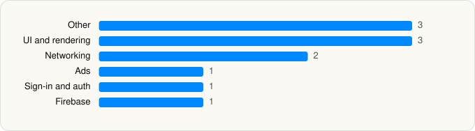

<picture><source media="(prefers-color-scheme: dark)" srcset="../../../../assets/logo/logo-dark.svg"></picture> [Tech Stack](../../../../README.md) / [Google](../../../../companies/google.md) / Google Sheets

# Google Sheets

<picture><source media="(prefers-color-scheme: dark)" srcset="../../../../assets/badges/ios-dark.svg"></picture> <picture><source media="(prefers-color-scheme: dark)" srcset="../../../../assets/badges/inactive-dark.svg"></picture> <picture><source media="(prefers-color-scheme: dark)" srcset="../../../../assets/badges/floor-dark.svg"></picture> <picture><source media="(prefers-color-scheme: dark)" srcset="../../../../assets/badges/encrypted-dark.svg"></picture>

[App Store](https://apps.apple.com/app/id842849113) · [latest.json](latest.json)

| | |
|---|---|
| Company | [Google](../../../../companies/google.md) |
| Store id | `842849113` |
| Bundle / package id | `com.google.Sheets` |
| Latest version | 1.2026.22200 (analysed 2026-06-11) |
| Versions tracked | 1 |
| SDKs in latest version | 11 |
| Languages | C/C++, Metal (shaders), Objective-C, React Native / JavaScript, Swift |
| UI | SwiftUI, UIKit |
| Build | Unknown / Xcode native |
| Minimum OS | iOS 17.0 (built with Xcode 26.2, SDK iphoneos26.2) |
| Devices / ABIs | iPhone, iPad |
| Localisations | 74 |
| Capabilities | 7 |
| Declares tracking | No |
| Tracked | No. Kept for history. |

## SDKs by category

<picture><source media="(prefers-color-scheme: dark)" srcset="../../../../assets/charts/apps/ios/google/google-sheets-dark.svg"></picture>

- **Other** (3): ABCCalloutView, CardStyle, GDDKitResourcesUI
- **UI and rendering** (3): MaterialDialogs, MaterialPullToRefresh, MaterialSearch
- **Networking** (2): GoogleKitCore, GoogleKitWeb
- **Ads** (1): OneGoogle
- **Sign-in and auth** (1): SSOAuth
- **Firebase** (1): gRPC

Frameworks (9)

App Intents, AVFoundation (audio/video), AVKit, Background Tasks, Core Location, StoreKit (in-app purchase), SwiftUI, UIKit, User Notifications

Capabilities (7)

App Groups, Associated Domains (Universal Links), Background App Refresh, Background Processing, CloudKit, iCloud, Keychain Sharing

## Version history

| Version | Analysed | Store update | SDKs | Change | SDK list is a floor | Binary encrypted | File |
|---|---|---|---|---|---|---|---|
| 1.2026.22200 | 2026-06-11 |  | 11 |  | Yes | Yes | [1.2026.22200.json](1.2026.22200.json) |

## Model-written summary

> Hybrid SwiftUI/UIKit Google Sheets iOS app with React Native, Metal shaders, GoogleKit SDKs, App Attest, and cross-app Google integrations

Written by a language model from the detected signals (`inferred[]`). It is commentary, not measurement.

---

Generated by `scripts/build_readme.py` from the JSON files. Do not edit by hand.
