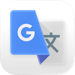
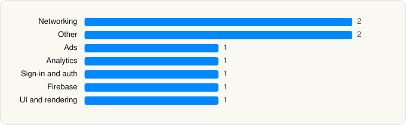

<picture><source media="(prefers-color-scheme: dark)" srcset="../../../../assets/logo/logo-dark.svg"></picture> [Tech Stack](../../../../README.md) / [Google](../../../../companies/google.md) / Google Translate

# Google Translate

<picture><source media="(prefers-color-scheme: dark)" srcset="../../../../assets/badges/ios-dark.svg"></picture> <picture><source media="(prefers-color-scheme: dark)" srcset="../../../../assets/badges/inactive-dark.svg"></picture> <picture><source media="(prefers-color-scheme: dark)" srcset="../../../../assets/badges/floor-dark.svg"></picture> <picture><source media="(prefers-color-scheme: dark)" srcset="../../../../assets/badges/encrypted-dark.svg"></picture>

[App Store](https://apps.apple.com/app/id414706506) · [latest.json](latest.json)

| | |
|---|---|
| Company | [Google](../../../../companies/google.md) |
| Store id | `414706506` |
| Bundle / package id | `com.google.Translate` |
| Latest version | 10.21.273 (analysed 2026-06-19) |
| Versions tracked | 1 |
| SDKs in latest version | 9 |
| Languages | C/C++, Metal (shaders), Objective-C, Swift |
| UI | SwiftUI, UIKit |
| Build | Unknown / Xcode native |
| Minimum OS | iOS 16.0 (built with Xcode 26.0.1, SDK iphoneos26.0) |
| Devices / ABIs | iPhone, iPad |
| Localisations | 83 |
| Capabilities | 6 |
| Declares tracking | No |
| Tracked | No. Kept for history. |

## SDKs by category

<picture><source media="(prefers-color-scheme: dark)" srcset="../../../../assets/charts/apps/ios/google/google-translate-dark.svg"></picture>

- **Networking** (2): GoogleKitCore, GoogleKitWeb
- **Other** (2): ChronosSiriShortcutManager, GoogleS3KitVoiceSearch
- **Ads** (1): OneGoogle
- **Analytics** (1): GIPPseudonymousID
- **Sign-in and auth** (1): SSOAuth
- **Firebase** (1): gRPC
- **UI and rendering** (1): MaterialSearch

Frameworks (30)

ActivityKit (Live Activities), App Intents, Authentication Services (Sign in with Apple / passkeys), AVFoundation (audio/video), Background Tasks, Combine (reactive), Contacts, Core Data, Core Image, Core Location, Core ML, Core Motion, CryptoKit, DeviceCheck / App Attest, EventKit (Calendar / Reminders), Local Authentication (Face ID / Touch ID), MessageUI (mail / SMS compose), MetalKit, MetricKit (diagnostics), Natural Language, Network.framework, Photos, PhotosUI, SafariServices, SiriKit (Intents), StoreKit (in-app purchase), SwiftUI, UIKit, User Notifications, WidgetKit (widgets)

Capabilities (6)

App Groups, Associated Domains (Universal Links), Background App Refresh, Background Audio, Keychain Sharing, Push Notifications (APNs)

## Version history

| Version | Analysed | Store update | SDKs | Change | SDK list is a floor | Binary encrypted | File |
|---|---|---|---|---|---|---|---|
| 10.21.273 | 2026-06-19 |  | 9 |  | Yes | Yes | [10.21.273.json](10.21.273.json) |

## Model-written summary

> SwiftUI/UIKit iOS app with 25 Metal shaders, 20+ on-device ML models for OCR/translation, 8 App Intents, WidgetKit and TranslationProvider extensions, and Google backend.

Written by a language model from the detected signals (`inferred[]`). It is commentary, not measurement.

---

Generated by `scripts/build_readme.py` from the JSON files. Do not edit by hand.
