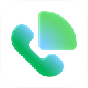
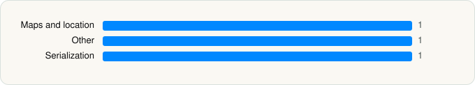

<picture><source media="(prefers-color-scheme: dark)" srcset="../../../../assets/logo/logo-dark.svg"></picture> [Tech Stack](../../../../README.md) / [Google](../../../../companies/google.md) / Google Voice

# Google Voice

<picture><source media="(prefers-color-scheme: dark)" srcset="../../../../assets/badges/ios-dark.svg"></picture> <picture><source media="(prefers-color-scheme: dark)" srcset="../../../../assets/badges/inactive-dark.svg"></picture> <picture><source media="(prefers-color-scheme: dark)" srcset="../../../../assets/badges/floor-dark.svg"></picture> <picture><source media="(prefers-color-scheme: dark)" srcset="../../../../assets/badges/encrypted-dark.svg"></picture>

[App Store](https://apps.apple.com/app/id318698524) · [latest.json](latest.json)

| | |
|---|---|
| Company | [Google](../../../../companies/google.md) |
| Store id | `318698524` |
| Bundle / package id | `com.google.GVDialer` |
| Latest version | 26.22 (analysed 2026-06-19) |
| Versions tracked | 2 |
| SDKs in latest version | 3 |
| Languages | C/C++, Objective-C, Swift |
| UI | SwiftUI, UIKit |
| Build | Unknown / Xcode native |
| Minimum OS | iOS 18.0 (built with Xcode 26.2, SDK iphoneos26.2) |
| Devices / ABIs | iPhone, iPad |
| Localisations | 78 |
| Capabilities | 10 |
| Declares tracking | No |
| Tracked | No. Kept for history. |

## SDKs by category

<picture><source media="(prefers-color-scheme: dark)" srcset="../../../../assets/charts/apps/ios/google/google-voice-dark.svg"></picture>

- **Maps and location** (1): GeocodingMetadata
- **Other** (1): SystemIcons 26.22
- **Serialization** (1): SwiftProtobuf

Frameworks (27)

App Intents, Authentication Services (Sign in with Apple / passkeys), AVFoundation (audio/video), AVKit, Background Tasks, CallKit (VoIP), Combine (reactive), Contacts, Core Image, Core Location, CryptoKit, DeviceCheck / App Attest, EventKit (Calendar / Reminders), Local Authentication (Face ID / Touch ID), MessageUI (mail / SMS compose), MetricKit (diagnostics), Network.framework, Photos, PhotosUI, PushKit (VoIP push), SafariServices, SiriKit (Intents), StoreKit (in-app purchase), SwiftUI, UIKit, User Notifications, WidgetKit (widgets)

Capabilities (10)

App Groups, Associated Domains (Universal Links), Background App Refresh, Background Audio, Background Push, Communication Notifications, Keychain Sharing, Push Notifications (APNs), SiriKit, VoIP

## Version history

| Version | Analysed | Store update | SDKs | Change | SDK list is a floor | Binary encrypted | File |
|---|---|---|---|---|---|---|---|
| 26.22 | 2026-06-19 |  | 3 | +0 / −0 | Yes | Yes | [26.22.json](26.22.json) |
| 26.21 | 2026-06-09 |  | 3 |  | Yes | Yes | [26.21.json](26.21.json) |

---

Generated by `scripts/build_readme.py` from the JSON files. Do not edit by hand.
