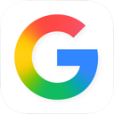
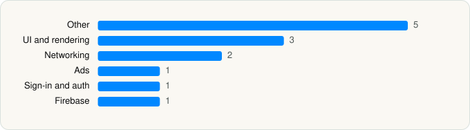

<picture><source media="(prefers-color-scheme: dark)" srcset="../../../../assets/logo/logo-dark.svg"></picture> [Tech Stack](../../../../README.md) / [Google](../../../../companies/google.md) / Google

# Google

<picture><source media="(prefers-color-scheme: dark)" srcset="../../../../assets/badges/ios-dark.svg"></picture> <picture><source media="(prefers-color-scheme: dark)" srcset="../../../../assets/badges/active-dark.svg"></picture> <picture><source media="(prefers-color-scheme: dark)" srcset="../../../../assets/badges/floor-dark.svg"></picture> <picture><source media="(prefers-color-scheme: dark)" srcset="../../../../assets/badges/encrypted-dark.svg"></picture>

[App Store](https://apps.apple.com/app/id284815942) · [latest.json](latest.json)

| | |
|---|---|
| Company | [Google](../../../../companies/google.md) |
| Store id | `284815942` |
| Bundle / package id | `com.google.GoogleMobile` |
| Latest version | 423.5 (analysed 2026-06-19) |
| Versions tracked | 1 |
| SDKs in latest version | 13 |
| Languages | C/C++, Metal (shaders), Objective-C, Swift |
| UI | SwiftUI, UIKit |
| Build | Unknown / Xcode native |
| Minimum OS | iOS 16.0 (built with Xcode 26.2, SDK iphoneos26.2) |
| Devices / ABIs | iPhone, iPad |
| Localisations | 45 |
| Capabilities | 10 |
| Declares tracking | No |
| Tracked | Yes |

## SDKs by category

<picture><source media="(prefers-color-scheme: dark)" srcset="../../../../assets/charts/apps/ios/google/google-dark.svg"></picture>

- **Other** (5): AmpKit, ChronosSiriShortcutManager, ChronosSpotlight, DiscoverPersonalizationConfigs, MapsAppClip
- **UI and rendering** (3): MaterialDialogs, MaterialPullToRefresh, MaterialSearch
- **Networking** (2): GoogleKitCore, GoogleKitWeb
- **Ads** (1): OneGoogle
- **Sign-in and auth** (1): SSOAuth
- **Firebase** (1): gRPC

Frameworks (39)

ActivityKit (Live Activities), AdSupport (IDFA), App Intents, ARKit, Authentication Services (Sign in with Apple / passkeys), AVFoundation (audio/video), AVKit, Background Tasks, Combine (reactive), Contacts, Core Image, Core Location, Core ML, Core Motion, CryptoKit, DeviceCheck / App Attest, EventKit (Calendar / Reminders), Local Authentication (Face ID / Touch ID), MapKit, Media Player, MessageUI (mail / SMS compose), MetalKit, MetricKit (diagnostics), MusicKit, Natural Language, Network.framework, PassKit (Wallet / Apple Pay), Photos, PhotosUI, SafariServices, SceneKit, SiriKit (Intents), Speech (recognition), SpriteKit, StoreKit (in-app purchase), SwiftUI, UIKit, User Notifications, WidgetKit (widgets)

Capabilities (10)

App Groups, Associated Domains (Universal Links), AutoFill Credentials, Background App Refresh, Background Audio, Background Processing, Background Push, Keychain Sharing, Push Notifications (APNs), Time-Sensitive Notifications

## Version history

| Version | Analysed | Store update | SDKs | Change | SDK list is a floor | Binary encrypted | File |
|---|---|---|---|---|---|---|---|
| 423.5 | 2026-06-19 |  | 13 |  | Yes | Yes | [423.5.json](423.5.json) |

## Model-written summary

> Swift/Objective-C iOS Google app with SwiftUI/UIKit, 15 App Intents for search/Lens/AI, 26 Metal shaders, Firebase, and App Attest

Written by a language model from the detected signals (`inferred[]`). It is commentary, not measurement.

---

Generated by `scripts/build_readme.py` from the JSON files. Do not edit by hand.
