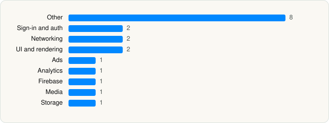

<picture><source media="(prefers-color-scheme: dark)" srcset="../../../../assets/logo/logo-dark.svg"></picture> [Tech Stack](../../../../README.md) / [Google](../../../../companies/google.md) / YouTube Music

# YouTube Music

<picture><source media="(prefers-color-scheme: dark)" srcset="../../../../assets/badges/ios-dark.svg"></picture> <picture><source media="(prefers-color-scheme: dark)" srcset="../../../../assets/badges/inactive-dark.svg"></picture> <picture><source media="(prefers-color-scheme: dark)" srcset="../../../../assets/badges/floor-dark.svg"></picture> <picture><source media="(prefers-color-scheme: dark)" srcset="../../../../assets/badges/encrypted-dark.svg"></picture>

[App Store](https://apps.apple.com/app/id1017492454) · [latest.json](latest.json)

| | |
|---|---|
| Company | [Google](../../../../companies/google.md) |
| Store id | `1017492454` |
| Bundle / package id | `com.google.ios.youtubemusic` |
| Latest version | 9.44.2 (analysed 2026-11-04) |
| Versions tracked | 2 |
| SDKs in latest version | 19 |
| Languages | C/C++, Metal (shaders), Objective-C, Swift |
| UI | SwiftUI, UIKit |
| Build | Swift Package Manager (SwiftPM) |
| Minimum OS | iOS 17.0 (built with Xcode 26.4.1, SDK iphoneos26.4) |
| Devices / ABIs | iPhone, iPad |
| Localisations | 79 |
| Capabilities | 11 |
| Declares tracking | No |
| Tracked | No. Kept for history. |

## SDKs by category

<picture><source media="(prefers-color-scheme: dark)" srcset="../../../../assets/charts/apps/ios/google/youtube-music-dark.svg"></picture>

- **Other** (8): CardboardSDK, ChronosSiriShortcutManager, GoogleKitDatePicker, GoogleS3KitVoiceSearch, GWACore, GWALocalization, MaterialContributionsSwitch, MaterialM3CTextField
- **Sign-in and auth** (2): GoogleSignIn, SSOAuth
- **Networking** (2): GoogleKitCore, GoogleKitWeb
- **UI and rendering** (2): MaterialDialogs, MaterialSearch
- **Ads** (1): OneGoogle
- **Analytics** (1): Facebook SDK
- **Firebase** (1): gRPC
- **Media** (1): GoogleCast
- **Storage** (1): GaeguNormal

Frameworks (31)

Authentication Services (Sign in with Apple / passkeys), AVFoundation (audio/video), AVKit, Background Tasks, CloudKit, Combine (reactive), Contacts, Core Bluetooth, Core Data, Core Image, Core Location, Core Motion, CryptoKit, DeviceCheck / App Attest, Local Authentication (Face ID / Touch ID), Media Player, MessageUI (mail / SMS compose), MetalKit, MetricKit (diagnostics), Natural Language, Network.framework, Photos, PhotosUI, SafariServices, SiriKit (Intents), StoreKit (in-app purchase), SwiftUI, UIKit, User Notifications, Watch Connectivity, WidgetKit (widgets)

Capabilities (11)

App Groups, Associated Domains (Universal Links), Background App Refresh, Background Audio, Background Processing, Bluetooth (central), CarPlay, External Accessory, Keychain Sharing, Push Notifications (APNs), SiriKit

## Version history

| Version | Analysed | Store update | SDKs | Change | SDK list is a floor | Binary encrypted | File |
|---|---|---|---|---|---|---|---|
| 9.44.2 | 2026-11-04 |  | 19 | +2 / −0 | Yes | Yes | [9.44.2.json](9.44.2.json) |
| 9.22.2 | 2026-06-19 |  | 17 |  | Yes | Yes | [9.22.2.json](9.22.2.json) |

### SDK changes between versions

- 9.22.2 → 9.44.2: added GaeguNormal, MaterialM3CTextField

---

Generated by `scripts/build_readme.py` from the JSON files. Do not edit by hand.
