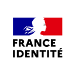
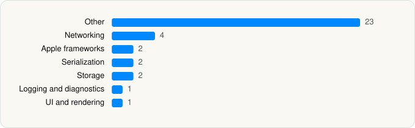

<picture><source media="(prefers-color-scheme: dark)" srcset="../../../../assets/logo/logo-dark.svg"></picture> [Tech Stack](../../../../README.md) / [Gouvernement Francais](../../../../companies/gouvernement-francais.md) / France Identité

# France Identité

<picture><source media="(prefers-color-scheme: dark)" srcset="../../../../assets/badges/ios-dark.svg"></picture> <picture><source media="(prefers-color-scheme: dark)" srcset="../../../../assets/badges/inactive-dark.svg"></picture> <picture><source media="(prefers-color-scheme: dark)" srcset="../../../../assets/badges/floor-dark.svg"></picture> <picture><source media="(prefers-color-scheme: dark)" srcset="../../../../assets/badges/encrypted-dark.svg"></picture>

[App Store](https://apps.apple.com/app/id1590142959) · [latest.json](latest.json)

| | |
|---|---|
| Company | [Gouvernement Francais](../../../../companies/gouvernement-francais.md) |
| Store id | `1590142959` |
| Bundle / package id | `fr.gouv.france-identite` |
| Latest version | 1.3.4433 (analysed 2026-11-11) |
| Versions tracked | 1 |
| SDKs in latest version | 35 |
| Languages | C/C++, Objective-C, Swift |
| UI | Lottie (animations), SwiftUI, UIKit |
| Build | Swift Package Manager (SwiftPM) |
| Minimum OS | iOS 16.6 (built with Xcode 26.1.1, SDK iphoneos26.1) |
| Devices / ABIs | iPhone |
| Localisations | 2 |
| Capabilities | 2 |
| Declares tracking | No |
| Tracked | No. Kept for history. |

## SDKs by category

<picture><source media="(prefers-color-scheme: dark)" srcset="../../../../assets/charts/apps/ios/gouvernement-francais/france-identit-dark.svg"></picture>

- **Other** (23): Atomics 1.0, AtomicsShims 1.0, BitByteData, ble 1.0, CardReader, CCryptoBoringSSL 1.0, CNIOAtomics 1.0, CNIOBoringSSL 1.0, CNIOBoringSSLShims 1.0, CNIODarwin 1.0, CNIOLinux 1.0, CNIOLLHTTP 1.0, CNIOOpenBSD 1.0, CNIOWASI 1.0, CNIOWindows 1.0, Crypto 1.0, CryptoBoringWrapper 1.0, CryptoExtras 1.0, IdaktoASN1 1.0, Lint 1.0, SpanPreview 1.0, SwiftASN1 1.0, T2cCore 1.0
- **Networking** (4): Alamofire, NIO 1.0, NIOPosix 1.0, NIOSSL 1.0
- **Apple frameworks** (2): DequeModule 1.0, InternalCollectionsUtilities 1.0
- **Serialization** (2): SwiftCBOR 1.0, SwiftProtobuf
- **Storage** (2): Format 1.0, SWCompression
- **Logging and diagnostics** (1): Logger 1.0
- **UI and rendering** (1): Lottie 4.6.0

Frameworks (16)

AVFoundation (audio/video), Combine (reactive), Core Bluetooth, Core Data, Core Image, Core Motion, Core NFC, CryptoKit, DeviceCheck / App Attest, Local Authentication (Face ID / Touch ID), Network.framework, PassKit (Wallet / Apple Pay), PDFKit, SwiftUI, UIKit, Vision

Capabilities (2)

Associated Domains (Universal Links), NFC

## Version history

| Version | Analysed | Store update | SDKs | Change | SDK list is a floor | Binary encrypted | File |
|---|---|---|---|---|---|---|---|
| 1.3.4433 | 2026-11-11 |  | 35 |  | Yes | Yes | [1.3.4433.json](1.3.4433.json) |

---

Generated by `scripts/build_readme.py` from the JSON files. Do not edit by hand.
