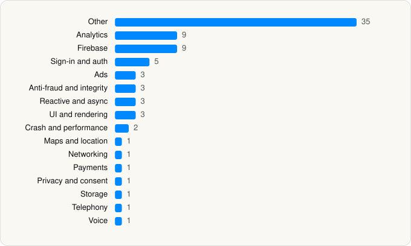

<picture><source media="(prefers-color-scheme: dark)" srcset="../../../../assets/logo/logo-dark.svg"></picture> [Tech Stack](../../../../README.md) / [GRABTAXI HOLDINGS PTE. LTD.](../../../../companies/grabtaxi-holdings-pte-ltd.md) / Grab

# Grab: Taxi Ride, Food Delivery

<picture><source media="(prefers-color-scheme: dark)" srcset="../../../../assets/badges/ios-dark.svg"></picture> <picture><source media="(prefers-color-scheme: dark)" srcset="../../../../assets/badges/active-dark.svg"></picture> <picture><source media="(prefers-color-scheme: dark)" srcset="../../../../assets/badges/floor-dark.svg"></picture> <picture><source media="(prefers-color-scheme: dark)" srcset="../../../../assets/badges/encrypted-dark.svg"></picture>

[App Store](https://apps.apple.com/app/id647268330) · [latest.json](latest.json)

| | |
|---|---|
| Company | [GRABTAXI HOLDINGS PTE. LTD.](../../../../companies/grabtaxi-holdings-pte-ltd.md) |
| Store id | `647268330` |
| Bundle / package id | `com.grabtaxi.iphone` |
| Latest version | 5.432.0 (analysed 2026-10-24) |
| Versions tracked | 1 |
| SDKs in latest version | 79 |
| Languages | C/C++, Objective-C, Swift |
| UI | Lottie (animations), SwiftUI, UIKit |
| Build | Swift Package Manager (SwiftPM) |
| Minimum OS | iOS 15.0 (built with Xcode 26.1.1, SDK iphoneos26.1) |
| Devices / ABIs | iPhone |
| Localisations | 12 |
| Capabilities | 19 |
| Declares tracking | Yes |
| Tracked | Yes |

## SDKs by category

<picture><source media="(prefers-color-scheme: dark)" srcset="../../../../assets/charts/apps/ios/grabtaxi-holdings-pte-ltd/grab-dark.svg"></picture>

- **Other** (35): AudioRecordingKit, ContactManager, CredoAppApplication 3.1.1, CredoAppCalendarEvents 3.2.0, CredoAppContacts 3.3.0, CredoAppCore 3.11.0, CredoAppLocation 3.0.0, CredoAppMedia 3.2.0, GeoSmartKit 1.3.1, GSelfieSDK, Hedwig, HomeGrownNavigation 1.6.22, JedAIAppKit 5.51.15, JedAIConfigKit 5.51.15, JedAIGeofenceKit 5.51.15, JedAIJEMAKit 5.51.15, JedAIKit 5.51.15, JedAILambdaKit 5.51.15, JedAIMetricsKit 5.51.15, JedAIPOIKit 5.51.15, JedAIReportKit 5.51.15, JedAISignalKit 5.51.15, JedAIUIKit 5.51.15, KampungMap 2.15.8, KartaPOI 2.2.2, LocationKit 1.2.2, MapComponentKit 2.10.4, MegLiveDetect 1.0, MegLiveV5Detect, MegLiveV5Manager 1.0, MessageCenterSDK, MGFaceIDBaseKit 1.0, SafetyReporting, SafetyUIKit, ScannerKit 1.0.0
- **Analytics** (9): AppsFlyer, AppsFlyerLib 6.17.7, Branch, Facebook SDK, FBAEMKit 1.0, FBSDKCoreKit, FirebaseAnalytics, GoogleAppMeasurement 11.11.0, GoogleAppMeasurementIdentitySupport 11.11.0
- **Firebase** (9): FBLPromises, Firebase, FirebaseCore, FirebaseCoreInternal, FirebaseInstallations, GoogleDataTransport, GoogleUtilities, nanopb, Promises
- **Sign-in and auth** (5): AppAuth, FBSDKLoginKit, GoogleSignIn, GTMAppAuth, GTMSessionFetcher
- **Ads** (3): Google Mobile Ads (AdMob), GoogleAdsOnDeviceConversion 3.1.0, GoogleMobileAds
- **Anti-fraud and integrity** (3): GKYC, MocaKYC, RecaptchaEnterprise 1.0
- **Reactive and async** (3): RxBlocking, RxCocoa, RxSwift
- **UI and rendering** (3): Lottie, SDWebImage, static
- **Crash and performance** (2): Datadog, FirebaseCrashlytics
- **Maps and location** (1): GoogleMaps
- **Networking** (1): Alamofire 5.9.0
- **Payments** (1): Stripe
- **Privacy and consent** (1): UserMessagingPlatform 3.1.0
- **Storage** (1): IndoorMapSDK 0.5.8
- **Telephony** (1): CredoAppTelephony 3.0.1
- **Voice** (1): VoipKit

Frameworks (46)

ActivityKit (Live Activities), AdSupport (IDFA), App Intents, App Tracking Transparency (ATT), Authentication Services (Sign in with Apple / passkeys), AVFoundation (audio/video), AVKit, Background Tasks, CallKit (VoIP), Combine (reactive), Contacts, Core Bluetooth, Core Image, Core Location, Core ML, Core Motion, Core NFC, CryptoKit, DeviceCheck / App Attest, EventKit (Calendar / Reminders), Local Authentication (Face ID / Touch ID), MapKit, Media Player, MessageUI (mail / SMS compose), MetalKit, MetricKit (diagnostics), Natural Language, Network.framework, PassKit (Wallet / Apple Pay), PDFKit, PencilKit, Photos, PhotosUI, PushKit (VoIP push), SafariServices, SceneKit, SiriKit (Intents), Speech (recognition), StoreKit (in-app purchase), Swift Charts, SwiftUI, UIKit, User Notifications, Vision, Watch Connectivity, WidgetKit (widgets)

Capabilities (19)

App Attest, App Groups, Apple Pay, Associated Domains (Universal Links), Background App Refresh, Background Audio, Background Location, Background Processing, Background Push, Bluetooth (central), Bluetooth (peripheral), Communication Notifications, Keychain Sharing, NFC, Push Notifications (APNs), Sign in with Apple, Time-Sensitive Notifications, VoIP, Wallet passes

## Version history

| Version | Analysed | Store update | SDKs | Change | SDK list is a floor | Binary encrypted | File |
|---|---|---|---|---|---|---|---|
| 5.432.0 | 2026-10-24 | 2026-10-13 | 79 |  | Yes | Yes | [5.432.0.json](5.432.0.json) |

---

Generated by `scripts/build_readme.py` from the JSON files. Do not edit by hand.
